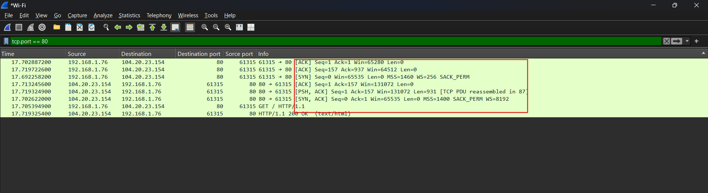
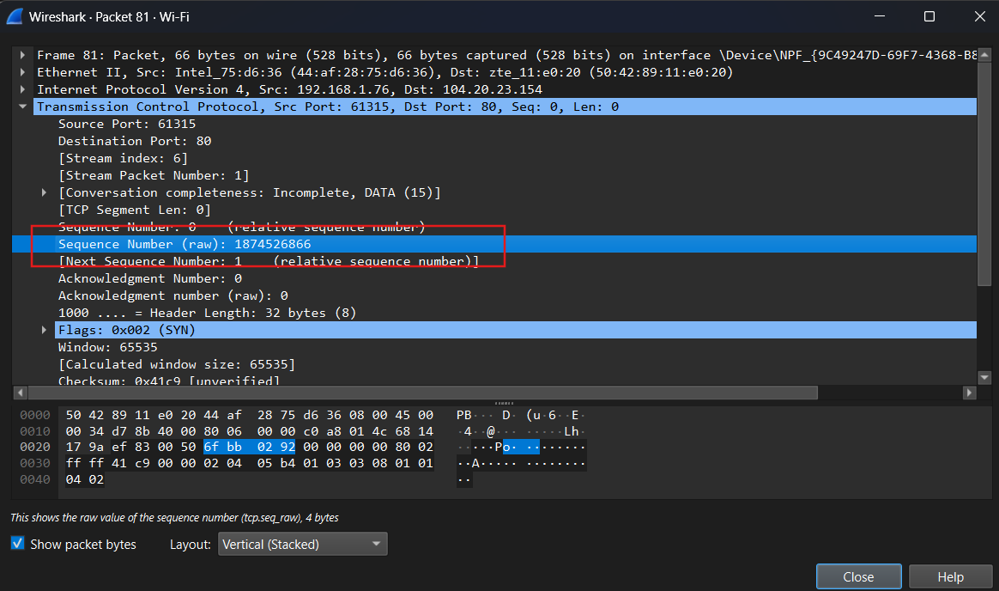

# Cybersecurity Portfolio - Week 1, Day 1
## Topic: OSI Model, TCP/IP & TCP 3-Way Handshake

**Objective:** 
Understand foundational network communication protocols and analyze a live TCP connection establishment (3-Way Handshake) using Wireshark.

### :hammer_and_wrench: Tools & Environment
* **OS:** Windows
* **CLI:** PowerShell
* **Network Analyzer:** Wireshark

### :memo: Lab Walkthrough & Execution

**1. Environment Setup & Configuration**
* Installed Wireshark and configured packet list columns for optimal analysis, isolating `Source IP`, `Dest IP`, `Source Port`, and `Dest Port`.

**2. Traffic Generation**
* Initiated a live capture on the active Wi-Fi interface.
* Executed `curl http://example.com` via PowerShell to generate standard, unencrypted HTTP web traffic.

**3. Packet Analysis**
* Applied the Wireshark display filter `tcp.port == 80` to isolate the web request traffic from background network noise.
* Successfully identified the initial connection establishment sequence prior to the actual HTTP GET request.

### :mag: Key Observations (The 3-Way Handshake)
By inspecting the packet details, I observed the precise sequence and acknowledgment numbers used to establish the TCP connection:

1. **Step 1 - [SYN]:** The client initiated the connection to the server. 
   * **Relative Sequence (Seq):** 0
2. **Step 2 - [SYN, ACK]:** The server acknowledged the request and synchronized its own sequence.
   * **Relative Sequence (Seq):** 0 
   * **Relative Acknowledgment (Ack):** 1
3. **Step 3 - [ACK]:** The client acknowledged the server's synchronization, fully establishing the connection.
   * **Relative Sequence (Seq):** 1 
   * **Relative Acknowledgment (Ack):** 1

*(Screenshot: Wireshark packet list filtered by tcp.port == 80 showing the 3-way handshake)*

**Deep Dive: Relative vs. Raw Sequence Numbers**
During analysis, I also inspected the TCP packet headers to observe the **raw sequence numbers**. For example, the initial SYN packet generated a raw randomized Initial Sequence Number (ISN) of `1874526866` instead of `0`. Operating systems generate these massive, randomized numbers to protect connections against TCP sequence prediction attacks (session hijacking). Wireshark defaults to displaying "relative" numbers (starting at 0) purely for analytical readability.

*(Screenshot: Wireshark packet details showing the raw Sequence Number)*

### :bulb: Conclusion
Successfully demonstrated the ability to capture, filter, and analyze live network traffic. Verified the theoretical mechanics of the TCP 3-Way Handshake (SYN, SYN-ACK, ACK) in a practical, real-world packet capture, while also understanding the security implications of Initial Sequence Numbers (ISN).
