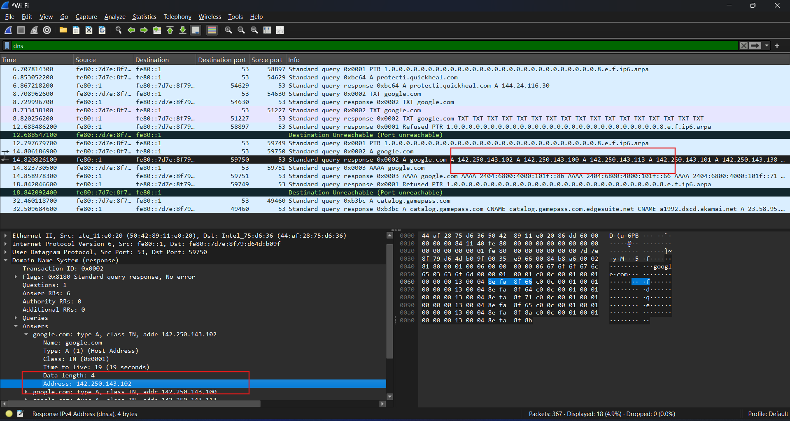
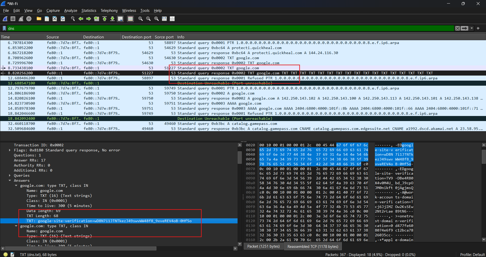
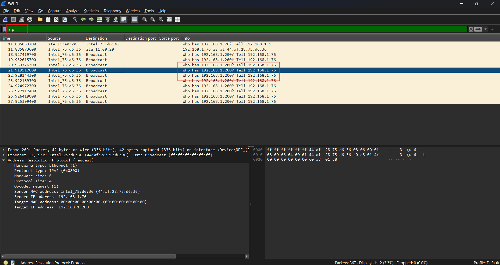

# Cybersecurity Portfolio - Week 1, Day 2
## Topic: DNS, ARP, DHCP & Traffic Filtering

**Objective:** 
Analyze fundamental networking protocols—DNS (Application Layer) and ARP (Data Link Layer)—by capturing and filtering live network traffic using Wireshark.

### :hammer_and_wrench: Tools & Environment
* **OS:** Windows
* **CLI:** PowerShell
* **Network Analyzer:** Wireshark

### :memo: Lab Walkthrough & Execution

**1. DNS Traffic Generation & Analysis**
* Initiated a live Wireshark capture on the active Wi-Fi interface.
* Executed `nslookup google.com` and `nslookup -type=TXT google.com` via PowerShell to query the DNS server for `A` records and `TXT` records.
* Applied the `dns` display filter in Wireshark to isolate the queries and responses.

**2. ARP Traffic Generation & Analysis**
* Forced an Address Resolution Protocol (ARP) broadcast by pinging an unassigned local IP address (`192.168.1.200`) from the host machine (`192.168.1.76`).
* Applied the `arp` display filter to observe Layer 2 MAC address resolution and broadcast behavior on the local subnet.

**3. Advanced Display Filtering**
* Practiced network noise reduction by applying the exclusion filter `!(arp or icmp or dns)`, hiding common background protocols to isolate targeted traffic.

---

### :mag: Key Observations & Packet Evidence

#### 1. Domain Name System (DNS) — A Record Resolution
By inspecting the DNS query response packet details, I observed the server translating the human-readable domain (`google.com`) into its corresponding IPv4 host addresses (including `142.250.143.102`, `142.250.143.100`, and `142.250.143.113`).

#### 2. Domain Name System (DNS) — TXT Record Verification
Inspecting the `TXT` query response revealed the verification strings attached to `google.com` (such as `google-site-verification=wD8N7i1JTNTkezJ49swvWW48f8_9xveREV4oB-0Hf5o`). Organizations use these TXT records to verify domain ownership and implement email security frameworks like SPF and DMARC.

#### 3. Address Resolution Protocol (ARP) — Layer 2 MAC Discovery
Filtering for `arp` captured the exact moment the host (`192.168.1.76`) broadcasted `"Who has 192.168.1.200? Tell 192.168.1.76"` across the local network:
* **Ethernet II Layer:** Sent to the Layer 2 Broadcast address (`ff:ff:ff:ff:ff:ff`) so every device on the local subnet receives the query.
* **ARP Payload:** Shows the Sender MAC (`44:af:28:75:d6:36`) and a Target MAC of `00:00:00:00:00:00` (unknown), demonstrating how a device requests a physical hardware address before Layer 3 communication can occur.
* **Successful ARP Reply:** Also observed the default gateway (`192.168.1.1`) querying the host and receiving the response `192.168.1.76 is at 44:af:28:75:d6:36`.

---

### :bulb: Conclusion
Successfully generated, captured, and analyzed critical core network protocols. Verified the real-world packet structures of DNS (`A` and `TXT` record resolution) and ARP (Layer 2 broadcast and MAC address discovery) while applying Wireshark display filters to isolate key evidence.
