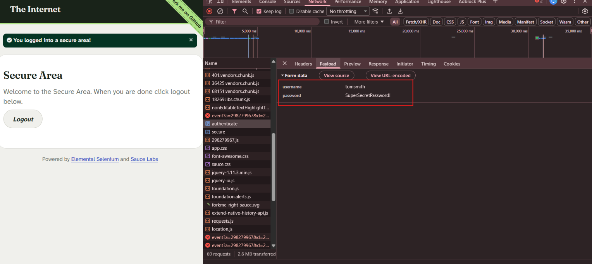
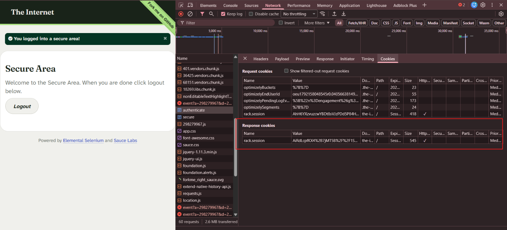

# Cybersecurity Portfolio - Week 1, Day 3
## Topic: HTTP/HTTPS Internals, Headers, Cookies, Status Codes & JWTs

**Objective:** 
Analyze Layer 7 (Application Layer) web traffic using Browser Developer Tools and CyberChef to inspect HTTP request methods (`GET` vs. `POST`), security response headers, session management cookies, HTTP status codes, and JSON Web Token (JWT) structures.

### :hammer_and_wrench: Tools & Environment
* **OS:** Windows
* **Web Analysis:** Browser Developer Tools (F12 Network Inspector)
* **Token Analysis:** GCHQ CyberChef (`JWT Decode`)
* **Target Lab Environments:** `httpforever.com`, `the-internet.herokuapp.com`, `httpbin.org`

---

### :memo: Lab Walkthrough & Execution

**1. HTTP `GET` Request & Response Header Inspection**
* Captured live HTTP traffic to `http://httpforever.com` using the browser Network tab with `Preserve log` enabled.
* Inspected the HTTP response headers to identify web server infrastructure and defensive security policies.

**2. HTTP `POST` Authentication & Session Cookie Analysis**
* Monitored the login workflow on `https://the-internet.herokuapp.com/login` during credential submission (`tomsmith` / `SuperSecretPassword!`).
* Isolated the `POST` request to `/authenticate` to inspect how form payloads are transmitted in the request body and how the server issues a new `rack.session` cookie upon successful authentication.

**3. HTTP Status Code Verification**
* Triggered and analyzed core HTTP status codes across test endpoints to observe server behavior:
  * **`200 OK`:** Standard successful page load.
  * **`303 See Other` / `302 Found`:** Post-authentication redirect to `/secure`.
  * **`401 Unauthorized`:** Failed/canceled HTTP Basic Authentication (`/basic_auth`).
  * **`403 Forbidden`:** Server-side access denial (`/status/403`).
  * **`404 Not Found`:** Request for a non-existent resource (`/status_codes/404`).

**4. JSON Web Token (JWT) Decoding**
* Loaded a sample JWT (`Header.Payload.Signature`) into CyberChef and applied the `JWT Decode` operation to inspect the unencrypted Base64URL-encoded claims.

---

### :mag: Key Observations & Visual Evidence

#### 1. Server Fingerprinting & Security Headers (`GET` Request)
Inspecting the response headers from `httpforever.com` revealed that the domain is fronted by `Server: cloudflare`. In addition to identifying the server software, the response included critical browser security headers such as `Content-Security-Policy`, `X-Frame-Options: DENY` (clickjacking protection), and `X-Content-Type-Options: nosniff` (MIME-sniffing protection).

#### 2. `POST` Request Form Data Payload
When submitting the login form on `the-internet.herokuapp.com`, the browser sent an HTTP `POST` request to the `authenticate` endpoint. Inspecting the **Payload** tab revealed the submitted credentials (`username: tomsmith` and `password: SuperSecretPassword!`) inside the request body. This highlights why login forms must strictly enforce HTTPS (TLS)—over unencrypted HTTP, anyone sniffing network traffic can read `POST` form payloads in cleartext.

#### 3. Session Management via Cookies (`Set-Cookie`)
Because HTTP is a stateless protocol, the server maintains authenticated state by issuing a new `rack.session` response cookie after verifying the `POST` credentials. Notably, the cookie has the **`HttpOnly`** flag enabled (`✓`), which is a key defensive control that prevents malicious client-side JavaScript (Cross-Site Scripting / XSS) from stealing the session token via `document.cookie`.

#### 4. JSON Web Token (JWT) Claim Inspection
Decoding the JWT in CyberChef demonstrated that while a JWT is cryptographically signed to prevent tampering, its payload is merely Base64URL-encoded—**not encrypted**. Anyone who intercepts the token can immediately read internal application claims:
* **Subject (`sub`):** `USR-8842`
* **Username (`username`):** `sec_analyst_01`
* **Privilege Role (`role`):** `admin`
* **MFA Status (`mfa_verified`):** `true`
* **Timestamps:** Issued At (`iat: 1760618400`) and Expiration (`exp: 1760622000`)

---

### :bulb: Conclusion
Successfully inspected Layer 7 web communications from initial `GET` requests through `POST` authentication, cookie-based session tracking, and stateless JWT analysis. Verified how defensive controls—such as HTTPS encryption, the `HttpOnly` cookie attribute, and strict HTTP security headers—protect web applications against credential interception, session hijacking, and sensitive data exposure.
