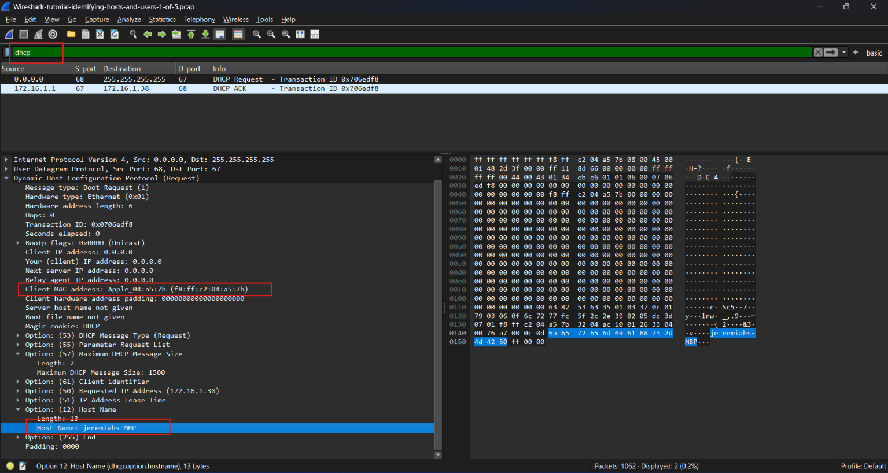
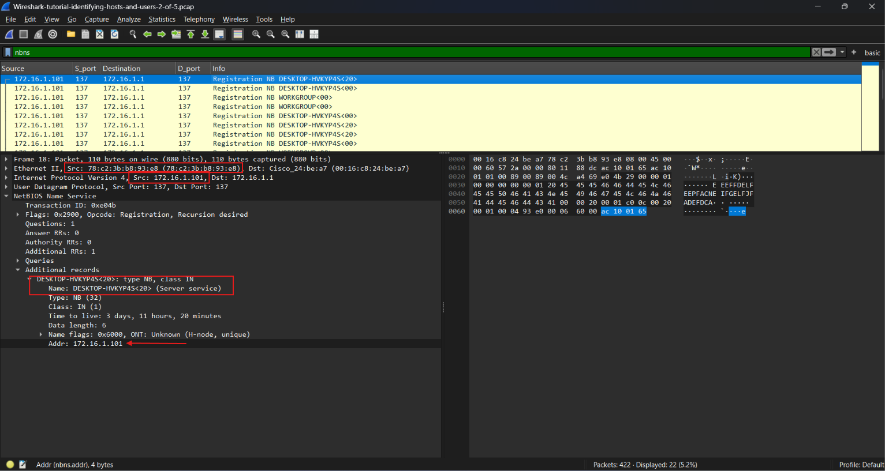
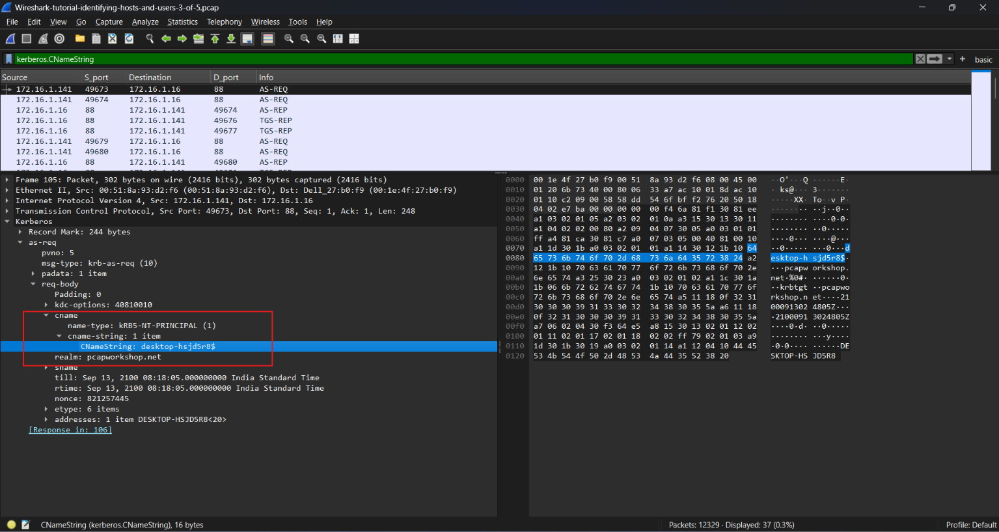
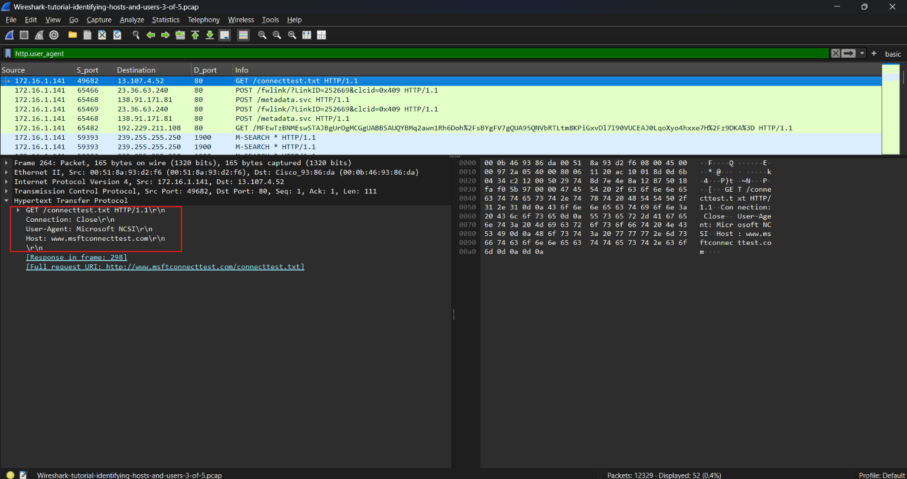
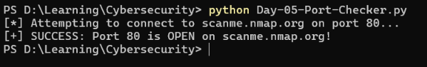

# Cybersecurity Portfolio - Week 1, Day 5
## Topic: Identifying Hosts in PCAPs & Basic Python Port Checking

**Objective:** 
Demonstrate the ability to extract critical host identification artifacts (IP, MAC, Hostname, Windows User) from a packet capture (PCAP) using Wireshark display filters. Additionally, write and execute a basic Python socket script to programmatically verify network connectivity to an external port.

### :hammer_and_wrench: Tools & Environment
* **OS:** Windows
* **Network Analyzer:** Wireshark
* **Programming:** Python 3 (Socket library)
* **Sample Data:** Malware-Traffic-Analysis.net (`Identifying Hosts and Users` PCAPs)

---

### :mag: Part 1: Wireshark Host & User Identification (The 4 Core Filters)

When analyzing suspicious network traffic, identifying *who* and *what* generated the traffic is the first step of incident response. I utilized four specific Wireshark display filters to extract the victim's machine identity from the sample PCAPs:

**1. DHCP (Dynamic Host Configuration Protocol)**
* **Filter:** `dhcp` (or `bootp`)
* **Artifacts Found:** By expanding the `Bootstrap Protocol` details, I identified the host's **MAC Address** (`f8:ff:c2:04:a5:7b`) and the initial **Hostname** (`jeremiahs-MBP`).
*(Screenshot: Wireshark showing DHCP Request details)*

**2. NBNS (NetBIOS Name Service)**
* **Filter:** `nbns`
* **Artifacts Found:** Confirmed the **Hostname** (`DESKTOP-HVKYP4S`) broadcasting across the local network, explicitly tying it to the source IP address (`172.16.1.101`) and MAC address (`78:c2:3b:b8:93:e8`).
*(Screenshot: Wireshark showing NBNS broadcast)*

**3. Kerberos (Active Directory Authentication)**
* **Filter:** `kerberos.CNameString`
* **Artifacts Found:** Revealed the exact Active Directory **Windows Username** (`desktop-hsjd5r8$`) of the machine authenticating to the domain during the packet capture.
*(Screenshot: Wireshark showing Kerberos CNameString)*

**4. HTTP User-Agent**
* **Filter:** `http.user_agent`
* **Artifacts Found:** Extracted the unencrypted `User-Agent` string (`Microsoft NCSI`), revealing specific operating system background telemetry communicating with `www.msftconnecttest.com`.
*(Screenshot: Wireshark showing HTTP User-Agent string)*

---

### :snake: Part 2: Python Socket Port Checker (Script Execution)

To bridge the gap between network analysis and automation, I wrote a foundational Python script utilizing the built-in `socket` library. The script programmatically attempts a TCP connection to Port 80 on `scanme.nmap.org` (a safe, authorized testing target) and returns the open/closed status.

*(Screenshot: PowerShell successfully executing the port checker script)*

*The raw Python script is available in this repository under: `Day-05-Port-Checker.py`*

### :bulb: Conclusion
Successfully demonstrated both manual and automated network enumeration techniques. Mastered the four core Wireshark filters required to identify compromised Windows hosts in a PCAP, and successfully developed a foundational Python networking script to interact with TCP ports programmatically.
