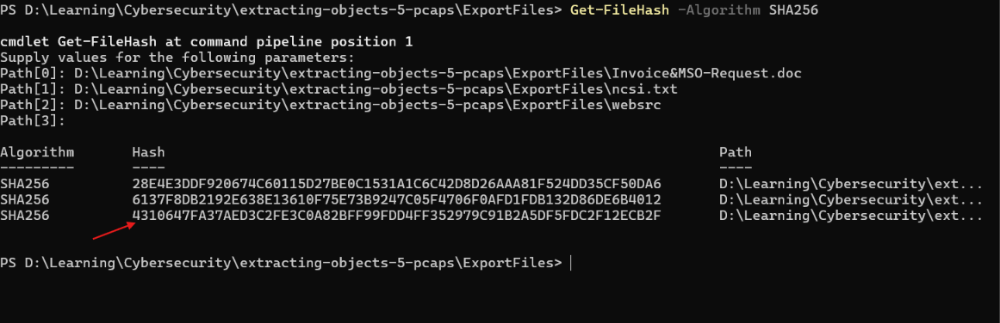
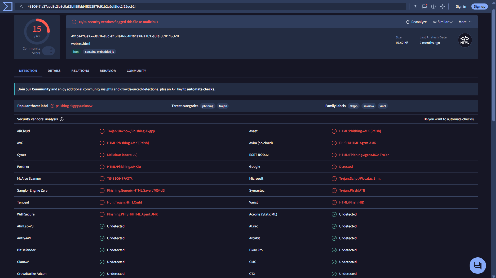
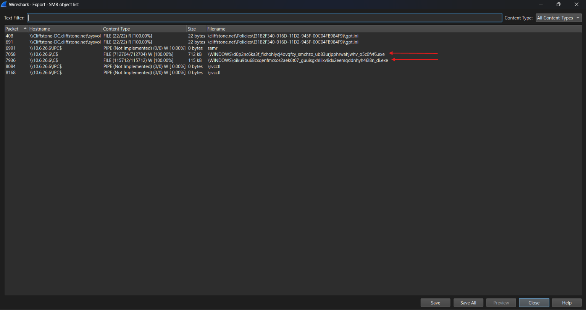
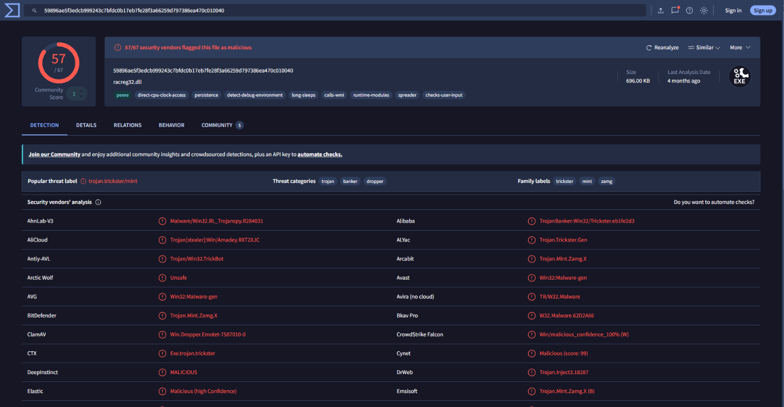
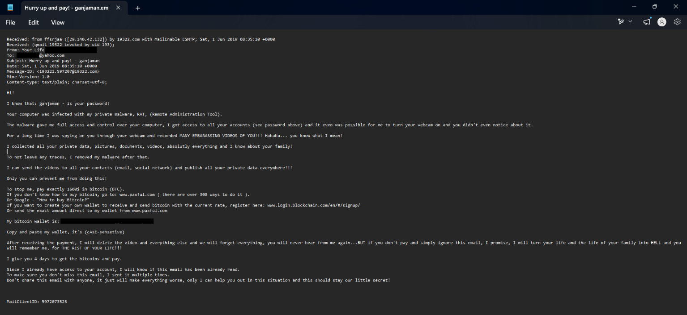
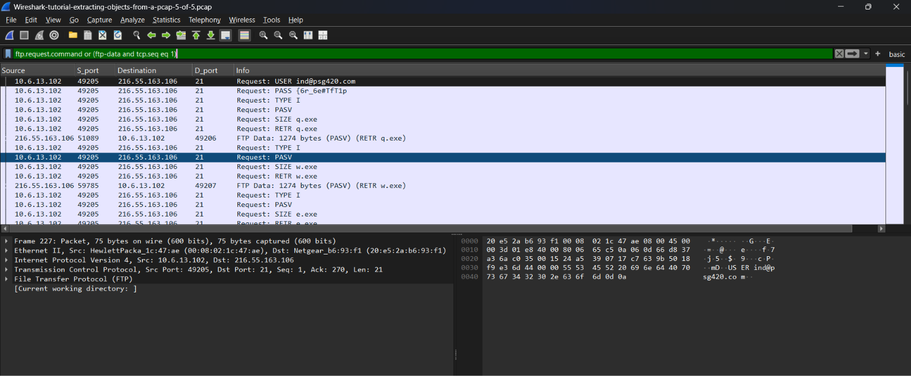
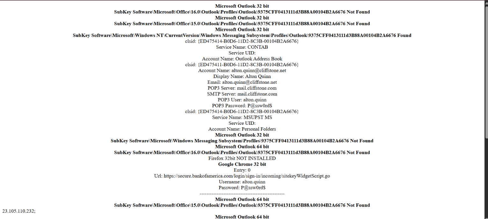

# Cybersecurity Portfolio - Week 1, Day 6
## Topic: Malicious PCAP Forensics, Object Extraction & VirusTotal OSINT

**Objective:** 
Perform Tier 1/Tier 2 SOC network forensics across multiple packet captures (PCAPs) by extracting malicious payloads and artifacts transferred over **HTTP**, **SMB**, **SMTP (IMF)**, and **FTP**. Generate cryptographic SHA-256 hashes via PowerShell and leverage VirusTotal threat intelligence to identify malware families, phishing kits, lateral movement, and credential exfiltration.

### :hammer_and_wrench: Tools & Environment
* **OS:** Windows
* **Network Analyzer:** Wireshark (`Export Objects` -> `HTTP`, `SMB`, `IMF`, and `FTP` stream reconstruction)
* **Hashing Utility:** PowerShell (`Get-FileHash -Algorithm SHA256`)
* **Threat Intelligence:** VirusTotal
* **Lab Dataset:** Malware-Traffic-Analysis.net (`Wireshark Tutorial: Extracting Objects from a Pcap`, Parts 1–5)

---

### :rotating_light: Executive SOC Incident Summary

| Case # | Protocol | Compromised Host IP / MAC | Key Artifact / Malware Identified | Threat Classification |
| :--- | :--- | :--- | :--- | :--- |
| **Case 1** | `HTTP` | Extracted from PCAPs 1–2 | `Invoice&MSO-Request.doc`, `websrc.html` | HTML Phishing / `Trojan:Script/Wacatac.B!ml` (**15/60** VT) |
| **Case 2** | `SMB` | Target: `\\10.6.26.6\C$` | `racreg32.dll` / Randomized `.exe` payloads | `Trojan.Trickster` / TrickBot Banking Trojan (**57/67** VT) |
| **Case 3** | `SMTP / IMF` | `10.6.1.104` (`00:08:02:1c:47:ae`) | `Hurry up and pay! - ganjaman.eml` | Compromised Spambot / BTC Sextortion Campaign |
| **Case 4** | `FTP` | `10.6.13.102` (`00:08:02:1c:47:ae`) | `q.exe`, `w.exe`, `e.exe` & Outlook/Chrome Dump | FTP Malware Staging & Credential Exfiltration (`alton.quinn`) |

---

### :mag: Forensic Investigation Walkthrough & Visual Evidence

#### Case 1: HTTP Object Extraction & Cryptographic Hashing
Using Wireshark's `File -> Export Objects -> HTTP` utility, I extracted unencrypted files transferred over HTTP (`Invoice&MSO-Request.doc`, `ncsi.txt`, and `websrc`) to an isolated directory and computed their SHA-256 hashes in PowerShell:

* **`Invoice&MSO-Request.doc`:** `28E4E3DDF920674C60115D27BE0C1531A1C6C42D8D26AAA81F524DD35CF50DA6`
* **`ncsi.txt`:** `6137F8DB2192E638E13610F75E73B9247C05F4706F0AFD1FDB132D86DE6B4012`
* **`websrc` (`websrc.html`):** `4310647FA37AED3C2FE3C0A82BFF99FDD4FF352979C91B2A5DF5FDC2F12ECB2F`

*(Screenshot: Generating SHA-256 file hashes for exported HTTP objects in PowerShell)*

Searching the SHA-256 hash for `websrc.html` on **VirusTotal** revealed a detection score of **15/60**, flagging the file as an embedded JavaScript phishing payload (`HTML:Phishing-AMK [Phish]` / `Trojan:Script/Wacatac.B!ml`).

*(Screenshot: VirusTotal detection results for the exported HTTP payload)*

---

#### Case 2: SMB Lateral Movement & TrickBot Malware Analysis
To investigate internal lateral movement, I inspected Server Message Block (SMB) traffic using `File -> Export Objects -> SMB`. The capture revealed two large, randomly named Windows executables written (`100.00%`) directly to the administrative share `\\10.6.26.6\C$`:
* `\WINDOWS\d0p2nc6ka3f_fixhohlycj4ovqfcy_smchzo_ub83urjpphrwahjwhv_o5c0fvf6.exe` (712 kB)
* `\WINDOWS\oiku9bu68cxqenfmcsos2aek6t07_guuisgxhllixv8dx2eemqddnhyh46l8n_di.exe` (115 kB)

*(Screenshot: Wireshark SMB object list showing malicious executables written across the network)*

Querying the extracted SMB payload hash (`59896ae5f3edcb999243c7bfdc0b17eb7fe28f3a66259d797386ea470c010040` / `racreg32.dll`) on **VirusTotal** resulted in **57/67** security vendors flagging the file as malicious—identifying it as **TrickBot / Trickster** (`trojan.trickster/mint`, `Win.Dropper.Emotet`), a notorious banking trojan and dropper that spreads laterally via SMB.

*(Screenshot: VirusTotal 57/67 detection confirming TrickBot/Trickster banking trojan)*

---

#### Case 3: SMTP Spambot Traffic & Email Forensics (IMF)
In the fourth PCAP (`4-of-5`), applying the Wireshark display filter `smtp.data.fragment` isolated outbound Simple Mail Transfer Protocol (SMTP) traffic on Port 25 originating from internal host `10.6.1.104` (MAC: `00:08:02:1c:47:ae`) to external mail server `98.137.159.26`. The infected host was acting as a spambot, rapidly dispatching dozens of extortion emails with subjects containing leaked passwords.

*(Screenshot: Wireshark filtered by smtp.data.fragment showing outbound spambot activity)*

Using `File -> Export Objects -> IMF` (Internet Message Format), I exported `Hurry up and pay! - ganjaman.eml` and inspected the raw message headers and body in a text editor:
* **Originating Header:** `Received: from ffsrjaa ([29.140.42.132]) by 19322[.]com`
* **Social Engineering Lure:** Claims the victim's computer was infected with a Remote Administration Tool (RAT) and demands **$1,600 in Bitcoin (BTC)** via `hxxp://www[.]paxful[.]com` or `hxxp://www[.]login[.]blockchain[.]com`.

*(Screenshot: Exported IMF .eml file revealing the raw Bitcoin sextortion email headers and body)*

---

#### Case 4: FTP Malware Staging & Cleartext Credential Exfiltration
In the final PCAP (`5-of-5`), applying the filter `ftp.request.command or (ftp-data and tcp.seq eq 1)` exposed unencrypted File Transfer Protocol (FTP) traffic between compromised internal host `10.6.13.102` (MAC: `00:08:02:1c:47:ae`) and external FTP server `216.55.163.106` on Port 21:
* **Attacker FTP Credentials:** `USER ind@psg420[.]com` / `PASS {6r_6e#TfT1p`
* **Malware Staging:** The infected host downloaded multiple malicious executables (`RETR q.exe`, `RETR w.exe`, `RETR e.exe`) over passive FTP.

*(Screenshot: Wireshark showing cleartext FTP credentials and executable retrieval)*

Inspecting the reconstructed `ftp-data` exfiltration stream revealed sensitive victim credentials harvested by an info-stealer from Microsoft Outlook and Google Chrome on the victim's machine:
* **Compromised User:** Alton Quinn (`alton.quinn@cliffstone.net`)
* **Mail Server (POP3/SMTP):** `mail.cliffstone[.]com` (Password: `P@ssw0rd$`)
* **Saved Browser Credentials:** `hxxps://secure[.]bankofamerica[.]com/login/sign-in/incoming/sitekeyWidgetScript.go` (Username: `alton.quinn` / Password: `P@ssw0rd$`)

*(Screenshot: Extracted FTP data stream exposing stolen Outlook and Bank of America credentials)*

---

### :bulb: Conclusion
Successfully executed a multi-protocol network forensic investigation across five real-world packet captures. Bypassed local endpoint antivirus restrictions to safely extract and hash malicious artifacts across `HTTP`, `SMB`, `SMTP/IMF`, and `FTP`, correlating network indicators of compromise (IOCs) with VirusTotal threat intelligence to uncover phishing payloads, TrickBot lateral movement, spambot abuse, and cleartext credential exfiltration.
