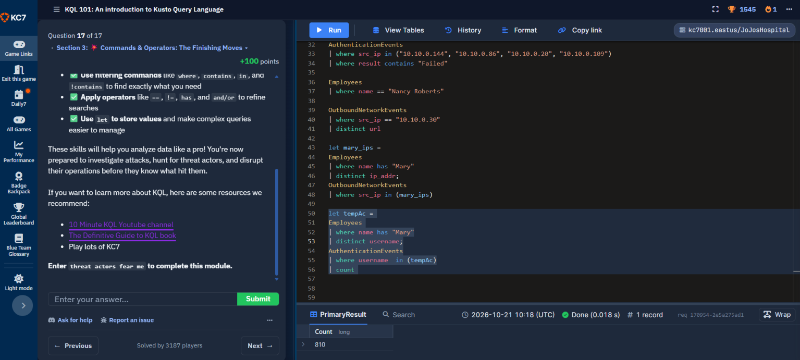

# Cybersecurity Portfolio - Week 1, Day 7
## Topic: Intro to KQL (Kusto Query Language) & SOC Breach Investigation

**Objective:** 
Develop foundational SIEM threat-hunting and log-analysis skills using **Kusto Query Language (KQL)** on the KC7 Cyber platform (`JoJosHospital` dataset). Practice filtering, aggregating, and correlating multi-table enterprise security telemetry across `Employees`, `AuthenticationEvents`, and `OutboundNetworkEvents`.

### :hammer_and_wrench: Tools & Environment
* **SIEM / Log Analytics Engine:** KC7 Cyber / Azure Data Explorer (KQL)
* **Completed Modules:** 
  * *Module 01: A Rap Beef — An Intro to Security Investigations*
  * *Module 06: KQL 101 — An Introduction to Kusto Query Language (17/17 Completed)*
* **Key KQL Operators Practiced:** `where`, `contains`, `!contains`, `has`, `in`, `distinct`, `count`, `summarize`, and `let` (variable assignment for cross-table correlation)

---

### :mag: Top 5 KQL Threat-Hunting Queries Executed

During the investigation, I progressed from single-table lookups to multi-table correlation using `let` statements to pivot between employee identity records, network traffic, and authentication logs:

#### 1. Hunting Failed Authentication Attempts Across Multiple Source IPs (`in` + `contains`)
Isolated failed login events originating from a specific list of suspicious internal IP addresses to detect potential brute-force or password-spraying activity:
```kql
AuthenticationEvents
| where src_ip in ("10.10.0.144", "10.10.0.86", "10.10.0.20", "10.10.0.109")
| where result contains "Failed"
```

#### 2. Employee Identity Attribution (`where ==`)
Queried the `Employees` table to pivot from a known employee name (`Nancy Roberts`) to her assigned internal IP address, username, and company role:
```kql
Employees
| where name == "Nancy Roberts"
```

#### 3. Enumerating Unique Outbound Web Requests from a Host (`distinct`)
Filtered `OutboundNetworkEvents` for a specific internal host (`10.10.0.30`) and deduplicated the results to view every unique URL visited by that machine:
```kql
OutboundNetworkEvents
| where src_ip == "10.10.0.30"
| distinct url
```

#### 4. Cross-Table Correlation: Pivoting from Employee Name to Network Traffic (`let` + `in`)
Stored all IP addresses belonging to employees named `"Mary"` inside a variable (`mary_ips`) and passed that variable directly into `OutboundNetworkEvents` to inspect their web browsing activity in a single query:
```kql
let mary_ips = 
    Employees
    | where name has "Mary"
    | distinct ip_addr;
OutboundNetworkEvents
| where src_ip in (mary_ips)
```

#### 5. Cross-Table Correlation: Counting Total Authentication Events for a User Group (`let` + `count`)
Extracted all distinct usernames for employees named `"Mary"` into a temporary variable (`tempAc`) and correlated them against `AuthenticationEvents`, confirming exactly **`810`** matching authentication records:
```kql
let tempAc = 
    Employees
    | where name has "Mary"
    | distinct username;
AuthenticationEvents
| where username in (tempAc)
| count
```

---

### :camera: Visual Evidence (KQL 101 Completion & Multi-Table Correlation)

*(Screenshot: Completing Question 17/17 in KC7 KQL 101 while executing `let` variable correlation queries across `Employees`, `OutboundNetworkEvents`, and `AuthenticationEvents`)*



---

### :bulb: Conclusion
Successfully completed the KC7 KQL 101 curriculum and introductory SOC breach investigation. Demonstrated the ability to write structured KQL queries, filter high-volume enterprise logs, deduplicate indicators with `distinct`, and chain multiple tables together using `let` variables to trace user activity across authentication and network telemetry.
