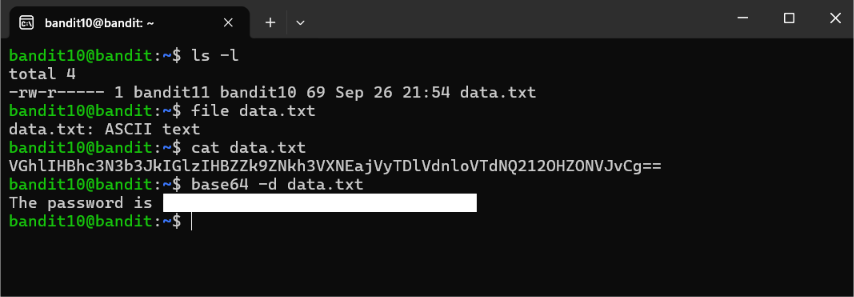

# Cybersecurity Portfolio - Week 2, Day 9
## Topic: Linux Permissions (`chmod`), SUID Privilege Escalation & OverTheWire Bandit (Levels 6–10)

**Objective:** 
Analyze Linux identity and access management controls—including `/etc/passwd` vs. `/etc/shadow`, octal permission bitmasks (`chmod`), and Set Owner User ID (`SUID`) privilege escalation vectors—while solving OverTheWire Bandit Levels 6 through 10 using CLI text-processing and forensic utilities (`find`, `2>/dev/null`, `grep`, `sort`, `uniq`, `strings`, and `base64`).

### :hammer_and_wrench: Tools & Environment
* **Client OS:** Windows (PowerShell / OpenSSH Client)
* **Target Environment:** OverTheWire Bandit Wargame (`bandit.labs.overthewire.org`, Port `2220`)
* **Core Linux Utilities:** `ls -l`, `find`, `grep`, `sort`, `uniq`, `strings`, `base64`

---

### :lock: Part 1: Linux Identity, Octal Permissions (`chmod`) & SUID Exploitation

#### 1. Credential Storage: `/etc/passwd` vs. `/etc/shadow`
* **`/etc/passwd` (World-Readable: `-rw-r--r--` / `644`):** Stores non-sensitive user account metadata required by system processes to map numeric User IDs (UIDs) to usernames, home directories, and default login shells (e.g., `/bin/bash` or `/usr/sbin/nologin`).
* **`/etc/shadow` (Restricted to Root: `-rw-r-----` / `640` or `000`):** Stores salted cryptographic password hashes (such as SHA-512 `$6$` or yescrypt `$y$`) and password aging policies. Isolating hashes inside `/etc/shadow` prevents unprivileged users from reading and cracking password hashes offline.

#### 2. Octal Permissions Analysis: `chmod 777` vs. `chmod 600`
Linux file permissions are evaluated across three distinct scopes: **User (Owner)**, **Group**, and **Others (World)**. Each scope is assigned a 3-bit octal value calculated as the sum of **Read ($r = 4$)**, **Write ($w = 2$)**, and **Execute ($x = 1$)**:

| Permission Command | Symbolic Notation | Octal Calculation | Security Posture & Use Case |
| :--- | :--- | :--- | :--- |
| **`chmod 777`** | `-rwxrwxrwx` | Owner: $4+2+1=7$ <br> Group: $4+2+1=7$ <br> Others: $4+2+1=7$ | **Critical Misconfiguration:** Grants every local user account full read, modify, and execute privileges. If applied to a `root`-executed cron script or web server directory, any compromised low-privilege account can overwrite the file to achieve arbitrary code execution or privilege escalation. |
| **`chmod 644`** | `-rw-r--r--` | Owner: $4+2+0=6$ <br> Group: $4+0+0=4$ <br> Others: $4+0+0=4$ | **Standard Public Configuration:** The file owner can read and modify the file, while group members and other users have read-only access. Commonly used for non-sensitive configuration files. |
| **`chmod 640`** | `-rw-r-----` | Owner: $4+2+0=6$ <br> Group: $4+0+0=4$ <br> Others: $0+0+0=0$ | **Group-Restricted Access (Observed in Bandit 10):** As seen in `bandit10` (`-rw-r----- 1 bandit11 bandit10 data.txt`), the file is owned by `bandit11`, but because `bandit10` is assigned as the file's **Group**, `bandit10` is granted read (`r--`) access while all other users on the server are blocked (`---`). |
| **`chmod 600`** | `-rw-------` | Owner: $4+2+0=6$ <br> Group: $0+0+0=0$ <br> Others: $0+0+0=0$ | **Strict Least Privilege:** Strictly restricts read and write access to the file owner alone. Required by OpenSSH for private key files (`~/.ssh/id_rsa`); SSH will refuse to use a private key if its permissions are looser than `600`. |

#### 3. How Misconfigured SUID (`4000`) Binaries Lead to `root` Compromise
* **Technical Mechanism:** Normally, a Linux process inherits the effective UID (EUID) of the user who launches it. However, when the **SUID (Set Owner User ID)** special bit (`4000`, displayed as an `s` in `-rwsr-xr-x`) is set on an executable binary, the Linux kernel executes that binary with the **permissions of the file owner (typically `root`)** rather than the user running it.
* **Legitimate Purpose:** Utilities such as `/usr/bin/passwd` and `/usr/bin/sudo` require the SUID bit so unprivileged users can perform tightly controlled administrative actions (like updating their own password hash in `/etc/shadow`).
* **Privilege Escalation Vector (MITRE ATT&CK `T1548.001` - Abuse Elevation Control Mechanism: Setuid and Setgid):** If an administrator mistakenly assigns the SUID bit (`chmod u+s` or `chmod 4755`) to a general-purpose binary capable of reading arbitrary files, writing files, or spawning subshells (such as `find`, `vim`, `bash`, `python3`, or `cp`), a low-privileged attacker can invoke that binary's built-in features (cataloged on **GTFOBins**) to read `/etc/shadow` or spawn an interactive shell with `EUID=0 (root)`, achieving full system takeover.
* **SOC & Pentest Hunting Command:** Analysts and penetration testers audit a Linux host for anomalous SUID binaries using:
  ```bash
  find / -perm -4000 -type f 2>/dev/null
  ```

---

### :memo: Part 2: Bandit Levels 6–10 Command & Concept Matrix

*(Note: In accordance with OverTheWire rules, all plaintext level passwords have been redacted).*

| Level Transition | Primary Command Executed | Technical Challenge & Security Concept |
| :--- | :--- | :--- |
| **Level 6 $\rightarrow$ 7** | `find / -user bandit7 -group bandit6 -size 33c 2>/dev/null` <br> `cat /var/lib/dpkg/info/bandit7.password` | **System-Wide Attribute Hunting & `stderr` Redirection:** Searched the entire root filesystem (`/`) for a file matching specific ownership (`-user`, `-group`) and byte size (`33c`). Redirected file descriptor `2` (`stderr`) to `/dev/null` to suppress thousands of `Permission denied` errors. |
| **Level 7 $\rightarrow$ 8** | `grep "millionth" data.txt` | **Pattern Matching (`grep`):** Filtered a massive text file to extract the exact line containing the keyword string `"millionth"`. |
| **Level 8 $\rightarrow$ 9** | `sort data.txt \| uniq -u` | **Pipeline Sorting & Deduplication:** Because `uniq` only compares adjacent lines, `data.txt` was first piped (`\|`) through `sort` to group identical strings together before passing `-u` to output the single unique line. |
| **Level 9 $\rightarrow$ 10** | `strings data.txt \| grep "==="` | **Binary String Extraction:** Used `strings` (a staple static malware analysis utility) to extract printable ASCII character sequences from a raw binary file, piping the output into `grep` to isolate the line prefixed with `===`. |
| **Level 10 $\rightarrow$ 11** | `base64 -d data.txt` | **Base64 Decoding:** Identified a Base64-encoded payload (characterized by alphanumeric text and trailing `==` padding) and decoded it back into cleartext using `base64 -d`. |

---

### :camera: Visual Evidence (Level 10 $\rightarrow$ 11 Permission Inspection & Base64 Decoding)

*(Screenshot: Inspecting group-read file permissions `-rw-r-----` with `ls -l`, verifying file headers with `file`, and decoding the Base64-encoded credential file using `base64 -d data.txt`)*



---

### :bulb: Conclusion
Completed OverTheWire Bandit Levels 6 through 10 while mastering Linux access control fundamentals (`chmod` octal bitmasks, `/etc/shadow` protection, and SUID privilege escalation risks). Demonstrated proficiency in chaining Linux CLI utilities via pipes (`|`) and stream redirection (`2>/dev/null`) to hunt files, parse binary strings, and decode obfuscated data.