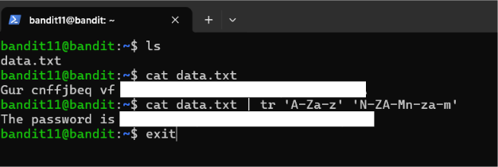
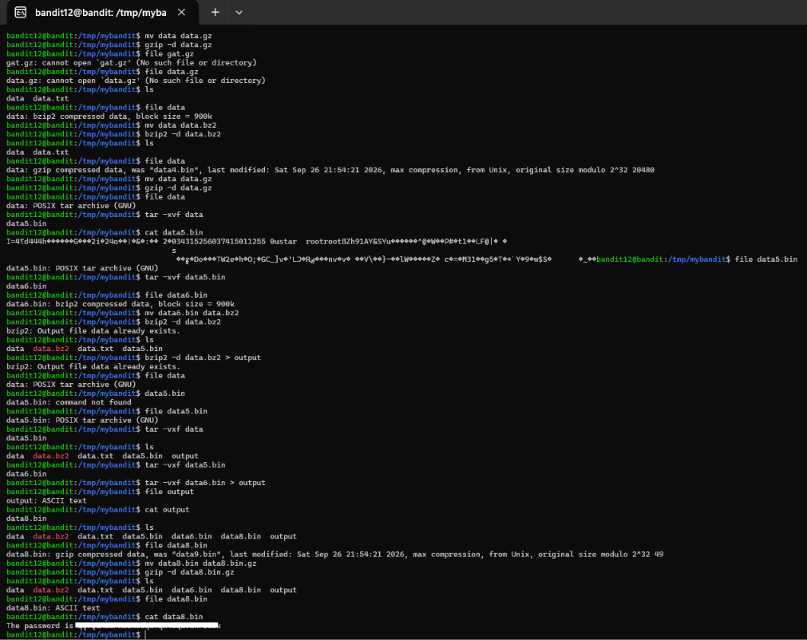
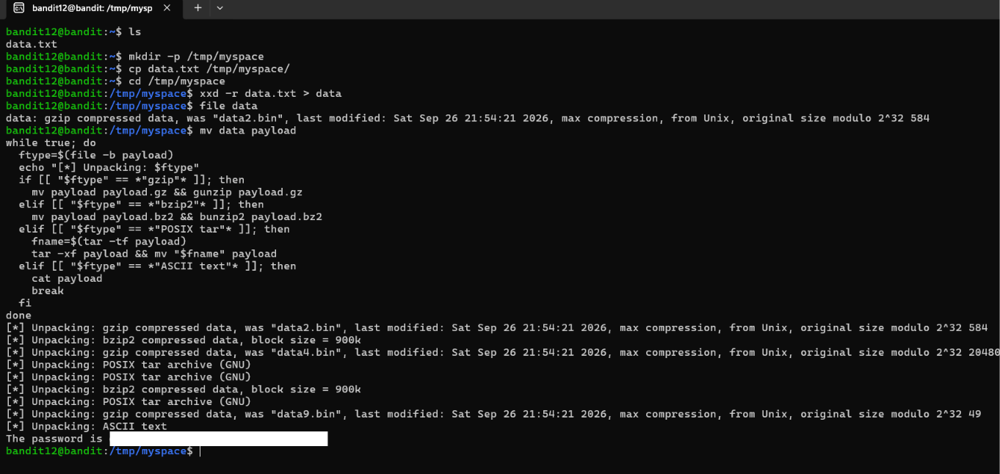
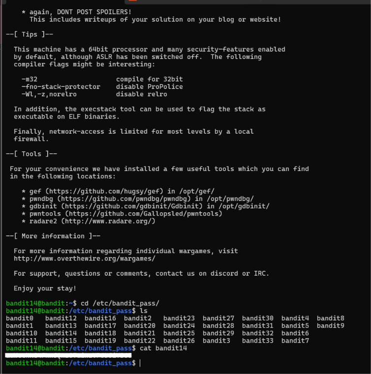
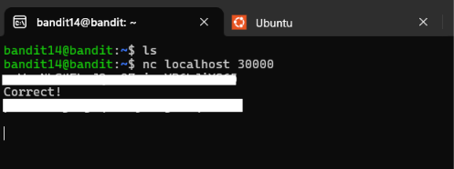
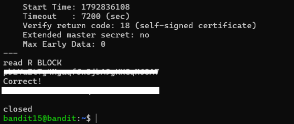

# Cybersecurity Portfolio - Week 2, Day 10
## Topic: Encoding, Multi-Layer Compression, SSH Private Keys, TLS Sockets & Bandit (Levels 11–15)

**Objective:** 
Solve OverTheWire Bandit Levels 11 through 15 while practicing core SOC and incident response skills: de-obfuscating substitution ciphers (`tr`), reversing hexadecimal dumps (`xxd -r`), unpacking deeply nested archives (`gzip`, `bzip2`, `tar`) both manually and via Bash automation, authenticating laterally with SSH private keys (`ssh -i`), and interacting with raw TCP (`nc`) and TLS-encrypted (`openssl s_client`) network services.

### :hammer_and_wrench: Tools & Environment
* **Client OS:** Windows (PowerShell / OpenSSH Client)
* **Target Environment:** OverTheWire Bandit Wargame (`bandit.labs.overthewire.org`, Port `2220`)
* **Core Linux Utilities:** `tr`, `xxd`, `file`, `gzip`/`gunzip`, `bzip2`/`bunzip2`, `tar`, `ssh -i`, `nc` (Netcat), `openssl s_client`

---

### :memo: Part 1: Bandit Levels 11–15 Command & Concept Matrix

*(Note: In accordance with OverTheWire rules, all plaintext level passwords have been redacted).*

| Level Transition | Primary Command Executed | Technical Challenge & Security Concept |
| :--- | :--- | :--- |
| **Level 11 $\rightarrow$ 12** | `cat data.txt \| tr 'A-Za-z' 'N-ZA-Mn-za-m'` | **ROT13 Cipher De-obfuscation:** Used `tr` (translate) to shift uppercase and lowercase ASCII alphabets by $13$ positions, reversing a symmetric Caesar substitution cipher. |
| **Level 12 $\rightarrow$ 13** | `xxd -r data.txt > data` <br> `gzip -d`, `bzip2 -d`, `tar -xvf` | **Hex Reversal & Matryoshka Archive Unpacking:** Converted an ASCII hexdump back into a raw binary file (`xxd -r`) and iteratively inspected magic bytes (`file`) to decompress 8 nested layers of `gzip`, `bzip2`, and `POSIX tar` archives. |
| **Level 13 $\rightarrow$ 14** | `ssh -i sshkey.private -p 2220 bandit14@localhost` <br> `cat /etc/bandit_pass/bandit14` | **SSH Private Key Authentication:** Authenticated to `bandit14` without a password by passing an exposed RSA/OpenSSH private key file (`-i sshkey.private`), demonstrating Linux lateral movement (`MITRE ATT&CK T1552.004`). |
| **Level 14 $\rightarrow$ 15** | `nc localhost 30000` | **Raw TCP Socket Communication:** Used Netcat (`nc`) to establish an unencrypted TCP connection to local port `30000` and transmit the current level's credential string over `stdin`. |
| **Level 15 $\rightarrow$ 16** | `openssl s_client -connect localhost:30001` | **TLS/SSL Encrypted Socket Communication:** Established an encrypted TLS session to local port `30001` (verifying the server's self-signed certificate) to securely transmit the credential payload. |

---

### :mag: Part 2: Walkthrough & Visual Evidence

#### 1. Level 11 $\rightarrow$ 12: Reversing ROT13 Obfuscation (`tr`)
Attackers frequently use lightweight obfuscation like ROT13 to hide strings or command-line indicators from basic static signatures. By piping `data.txt` into `tr 'A-Za-z' 'N-ZA-Mn-za-m'`, every character was rotated $13$ positions across the $26$-letter English alphabet, immediately revealing the plaintext password.

*(Screenshot: Reversing the ROT13 substitution cipher using `tr`)*


---

#### 2. Level 12 $\rightarrow$ 13: Hexdump Reversal (`xxd -r`) & Multi-Layer Archive Extraction
Malware droppers often pack payloads inside multiple nested compression formats (`gzip`, `bzip2`, `tar`) and encode them as hex text to bypass email or network filters.
* First, I created a working directory in `/tmp` and ran `xxd -r data.txt > data` to reconstruct the binary archive from the hexdump.
* **Method A — Manual Forensic Unpacking:** I inspected the file header at each stage using `file`, renamed the file with the appropriate extension (`.gz`, `.bz2`), and decompressed each layer step-by-step using `gzip -d`, `bzip2 -d`, and `tar -xvf` until reaching the final `ASCII text` file (`data8.bin`).

*(Screenshot: Manually identifying file signatures with `file` and decompressing nested `gzip`, `bzip2`, and `tar` archives)*


* **Method B — Automated Bash Loop Unpacking:** To automate this repetitive forensic workflow, I also executed a `while` loop in `/tmp/myspace` that dynamically checks the output of `file -b payload` and invokes `gunzip`, `bunzip2`, or `tar -xf` until `ASCII text` is reached:

```bash
while true; do
  ftype=$(file -b payload)
  echo "[*] Unpacking: $ftype"
  if [[ "$ftype" == *"gzip"* ]]; then
    mv payload payload.gz && gunzip payload.gz
  elif [[ "$ftype" == *"bzip2"* ]]; then
    mv payload payload.bz2 && bunzip2 payload.bz2
  elif [[ "$ftype" == *"POSIX tar"* ]]; then
    fname=$(tar -tf payload)
    tar -xf payload && mv "$fname" payload
  elif [[ "$ftype" == *"ASCII text"* ]]; then
    cat payload
    break
  fi
done
```

*(Screenshot: Automated Bash loop unpacking all 8 nested archive layers in a single execution)*


---

#### 3. Level 13 $\rightarrow$ 14: SSH Private Key Authentication (`ssh -i`)
In Level 13, inspecting the home directory revealed an exposed SSH private key (`sshkey.private`). Rather than needing `bandit14`'s password, I passed the identity file directly to the SSH client (`ssh -i sshkey.private -p 2220 bandit14@localhost`) to pivot into the `bandit14` account and read `/etc/bandit_pass/bandit14`.

*(Screenshot: Authenticating as `bandit14` using the discovered SSH private key and retrieving the credential from `/etc/bandit_pass`)*


---

#### 4. Level 14 $\rightarrow$ 15 & Level 15 $\rightarrow$ 16: Raw TCP (`nc`) vs. Encrypted TLS (`openssl s_client`)
* **Unencrypted TCP (`nc localhost 30000`):** Used Netcat to open a raw TCP socket to `localhost:30000` and submit `bandit14`'s password in cleartext.

*(Screenshot: Submitting the Level 14 password over a raw TCP socket using Netcat)*


* **Encrypted TLS (`openssl s_client -connect localhost:30001`):** Because port `30001` requires SSL/TLS encryption, a plain Netcat connection fails. Using `openssl s_client` completed the TLS handshake (noting `Verify return code: 18 (self-signed certificate)`) and securely transmitted the Level 15 password to retrieve the Level 16 credential.

*(Screenshot: Establishing a TLS-encrypted session to port 30001 via `openssl s_client`)*


---

### :bulb: Conclusion
Successfully completed Bandit Levels 11 through 15. Demonstrated both manual and scripted Bash techniques for unpacking multi-layered binary payloads, lateral authentication using SSH private keys, and interacting with raw TCP and TLS-encrypted network services from the Linux command line.
