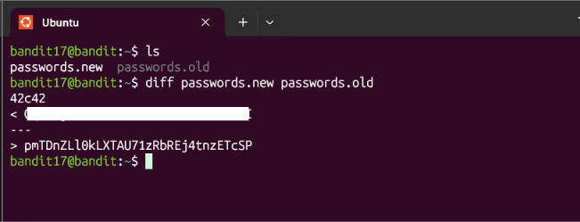
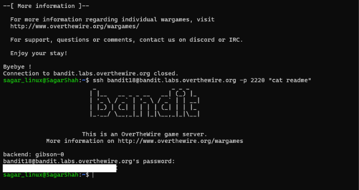
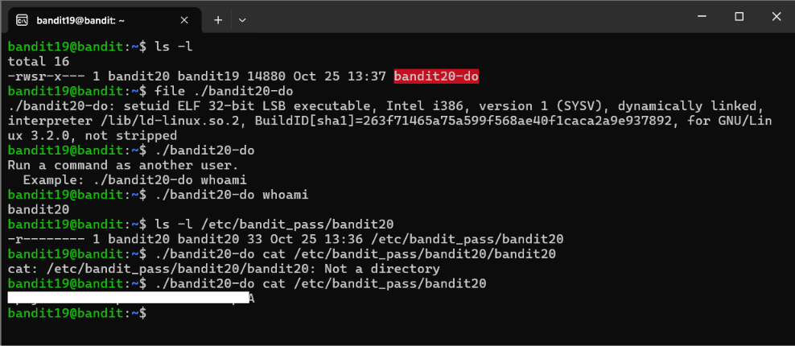
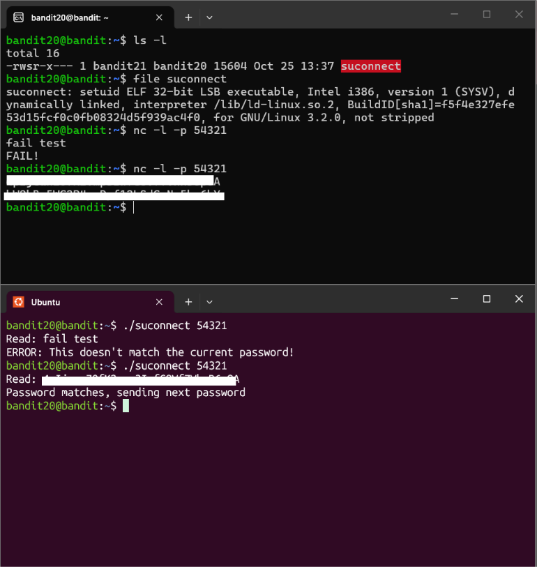

# Cybersecurity Portfolio - Week 2, Day 11
## Topic: Processes, Sockets, Nmap Scanning & OverTheWire Bandit (Levels 16–20)

**Objective:** 
Perform local port scanning and service enumeration (`nmap`, `ss -tulnp`), compare file variations (`diff`), bypass hostile shell configuration traps via SSH command injection, exploit SetUID (`SUID`) binaries for privilege escalation, and utilize Netcat (`nc`) for inter-process socket communication to solve OverTheWire Bandit Levels 16 through 20. 

### :hammer_and_wrench: Tools & Environment
* **Client OS:** Windows (PowerShell / WSL Ubuntu / OpenSSH Client)
* **Target Environment:** OverTheWire Bandit Wargame (`bandit.labs.overthewire.org`, Port `2220`)
* **Core Linux Utilities:** `ps aux`, `ss -tulnp`, `nmap`, `openssl`, `nano`, `chmod`, `diff`, `ssh`, `nc`

---

### :shield: Defensive Analysis: Top 3 Linux Persistence Mechanisms
During incident response, SOC analysts hunt for persistence (mechanisms attackers use to maintain access after reboots or password resets). The three most critical locations to audit in a Linux environment are:

1. **`~/.bashrc` (User Shell Startup Script):** This script executes automatically every time a user starts an interactive Bash session. Attackers append reverse shells or credential-stealing aliases to the bottom of this file. *(Note: This exact mechanism was weaponized in Bandit Level 18 to force an immediate logout upon connection).*
2. **`~/.ssh/authorized_keys` (SSH Backdoors):** Stores public cryptographic keys that are allowed to log into the account without a password. Attackers append their own public key here to bypass password authentication completely.
3. **`/etc/crontab` & `/var/spool/cron/` (Scheduled Tasks):** The Linux equivalent of Windows Task Scheduler. Attackers create hidden cron jobs to silently execute malware payloads or phone home to a Command & Control (C2) server every few minutes.

---

### :mag: Bandit Levels 16–20 Walkthrough & Visual Evidence

*(Note: In accordance with OverTheWire rules, all plaintext level passwords have been redacted).*

#### Level 16 $\rightarrow$ 17: Service Enumeration (`nmap`) & External SSH Key Pivoting
* **Objective:** Find a hidden SSL service listening on a port between 31000 and 32000.
* **Execution:** Used `nmap -sV -T4 -p 31000-32000 localhost` to enumerate open TCP ports and probe for SSL/TLS versions. Identified port `31790` as the target.
* **Extraction & Pivoting:** Connected via `openssl s_client -connect localhost:31790 -quiet` and submitted the current credential, which returned an RSA Private Key. Because the OverTheWire server recently blocked SSH connections originating from `localhost` to conserve resources, I saved the private key to my local WSL machine (`nano b17.key`), locked the permissions (`chmod 600 b17.key`), and authenticated securely from the outside.

*(Screenshot: Nmap port scanning, extracting the RSA private key via OpenSSL, and SSH key authentication)*

---

#### Level 17 $\rightarrow$ 18: Identifying Anomalies (`diff`)
* **Objective:** Identify the single modified line between an old and new password file.
* **Execution:** Executed `diff passwords.new passwords.old` to perform a line-by-line comparison, instantly isolating the unique credential string appended to the new file.

*(Screenshot: Using `diff` to isolate file variations)*

---

#### Level 18 $\rightarrow$ 19: Bypassing `.bashrc` Traps via SSH Command Injection
* **Objective:** Read a file on a server that immediately terminates the connection upon login.
* **Execution:** The `bandit18` account was booby-trapped with an `exit` command inside its `~/.bashrc` file. To bypass this, I appended the command directly to the SSH initialization string (`ssh bandit18@... -p 2220 "cat readme"`). This forces SSH to execute the command natively in a non-interactive shell, entirely bypassing the malicious `.bashrc` execution flow.

*(Screenshot: Observing the `.bashrc` logout trap and bypassing it via SSH command injection)*

---

#### Level 19 $\rightarrow$ 20: SUID Privilege Escalation
* **Objective:** Exploit a misconfigured SUID binary to access a protected file.
* **Execution:** Listed directory permissions (`ls -l`) and identified an executable named `bandit20-do` with the SUID bit set (`-rwsr-x---`) and owned by `bandit20`. By executing `./bandit20-do cat /etc/bandit_pass/bandit20`, the command inherited `bandit20`'s effective user ID (EUID), successfully bypassing standard read restrictions.

*(Screenshot: Identifying and exploiting the SUID binary)*

---

#### Level 20 $\rightarrow$ 21: Cross-Terminal Socket Communication (`nc`)
* **Objective:** Establish a local listener and transmit a credential to a SUID networking binary.
* **Execution:** Utilized two parallel terminal sessions. In Terminal 1, I initialized a Netcat listener (`nc -l -p 54321`) on an arbitrary high port. In Terminal 2, I executed the SUID binary `./suconnect 54321`, which connected to my listener. I transmitted the current level's password through Terminal 1's `stdin`, prompting the binary to return the subsequent level's credential.

*(Screenshot: Dual-terminal execution demonstrating local Netcat listeners and socket communication)*

---

### :bulb: Conclusion
Successfully completed OverTheWire Bandit Levels 16 through 20. Demonstrated practical proficiency in network service enumeration (`nmap`), cryptographic key management, forensic file comparison (`diff`), bypassing terminal configuration traps, and identifying and exploiting Linux SetUID (`SUID`) privilege escalation vulnerabilities.
