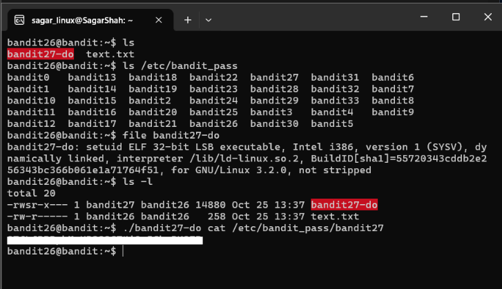
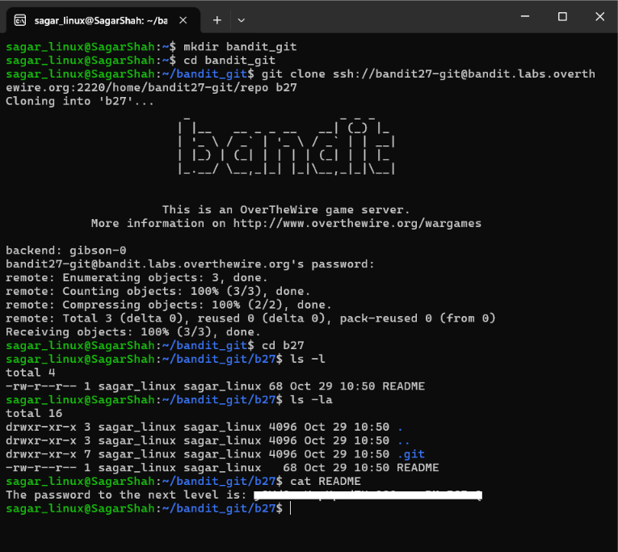
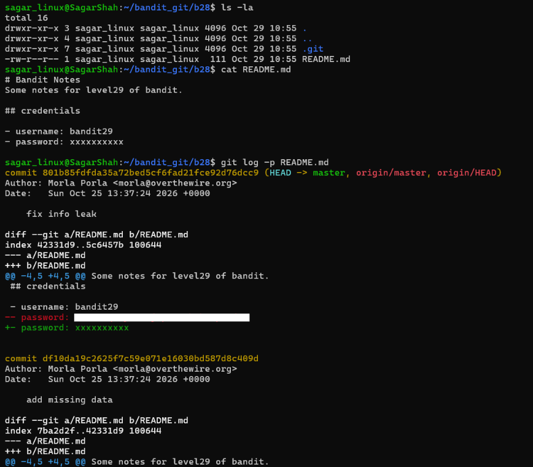
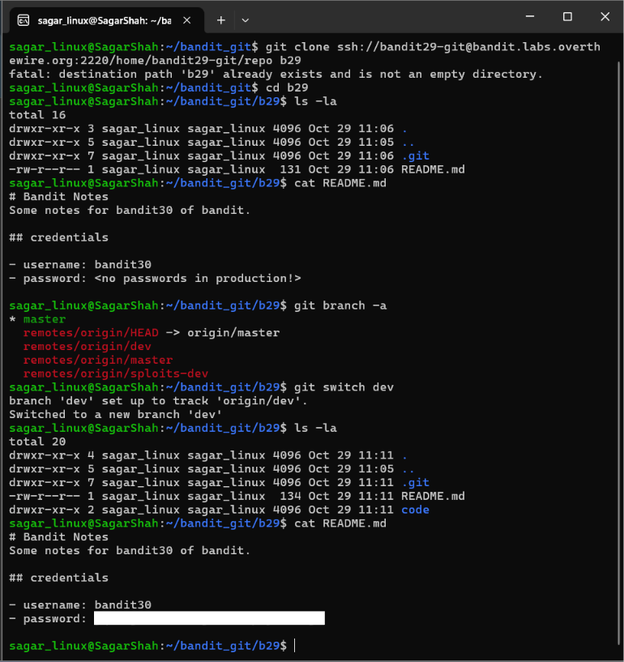
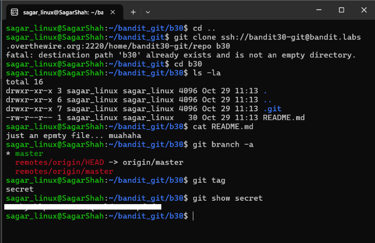
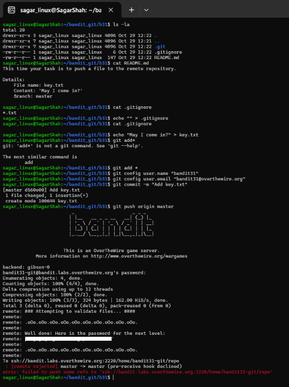
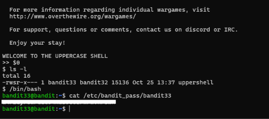
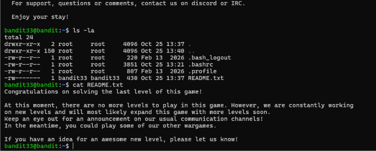

# Cybersecurity Portfolio - Week 2, Day 13
## Topic: Leaked Secrets in Git Repositories, Linux Logging (`/var/log`) & OverTheWire Bandit (Levels 26–33 Finale)

**Objective:** 
Investigate Linux system logging architecture (`/var/log`) and complete the final stages of the OverTheWire Bandit Wargame (Levels 26 through 33). Demonstrate how hardcoded credentials and sensitive artifacts are harvested from exposed `.git` repositories across commit histories (`git log -p`), non-production branches (`git branch -a`, `git switch`), and tags (`git tag`, `git show`), bypass `.gitignore` restrictions, and escape an uppercase-restricted shell (`uppershell`) using positional shell parameters (`$0`).

### :hammer_and_wrench: Tools & Environment
* **Client OS:** Windows 11 / WSL Ubuntu (`sagar_linux@SagarShah`)
* **Target Environment:** OverTheWire Bandit Wargame (`bandit.labs.overthewire.org`, Port `2220`)
* **Core Utilities:** `git` (`clone`, `log -p`, `branch -a`, `switch`, `tag`, `show`, `add`, `commit`, `push`), SUID binaries (`bandit27-do`, `uppershell`), POSIX `sh` (`$0`), `/bin/bash`

---

### :shield: Part 1: AppSec & SOC Analysis — Harvesting Credentials from `.git` History & Prevention

#### 1. How Attackers Harvest Secrets from Exposed `.git` Repositories (`MITRE ATT&CK T1552.001`)
Git is an immutable, content-addressable version control system: every file modification, addition, and deletion is permanently stored as a blob object inside the hidden `.git/objects/` directory. A common developer mistake is accidentally committing a hardcoded API key, database password, or SSH key, and attempting to "fix" the leak by replacing the secret with `xxxxxxxx` in a subsequent commit.
* **Commit History Diffs (`git log -p`):** Deleting a secret in a newer commit only removes it from the current `HEAD` working tree. Attackers run `git log -p` (or `git log -S "password" -p`) to inspect historical diffs (`-` lines) and recover the original plaintext secret.
* **Non-Production Branches (`git branch -a`):** Developers frequently strip credentials from the `master`/`main` production branch while leaving valid staging or production credentials inside `dev`, `test`, or feature branches (`remotes/origin/dev`).
* **Annotated & Lightweight Tags (`git tag` / `git show`):** Release tags or developer bookmark tags can point to orphaned commits or blob objects containing secrets that do not appear on any active branch.

#### 2. How to Prevent & Remediate Git Secret Leaks (DevSecOps Controls)
1. **Enforce `.gitignore` & Environment Variables Before the First Commit:** Store credentials exclusively in environment variables or `.env` / `*.key` files that are explicitly listed in `.gitignore` *prior* to initializing commits, and use a Secrets Manager (HashiCorp Vault, AWS Secrets Manager, Azure Key Vault) in production.
2. **Pre-Commit & CI/CD Secret Scanning:** Deploy automated secret scanners such as **Gitleaks**, **TruffleHog**, or **GitHub Push Protection** as local `pre-commit` hooks and CI/CD pipeline gates to block commits containing high-entropy strings or regex-matched API keys before they ever reach a remote repository.
3. **Proper Incident Response (Rotate First, Purge Second):** If a secret is ever pushed to a repository, **immediately revoke and rotate the credential**—assume it has already been scraped by automated bots. Afterward, purge the object from all historical commits across all branches and tags using `git filter-repo` or **BFG Repo-Cleaner** and force-push the cleaned history.

#### 3. Linux System Logging Architecture (`/var/log`)
From today's Linux Journey reading, SOC analysts correlate host compromises using key log files inside `/var/log/`:
* **`/var/log/auth.log` (Debian/Ubuntu) / `/var/log/secure` (RHEL):** Tracks authentication events, `sshd` logins, `sudo` command executions, and SUID privilege changes.
* **`/var/log/syslog` / `/var/log/messages`:** Central system daemon, service, and `cron` execution logs.
* **`/var/log/dmesg` & `/var/log/kern.log`:** Kernel ring buffer and hardware/driver events.

---

### :memo: Part 2: Bandit Levels 26–33 Command & Vulnerability Matrix

*(Note: In accordance with OverTheWire rules, all plaintext level passwords have been redacted).*

| Level Transition | Primary Command / Exploit Executed | Technical Vulnerability & Security Concept |
| :--- | :--- | :--- |
| **Level 26 $\rightarrow$ 27** | `./bandit27-do cat /etc/bandit_pass/bandit27` | **SUID Wrapper Exploitation:** Executed the `bandit27`-owned SetUID binary (`-rwsr-x---`) after escaping `bandit26`'s restricted `more` shell to read `/etc/bandit_pass/bandit27`. |
| **Level 27 $\rightarrow$ 28** | `git clone ssh://bandit27-git@...:2220/home/bandit27-git/repo b27`   `cat README` | **Remote Git Repository Enumeration:** Cloned an internal SSH-hosted Git repository to local storage and extracted credentials stored in plaintext inside the `README` file. |
| **Level 28 $\rightarrow$ 29** | `git log -p README.md` | **Historical Commit Diff Harvesting:** Inspected commit `801b85fd` (`"fix info leak"`) using `-p` (patch view) to recover the redacted password from the historical `- password:` diff line. |
| **Level 29 $\rightarrow$ 30** | `git branch -a`   `git switch dev`   `cat README.md` | **Unprotected Development Branch Exposure:** Enumerated remote tracking branches (`remotes/origin/dev`) and switched branches to recover credentials omitted from `master`. |
| **Level 30 $\rightarrow$ 31** | `git tag`   `git show secret` | **Git Tag Object Inspection:** Listed repository tags to uncover a hidden `secret` tag and dumped its underlying blob object via `git show`. |
| **Level 31 $\rightarrow$ 32** | `echo "" > .gitignore`   `echo "May I come in?" > key.txt`   `git add * && git commit -m "Add key.txt" && git push origin master` | **Bypassing `.gitignore` Controls & Remote Hook Triggering:** Cleared the restrictive `*.txt` rule in `.gitignore` (or used `git add -f`) to stage and push `key.txt`, triggering a server-side `pre-receive` hook that returned `bandit32`'s password. |
| **Level 32 $\rightarrow$ 33** | `>> $0`   `/bin/bash`   `cat /etc/bandit_pass/bandit33` | **Escaping `uppershell` via Positional Parameter Expansion (`$0`):** Bypassed a custom SUID shell wrapper that converts all alphabetical input to uppercase by invoking `$0` (which expands to `sh` without using letters). |

---

### :mag: Part 3: Walkthrough & Visual Evidence

#### 1. Level 26 $\rightarrow$ 27: SUID Binary Privilege Escalation (`bandit27-do`)
After breaking out of `bandit26`'s restricted pager into an interactive shell, inspecting the home directory with `ls -l` and `file` revealed `bandit27-do`, a 32-bit SUID ELF executable (`-rwsr-x--- 1 bandit27 bandit26`). Invoking `./bandit27-do cat /etc/bandit_pass/bandit27` executed `cat` under `bandit27`'s effective UID.

*(Screenshot: Inspecting `bandit27-do` SUID permissions and dumping `/etc/bandit_pass/bandit27`)*

---

#### 2. Level 27 $\rightarrow$ 28: Cloning the Remote Git Repository over SSH
From my local Ubuntu WSL environment (`~/bandit_git`), I cloned `bandit27-git`'s repository over port `2220` (`git clone ssh://bandit27-git@bandit.labs.overthewire.org:2220/home/bandit27-git/repo b27`) and read the `README` file to retrieve `bandit28`'s password.

*(Screenshot: Cloning the `bandit27-git` repository over SSH and reading the `README` credential)*

---

#### 3. Level 28 $\rightarrow$ 29: Recovering Deleted Credentials via `git log -p`
In the `b28` repository, `cat README.md` showed `password: xxxxxxxxxxx`. Running `git log -p README.md` exposed the previous commit (`801b85fdfda35a72bed5cf6fad21fce92d76dcc9` — `"fix info leak"`), displaying the exact line removed (`- password: <redacted>`) right above `+ password: xxxxxxxxxxx`.

*(Screenshot: Using `git log -p README.md` to expose the deleted password in the commit diff)*

---

#### 4. Level 29 $\rightarrow$ 30: Pivoting to Remote Development Branches (`git branch -a` & `git switch dev`)
In `b29`, the `master` branch `README.md` stated `<no passwords in production!>`. Running `git branch -a` revealed additional remote branches (`remotes/origin/dev` and `remotes/origin/sploits-dev`). Switching to the `dev` branch via `git switch dev` exposed the developer's hardcoded credential inside `README.md`.

*(Screenshot: Enumerating remote branches with `git branch -a` and switching to `dev` to extract `bandit30`'s password)*

---

#### 5. Level 30 $\rightarrow$ 31: Extracting Secrets Hidden in Git Tags (`git tag` & `git show`)
In `b30`, `README.md` contained only `just an epmty file... muahaha` and no extra branches existed. Executing `git tag` identified a tag named `secret`, and `git show secret` printed the raw credential string.

*(Screenshot: Discovering and reading the `secret` Git tag via `git tag` and `git show secret`)*

---

#### 6. Level 31 $\rightarrow$ 32: Overriding `.gitignore` Rules & Pushing to Remote
In `b31`, `README.md` instructed pushing a file named `key.txt` containing `'May I come in?'` to the `master` branch, while `.gitignore` contained `*.txt` to block text files from being staged. I cleared `.gitignore` (`echo "" > .gitignore`), created `key.txt`, staged and committed the changes, and executed `git push origin master`. The remote server's `pre-receive` hook validated `key.txt` and printed `bandit32`'s password directly in the terminal output.

*(Screenshot: Bypassing `.gitignore`, committing `key.txt`, and triggering the remote validation hook via `git push origin master`)*

---

#### 7. Level 32 $\rightarrow$ 33 (Finale): Escaping `WELCOME TO THE UPPERCASE SHELL` via `$0`
Logging into `bandit32` launched a custom SUID binary (`-rwsr-x--- 1 bandit33 bandit32 uppershell`) that converts all alphabetical characters to uppercase before executing them, causing standard commands like `ls` or `bash` to fail (`LS: not found`).
* By entering `$0` at the `>> ` prompt, the shell expanded `$0` to the name of the running interpreter (`sh`)—which contains no alphabetical characters in the input string—spawning an unprivileged-syntax POSIX `sh` shell running with `bandit33`'s effective UID.
* From `$`, I upgraded to `/bin/bash`, read `/etc/bandit_pass/bandit33`, and logged into `bandit33` to verify full completion of the wargame.

*(Screenshot: Escaping the uppercase shell using `$0`, spawning `/bin/bash` as `bandit33`, and retrieving the final password)*

*(Screenshot: Logging into `bandit33` and reading the final completion banner in `README.txt`)*

---

### :bulb: Conclusion
Successfully completed **all 34 levels (Level 0 through Level 33)** of the OverTheWire Bandit Wargame! Today's final sprint demonstrated practical Application Security (AppSec) and Linux privilege escalation skills: auditing Git commit histories, branches, and tags for leaked credentials, bypassing `.gitignore` restrictions, and using special shell parameter expansion (`$0`) to break out of restricted execution environments.