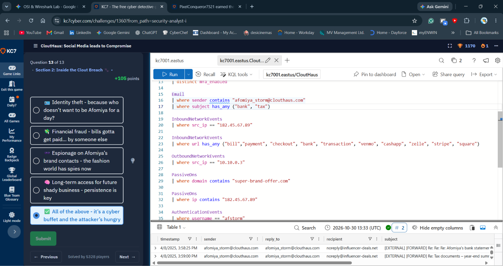
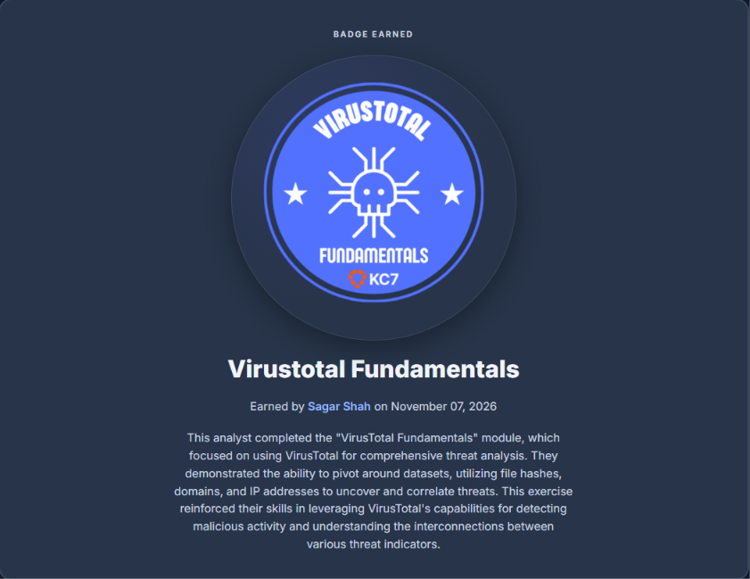

# Cybersecurity Portfolio - Week 2, Day 14
## Topic: SOC Breach Investigation (KC7 CloutHaus) & VirusTotal Threat Intelligence Pivoting

**Objective:** 
Conduct an end-to-end Tier 1/Tier 2 SOC breach investigation on the **KC7 Cyber (`CloutHaus`)** enterprise dataset using **Kusto Query Language (KQL)** and **VirusTotal** threat intelligence pivoting. Trace a targeted social-engineering and spear-phishing attack against a high-profile influencer from initial OSINT reconnaissance and link click through credential harvesting, unauthorized account access, financial fraud, and sensitive data exfiltration.

### :hammer_and_wrench: Tools & Environment
* **SIEM / Log Analytics Engine:** Azure Data Explorer (KQL) — `kc7001.eastus / CloutHaus`
* **Threat Intelligence Platform:** VirusTotal (Passive DNS, File Hash & Infrastructure Pivoting)
* **Completed Modules:**
  * *KC7 Module 03: CloutHaus — Social Media Leads to Compromise (13/13 Completed)*
  * *KC7 Module 05: VirusTotal Fundamentals (Badge Earned)*

---

### :rotating_light: Part 1: Official SOC Incident Ticket (`INC-2026-CH03`)

| Ticket Field | Incident Details |
| :--- | :--- |
| **Incident ID** | `INC-2026-CH03` |
| **Severity / Priority** | **CRITICAL (P1)** — Confirmed Account Takeover (ATO) & Sensitive Financial Exfiltration |
| **Status** | Contained & Documented |
| **Compromised Employee** | **Afomiya Storm** (`afomiya_storm@clouthaus.com` / Username: `afstorm`) |
| **Compromised Host IP** | `10.10.0.3` |
| **Threat Actor IP** | `182.45.67.89` |
| **Malicious Infrastructure** | `hxxps://super-brand-offer[.]com`, `noreply@influencer-deals[.]net` |
| **MITRE ATT&CK Mapping** | `T1593.001` (Search Open Websites/Social Media), `T1566.002` (Spearphishing Link), `T1078` (Valid Accounts), `T1114.003` (Email Forwarding Rule / Collection) |

---

### :mag: Part 2: Incident Kill Chain & Forensic Analysis

#### 1. OSINT Reconnaissance & Initial Access (Social Media + Spear-Phishing)
The threat actor leveraged personal details overshared on social media by CloutHaus influencer **Afomiya Storm** (`afomiya_storm@clouthaus.com`) to craft a highly targeted spear-phishing lure masquerading as a lucrative brand sponsorship deal (`super-brand-offer[.]com` / `influencer-deals[.]net`).
* Querying `OutboundNetworkEvents` for Afomiya's internal workstation (`10.10.0.3`) confirmed she clicked the malicious link, leading to credential harvesting.

#### 2. Account Takeover (ATO) & Infrastructure Pivoting (`PassiveDns` & `AuthenticationEvents`)
* **Passive DNS Resolution:** Pivoting in `PassiveDns` on the phishing domain `super-brand-offer.com` resolved the domain to external threat actor IP **`182.45.67.89`**. Reverse-pivoting on `182.45.67.89` exposed additional co-hosted domains controlled by the same threat actor infrastructure.
* **Unauthorized Login & MFA Audit:** Correlating `AuthenticationEvents` (`where username == "afstorm"`) and `InboundNetworkEvents` (`where src_ip == "182.45.67.89"`) confirmed the attacker authenticated directly into Afomiya's corporate account from `182.45.67.89` (exploiting missing/disabled Multi-Factor Authentication, `mfa_enabled`).

#### 3. Post-Compromise Actions on Objectives (Financial Fraud & Data Exfiltration)
Once inside Afomiya's account, the threat actor executed multiple post-exploitation objectives:
1. **Financial Transaction Probing:** Inspected `InboundNetworkEvents` from `182.45.67.89` for payment-related URLs (`bill`, `payment`, `checkout`, `bank`, `transaction`, `venmo`, `cashapp`, `zelle`, `stripe`, `square`).
2. **Sensitive Email Exfiltration:** Queried the `Email` table for outbound messages sent from `afomiya_storm@clouthaus.com` containing financial keywords (`has_any ("bank", "tax")`). This uncovered unauthorized email forwards sent to the attacker's drop address **`noreply@influencer-deals.net`**:
   * `4/8/2025, 3:58:25 PM` — Subject: `[EXTERNAL] [FORWARD] Re: Re: Afomiya's bank statement...`
   * `4/8/2025, 3:59:00 PM` — Subject: `[EXTERNAL] [FORWARD] Re: Tax documents - year-end summ...`

---

### :computer: Part 3: Key KQL Threat-Hunting Queries Executed

```kql
// 1. Audit MFA posture across employees
Employees
| distinct mfa_enabled

// 2. Detect exfiltrated financial and tax emails forwarded by the compromised account
Email
| where sender contains "afomiya_storm@clouthaus.com"
| where subject has_any ("bank", "tax")

// 3. Trace all inbound web activity originating from the threat actor's IP address
InboundNetworkEvents
| where src_ip == "182.45.67.89"

// 4. Hunt for financial fraud and payment portal access in inbound traffic
InboundNetworkEvents
| where url has_any ("bill", "payment", "checkout", "bank", "transaction", "venmo", "cashapp", "zelle", "stripe", "square")

// 5. Inspect outbound web browsing from the victim's workstation (10.10.0.3)
OutboundNetworkEvents
| where src_ip == "10.10.0.3"

// 6. Pivot from the phishing domain to IP and discover co-hosted attacker domains
PassiveDns
| where domain contains "super-brand-offer.com"

PassiveDns
| where ip contains "182.45.67.89"

// 7. Audit authentication telemetry for compromised user 'afstorm'
AuthenticationEvents
| where username == "afstorm"
```

*(Screenshot: Executing KQL queries in Azure Data Explorer during Question 13/13 of the CloutHaus investigation, exposing forwarded bank statements and tax documents to `noreply@influencer-deals.net`)*


---

### :dna: Part 4: VirusTotal Fundamentals — Threat Intelligence Pivoting

In addition to the CloutHaus KQL investigation, I completed **KC7 Module 05: VirusTotal Fundamentals**, practicing OSINT infrastructure and artifact correlation:
* **Hash-to-Network Pivoting (`Relations` Tab):** Queried malicious SHA-256 file hashes to identify Command-and-Control (C2) domains, contacted IP addresses, and parent execution wrappers (`Execution Parents` / `Dropped Files`).
* **Passive DNS & Sibling Domain Discovery:** Used VirusTotal's Passive DNS replication history to pivot from a single malicious domain to its underlying hosting IP, uncovering sibling phishing domains registered by the same threat actor.

| CloutHaus Investigation Badge | VirusTotal Fundamentals Badge |
| :---: | :---: |
|  |  |

---

### :shield: Part 5: SOC Remediation & Hardening Recommendations

1. **Immediate Containment:** Revoke active session tokens and force a password reset for `afomiya_storm@clouthaus.com` (`afstorm`); remove any unauthorized inbox forwarding rules to `influencer-deals[.]net`.
2. **Network & Email Blocking:** Block `182.45.67.89`, `super-brand-offer[.]com`, and `influencer-deals[.]net` across the corporate firewall, DNS sinkhole, and Secure Email Gateway (SEG).
3. **Mandatory MFA Enforcement:** Enforce phishing-resistant Multi-Factor Authentication (FIDO2 / WebAuthn) across all employee accounts where `mfa_enabled == false`.
4. **OPSEC & Phishing Awareness Training:** Conduct targeted security awareness training for public-facing staff regarding social media oversharing (OSINT exposure) and out-of-band verification for external sponsorship/financial requests.
