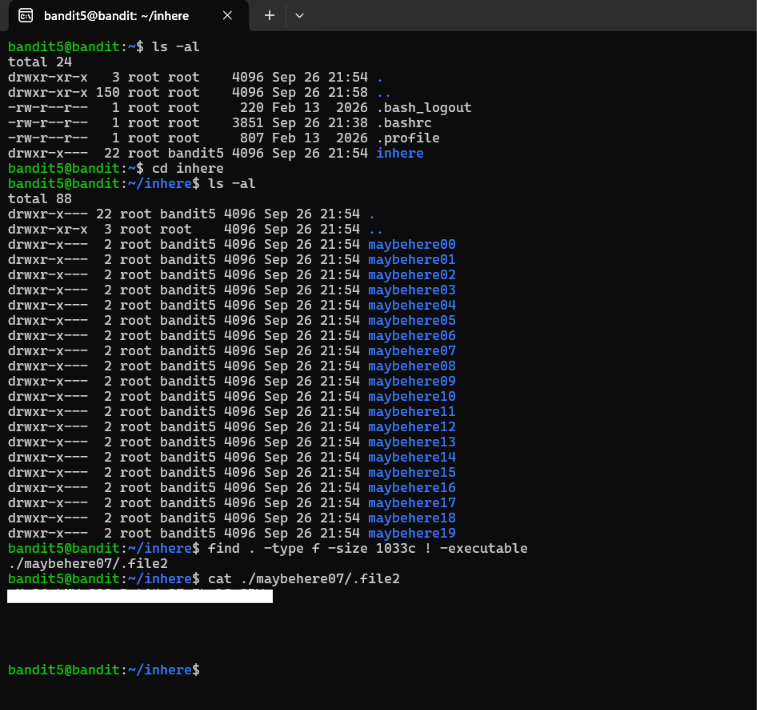

# Cybersecurity Portfolio - Week 2, Day 8
## Topic: Linux CLI Navigation, Hidden Files, File Signatures & OverTheWire Bandit (Levels 0–5)

**Objective:** 
Establish remote Secure Shell (SSH) sessions to a Linux environment from Windows PowerShell and solve OverTheWire Bandit Levels 0 through 5. Practice essential Linux command-line forensics including hidden dot-file enumeration (`ls -la`), special-character path handling (`./-`), magic-byte file inspection (`file`), and attribute-based file hunting (`find`).

### :hammer_and_wrench: Tools & Environment
* **Client OS:** Windows (PowerShell / OpenSSH Client)
* **Target Environment:** OverTheWire Bandit Wargame (`bandit.labs.overthewire.org`, Port `2220`)
* **Core Linux Utilities:** `ssh`, `ls`, `cd`, `cat`, `file`, `find`

---

### :memo: Bandit Levels 0–5 Command & Concept Matrix

*(Note: In accordance with OverTheWire rules, all level passwords have been redacted).*

| Level Transition | Primary Command Executed | Technical Challenge & Security Concept |
| :--- | :--- | :--- |
| **Level 0 $\rightarrow$ 1** | `ls`   `cat readme` | **SSH Session Initialization:** Authenticated via SSH on non-standard port `2220` and read standard cleartext file contents using `cat`. |
| **Level 1 $\rightarrow$ 2** | `cat ./-` | **Dashed Filename Handling:** A leading hyphen (`-`) is interpreted by Linux CLI utilities as an option flag or `stdin` redirect. Prefixing the relative directory path (`./-`) forces `cat` to treat `-` as a literal filename. |
| **Level 2 $\rightarrow$ 3** | `cat "./--spaces in this filename--"` | **Whitespace & Flag Escaping:** Wrapping the relative path in double quotes prevents the Bash shell from splitting space-separated words into multiple command arguments. |
| **Level 3 $\rightarrow$ 4** | `cd inhere && ls -la`   `cat "...Hiding-From-You"` | **Hidden Dot-File Discovery:** Files prefixed with a period (`.`) are hidden from standard `ls` output. Passing the `-a` (all) and `-l` (long listing) flags exposes hidden files and their permission bits. |
| **Level 4 $\rightarrow$ 5** | `file ./inhere/*`   `cat ./inhere/-file07` | **Magic Byte Inspection:** Linux does not rely on file extensions to determine file types. Running `file` inspects file headers (magic bytes) to isolate the single human-readable `ASCII text` file (`-file07`) among binary data files. |
| **Level 5 $\rightarrow$ 6** | `find . -type f -size 1033c ! -executable`   `cat ./maybehere07/.file2` | **Forensic Attribute Hunting:** Used `find` across 20 subdirectories (`maybehere00`–`maybehere19`) to filter strictly for regular files (`-type f`), exact byte size (`-size 1033c`), and negated execution permissions (`! -executable`). |

---

### :shield: Defensive & Incident Response Analysis: Why Attackers Use Hidden Dot-Files

In Linux and Unix-like operating systems, any file or directory beginning with a leading dot (e.g., `.hidden`, `.file2`, or `...Hiding-From-You`) is automatically excluded from standard directory listings (`ls`) and graphical file managers. This originally served as a convenience feature to keep user configuration files (such as `.bashrc`, `.profile`, and `.bash_logout`) from cluttering the home directory.

**How Threat Actors Abuse This Mechanism (MITRE ATT&CK `T1564.001` - Hide Artifacts: Hidden Files and Directories):**
1. **Evading Casual Admin Inspection:** Attackers routinely drop malicious payloads, staging archives, and persistence scripts inside hidden directories with deceptive names (such as `/tmp/...` or `/var/tmp/.ICE-unix`) so system administrators running a basic `ls` command overlook them.
2. **Living-off-the-Land Persistence:** Malware frequently modifies existing hidden shell configuration files (`.bashrc` or `.profile`) in a compromised user's home directory so that a reverse shell or credential harvester executes silently every time the user logs in via SSH.
3. **SOC Countermeasure:** During host forensics, analysts must always enumerate directories using `ls -la` or search the filesystem with `find` (which inspects all files regardless of leading dots, as seen when locating `./maybehere07/.file2`) and check file types with `file` rather than trusting filenames or extensions.

---

### :camera: Visual Evidence (Level 5 $\rightarrow$ 6 Forensic File Hunt)

*(Screenshot: Enumerating hidden shell profiles with `ls -al` and executing `find . -type f -size 1033c ! -executable` to uncover the hidden credential file `./maybehere07/.file2`)*

---

### :bulb: Conclusion
Successfully navigated the Linux command line over SSH to complete OverTheWire Bandit Levels 0 through 5. Demonstrated practical proficiency in bypassing special-character filename restrictions, exposing hidden dot-files, identifying file types via header signatures, and constructing targeted `find` queries to locate specific artifacts across multi-directory structures.