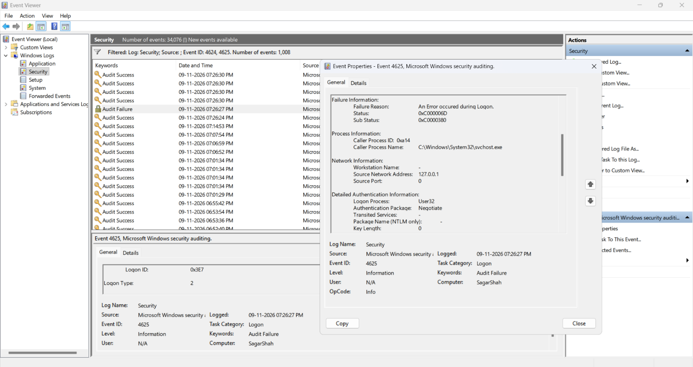
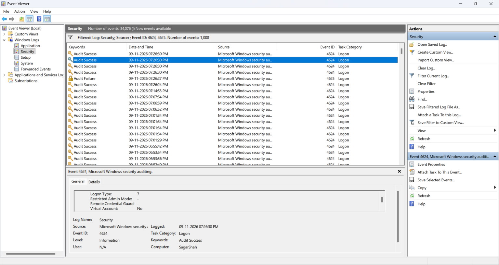

# Cybersecurity Portfolio - Week 3, Day 16
## Topic: Windows Authentication (NTLM vs. Kerberos), Event IDs 4624/4625 & Logon Type Forensics

**Objective:** 
Compare Windows authentication protocols (**Kerberos** vs. **NTLM**) and analyze live Windows Security Event Logs (`eventvwr.msc` $\rightarrow$ `Windows Logs` $\rightarrow$ `Security`) on a local endpoint. Filter and investigate **Event ID `4624` (Successful Logon)** and **Event ID `4625` (Failed Logon)**, correlate **`Logon Type`** codes (`2`, `3`, `5`, `7`, `10`), and decode hexadecimal failure status codes (`0xC000006D` / `0xC0000380`) generated during a live lock-screen authentication test.

### :hammer_and_wrench: Tools & Environment
* **Host OS:** Windows (`Computer: SagarShah`)
* **Log Analysis Utility:** Windows Event Viewer (`eventvwr.msc` — `Security.evtx`)
* **Reference Frameworks:** 13Cubed Windows Event Log & RDP Cheat Sheets, Ultimate Windows Security Encyclopedia, MITRE ATT&CK (`T1078`, `T1110.001`, `T1021.001`, `T1021.002`)

---

### :key: Part 1: Windows Authentication Architecture — NTLM vs. Kerberos

When a user or service authenticates in a Windows environment, credentials are validated without transmitting plaintext passwords across the network using one of two primary protocols:

| Feature | **NTLM (New Technology LAN Manager)** | **Kerberos (Active Directory Default)** |
| :--- | :--- | :--- |
| **Mechanism** | **Cryptographic Challenge-Response:** The target host sends a random 8-byte nonce (*Challenge*); the client encrypts the challenge using the user's NT password hash and returns the *Response*. | **Ticket-Based Symmetric Cryptography:** The client authenticates to a Domain Controller's **Key Distribution Center (KDC)** to obtain a **Ticket Granting Ticket (TGT)**, which is exchanged for specific **Service Tickets (TGS)**. |
| **Typical Environment** | Standalone/non-domain Windows hosts (workgroups), local console logons, or network connections initiated via raw IP address (`\\192.168.1.10`) rather than FQDN. | Enterprise **Active Directory (AD)** domains where clients, servers, and Domain Controllers share centralized identity management. |
| **Authentication Package Field** | Often logged under `NTLM` or wrapped inside **`Negotiate` (SPNEGO)** when falling back from Kerberos on standalone hosts. | Logged as `Kerberos` (generates dedicated Kerberos ticket events: Event IDs `4768` TGT Request and `4769` TGS Request). |
| **Primary Adversary Abuse** | **Pass-the-Hash (`T1550.002`) & NTLM Relay (`T1557.001`):** Attackers extract NT hashes from `lsass.exe` memory and authenticate directly without cracking the underlying plaintext password. | **Kerberoasting (`T1558.003`), AS-REP Roasting (`T1558.004`) & Golden Tickets (`T1558.001`):** Attackers request RC4-encrypted service tickets to crack offline or forge KDC `krbtgt` tickets. |

---

### :clipboard: Part 2: Reference Guide — Event IDs 4624/4625 & Windows Logon Types

#### 1. Core Authentication Event IDs
| Event ID | Audit Category | Description & SOC Triage Value |
| :---: | :--- | :--- |
| **`4624`** | `Audit Success` | **An account was successfully logged on.** Recorded on the target machine where the logon session is created. Must be paired with the `Logon Type` field to distinguish routine background service startups from human or network logons. |
| **`4625`** | `Audit Failure` | **An account failed to log on.** Indicates mistyped credentials, expired accounts, or an active password-spraying / brute-force attack (`MITRE T1110`). Includes `Status` and `Sub Status` hex codes pinpointing why authentication failed. |

#### 2. Essential Windows Logon Types (`4624` & `4625`)
| Logon Type | Official Name | How the Logon Occurs | :rotating_light: SOC Analyst Investigation Context |
| :---: | :--- | :--- | :--- |
| **`2`** | **Interactive** | User physically logs in at the local keyboard and screen (console login or local credential prompt). | Expected on user laptops/workstations; suspicious if observed on a headless server inside a restricted data center. |
| **`3`** | **Network** | Network authentication without an interactive GUI desktop (e.g., accessing SMB shares `\\Server\C$`, RPC, IPC$, or WinRM/PowerShell Remoting). | **Lateral Movement Indicator (`T1021.002`):** High volumes of Type `3` logons across multiple internal hosts indicate SMB lateral movement, PsExec, or network credential scanning. |
| **`5`** | **Service** | The Windows Service Control Manager (`services.exe`) starts a background service configured to run under a specific account (`SYSTEM`, `LocalService`, etc.). | Accounts for the vast majority of baseline `4624` events on Windows; investigate only if a new malicious service was installed (`Event ID 7045` / `4697`). |
| **`7`** | **Unlock** | A user unlocks an already-authenticated interactive session that was previously locked (`Win + L` or screensaver timeout). | Confirms physical console presence (or a remote session resumption) when a user returns to their workstation. |
| **`10`** | **RemoteInteractive** | User connects over the network to a full graphical desktop session via **Remote Desktop Protocol (RDP — TCP Port 3389)** or Terminal Services. | **Critical Initial Access / Lateral Movement Vector (`T1021.001`):** A burst of `4625` (Type `10` or `3`) followed by a `4624` (Type `10`) from an unusual IP indicates a successful RDP brute-force or stolen credential login. |

---

### :mag: Part 3: Live Endpoint Lab — Timeline & Forensic Analysis (`eventvwr.msc`)

To test how Windows records authentication telemetry in real time, I opened `eventvwr.msc` (`Windows Logs` $\rightarrow$ `Security`), applied a filter for Event IDs **`4624, 4625`** (isolating `1,008` authentication events out of `34,076` total security events), locked the workstation (`Win + L`), intentionally entered an incorrect PIN once, and then unlocked the workstation with the valid credential.

#### 1. Event 1 (`07:26:27 PM`) — Failed Authentication (`Event ID 4625`, `Logon Type 2`)
At **`09-11-2026 07:26:27 PM`**, Windows recorded an **`Audit Failure` (`Event ID 4625`)** the exact second the invalid PIN was submitted at the lock screen:
* **Logon Type:** `2` (*Interactive* — local console credential prompt)
* **Caller Process:** `C:\Windows\System32\svchost.exe` (`Caller Process ID: 0xa14`)
* **Source Network Address:** `127.0.0.1` (Localhost loopback)
* **Logon Process / Auth Package:** `User32` / `Negotiate`
* **Hexadecimal Failure Codes:**
  * **`Status: 0xC000006D`** (`STATUS_LOGON_FAILURE` — The attempted logon is invalid due to bad username or authentication information).
  * **`Sub Status: 0xC0000380`** (`STATUS_SMARTCARD_WRONG_PIN` — Indicates an incorrect Windows Hello PIN / Next Generation Credentials [NGC] PIN entry).

*(Screenshot: Inspecting `Event ID 4625` (`Audit Failure`) at `07:26:27 PM` showing `Logon Type: 2`, `Source Network Address: 127.0.0.1`, and failure status codes `0xC000006D` / `0xC0000380`)*

---

#### 2. Event 2 (`07:26:30 PM` — 3 Seconds Later) — Successful Workstation Unlock (`Event ID 4624`, `Logon Type 7`)
Exactly **3 seconds later** at **`09-11-2026 07:26:30 PM`**, entering the valid credential generated an **`Audit Success` (`Event ID 4624`)**:
* **Logon Type:** `7` (*Unlock* — confirming the locked interactive desktop session on `Computer: SagarShah` was unlocked).
* **Forensic Correlation:** Seeing an `Event ID 4625` at `07:26:27 PM` immediately followed by a single `Event ID 4624` (`Logon Type 7`) at `07:26:30 PM` from `127.0.0.1` represents a classic **benign user mistype** at the physical keyboard—whereas hundreds of `4625` events within 3 seconds from an external IP would indicate an automated brute-force attack.

*(Screenshot: Inspecting `Event ID 4624` (`Audit Success`) at `07:26:30 PM` confirming a successful screen unlock with `Logon Type: 7`)*

---

### :bulb: Conclusion
Successfully audited Windows Security Event Logs (`4624` and `4625`) in `eventvwr.msc` and documented the operational differences between NTLM and Kerberos authentication. By generating a controlled failed login (`07:26:27 PM`) followed by a successful screen unlock (`07:26:30 PM`), I demonstrated how SOC analysts combine **Event IDs**, **Logon Types (`2` vs. `7`)**, **Source IPs (`127.0.0.1`)**, and **NTSTATUS hex codes (`0xC000006D` / `0xC0000380`)** to reconstruct user authentication timelines.
