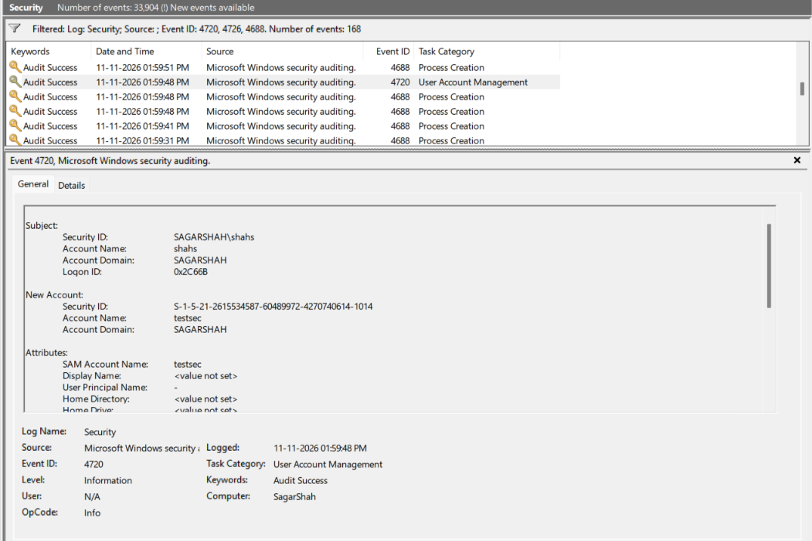
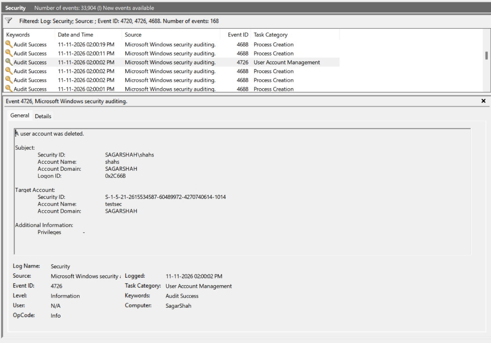
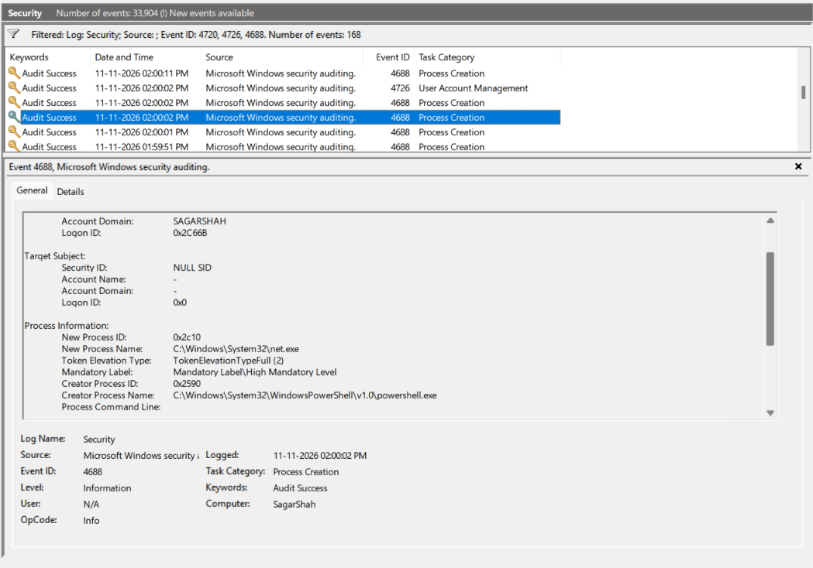

# Cybersecurity Portfolio - Week 3, Day 17
## Topic: Auditing Account Creation, Process Creation & Persistence Event IDs (`4688`, `4720`, `4726`, `4732`, `7045`)

**Objective:** 
Configure Windows Advanced Audit Policy (`auditpol`) prerequisites and investigate high-severity post-exploitation Windows Event IDs. Simulate adversary backdoor account creation and removal (`net user testsec ... /add` and `/delete`) via elevated PowerShell, and correlate **Event ID `4688` (Process Creation)**, **Event ID `4720` (User Account Created)**, and **Event ID `4726` (User Account Deleted)** using the shared **`Logon ID` (`0x2C66B`)** and parent-child process fields.

### :hammer_and_wrench: Tools & Environment
* **Host OS:** Windows (`Computer: SagarShah` / Domain: `SAGARSHAH`)
* **Utilities:** Administrator PowerShell (`auditpol.exe`, `net.exe`), Windows Event Viewer (`eventvwr.msc` $\rightarrow$ `Security.evtx` & `System.evtx`)
* **Reference Frameworks:** Ultimate Windows Security Encyclopedia, 13Cubed Windows Event Log Cheat Sheet, MITRE ATT&CK (`T1136.001`, `T1098`, `T1543.003`, `T1059.001`)

---

### :clipboard: Part 1: Reference Guide — The "Big 5" Post-Exploitation Event IDs

While Event IDs `4624` and `4625` track **Initial Access / Authentication**, SOC analysts rely on the following five Event IDs to detect **Execution, Persistence, and Privilege Escalation** after an attacker lands on a Windows host:

| Event ID | Log Channel | Official Event Name | :rotating_light: SOC Analyst Triage & Attack Scenario |
| :---: | :--- | :--- | :--- |
| **`4688`** | `Security` | **A new process has been created.** | **Execution Tracking (`T1059`):** Records every `.exe` launched on the system, including `New Process Name`, `Creator Process Name` (Parent Process), `Token Elevation Type`, and (when GPO-enabled) `Process Command Line`. *Disabled by default on standalone Windows clients; requires `auditpol` enablement.* |
| **`4720`** | `Security` | **A user account was created.** | **Backdoor Persistence (`T1136.001`):** Fires whenever a local or domain user account is created. Analysts inspect `Subject` (who created it) and `New Account` (the backdoor username and SID). |
| **`4726`** | `Security` | **A user account was deleted.** | **Defense Evasion / Anti-Forensics (`T1070`):** Tracks account removal. Threat actors frequently create a temporary account (`4720`), exfiltrate data, and delete the account (`4726`) minutes later to hide their tracks. |
| **`4732`** | `Security` | **A member was added to a security-enabled local group.** | **Privilege Escalation (`T1098`):** Fires when a user SID is added to a local group. When `net user <name> /add` runs, Windows automatically logs a `4732` adding the user to the standard `Users` group (`S-1-5-32-545`). Critical alerts trigger when a user is added to **`Administrators` (`S-1-5-32-544`)** or **`Remote Desktop Users` (`S-1-5-32-555`)**. |
| **`7045`** | **`System`** *(Note: System Log, not Security!)* | **A service was installed in the system.** | **Service Persistence & Lateral Movement (`T1543.003` / `T1569.002`):** Recorded by the `Service Control Manager` inside the **`System`** log whenever a new background Windows service is registered. Heavily used by ransomware, `PsExec`, and Cobalt Strike beacons to execute payloads as `NT AUTHORITY\SYSTEM`. |

---

### :link: Part 2: How SOC Analysts Connect Actions to Logons (`Logon ID` vs. `Logon Type`)

A common question during log analysis is: ***Why don't Event IDs `4688`, `4720`, or `4726` contain a `Logon Type` field?***

1. **`Logon Type` Only Exists at Session Creation (`4624` / `4625`):** Windows only records the `Logon Type` (`2` Interactive, `3` Network, `10` RDP) once—at the exact moment the user authenticates in Event ID `4624`.
2. **`Logon ID` Is the Golden Forensic Thread:** When `Event ID 4624` creates a login session, Windows assigns that session a unique hexadecimal badge number called a **`Logon ID`** (in this lab, **`0x2C66B`**).
3. **Session Correlation:** Every subsequent action performed during that session—spawning `net.exe` (`4688`), creating `testsec` (`4720`), and deleting `testsec` (`4726`)—is stamped with **`Logon ID: 0x2C66B`** under the `Subject` field. To determine *how* the user who created `testsec` logged in (`Logon Type`), a SOC analyst searches backward for `Event ID 4624` where `Logon ID == 0x2C66B`.

---

### :mag: Part 3: Live Endpoint Lab — Auditing Account Lifecycle & Process Creation

#### Step 1: Enabling Audit Policy Prerequisites (`auditpol`)
Because Windows disables Process Creation auditing by default, absence of an event is not proof that an action never occurred unless auditing is verified first. Using an elevated PowerShell prompt, I enabled auditing for both `Process Creation` and `User Account Management` and executed a controlled account lifecycle test:

```powershell
# 1. Enable Audit Policies for Event IDs 4688, 4720, and 4726
auditpol /set /subcategory:"Process Creation" /success:enable /failure:enable
auditpol /set /subcategory:"User Account Management" /success:enable /failure:enable

# 2. Simulate backdoor account creation and cleanup
net user testsec Password123! /add
net user testsec /delete
```

---

#### Step 2: Event ID `4720` — Detecting Account Creation (`01:59:48 PM`)
At **`11-11-2026 01:59:48 PM`**, Windows logged **`Event ID 4720` (`User Account Management`)**:
* **Subject (Who performed the action):** `SAGARSHAH\shahs` (`Logon ID: 0x2C66B`)
* **New Account Created:** `Account Name: testsec` (`SAGARSHAH`)
* **Assigned Security ID (SID):** `S-1-5-21-2615534587-60489972-4270740614-1014` *(Relative Identifier `RID = 1014`, indicating a user-created local account)*.

*(Screenshot: Event ID 4720 capturing the creation of local user `testsec` by `SAGARSHAH\shahs` under `Logon ID: 0x2C66B`)*


---

#### Step 3: Event ID `4726` — Detecting Account Deletion (`02:00:02 PM`)
Exactly $14$ seconds later at **`11-11-2026 02:00:02 PM`**, executing `net user testsec /delete` generated **`Event ID 4726` (`A user account was deleted`)**:
* **Subject:** `SAGARSHAH\shahs` (`Logon ID: 0x2C66B`)
* **Target Account:** `Account Name: testsec` (`SID: S-1-5-21-2615534587-60489972-4270740614-1014`)

*(Screenshot: Event ID 4726 confirming the deletion of `testsec` 14 seconds after creation)*


---

#### Step 4: Event ID `4688` — Process Creation & Parent-Child Genealogy (`02:00:02 PM`)
Correlating the exact same timestamp (`11-11-2026 02:00:02 PM`) and session (`Logon ID: 0x2C66B`) inside **`Event ID 4688` (`Process Creation`)** revealed the underlying command execution tree:
* **New Process Name:** `C:\Windows\System32\net.exe` (`New Process ID: 0x2c10`)
* **Creator Process Name (Parent Process):** `C:\Windows\System32\WindowsPowerShell\v1.0\powershell.exe` (`Creator Process ID: 0x2590`)
* **Privilege Context:** `TokenElevationTypeFull (2)` and `Mandatory Label\High Mandatory Level` — proving that `powershell.exe` was running with elevated **Administrator** privileges when it spawned `net.exe`.

*(Screenshot: Event ID 4688 showing `powershell.exe` spawning `C:\Windows\System32\net.exe` with `TokenElevationTypeFull (2)` High Mandatory Level privileges)*


---

### :bulb: Conclusion
Successfully configured Windows audit policies (`auditpol`) and captured a complete forensic chain across **Event IDs `4720`, `4726`, and `4688`**. Demonstrated how SOC analysts pivot across events using the **`Logon ID` (`0x2C66B`)**, verify administrator token elevation (`TokenElevationTypeFull`), and trace parent-child execution (`powershell.exe` $\rightarrow$ `net.exe`) directly inside Windows Security logs.