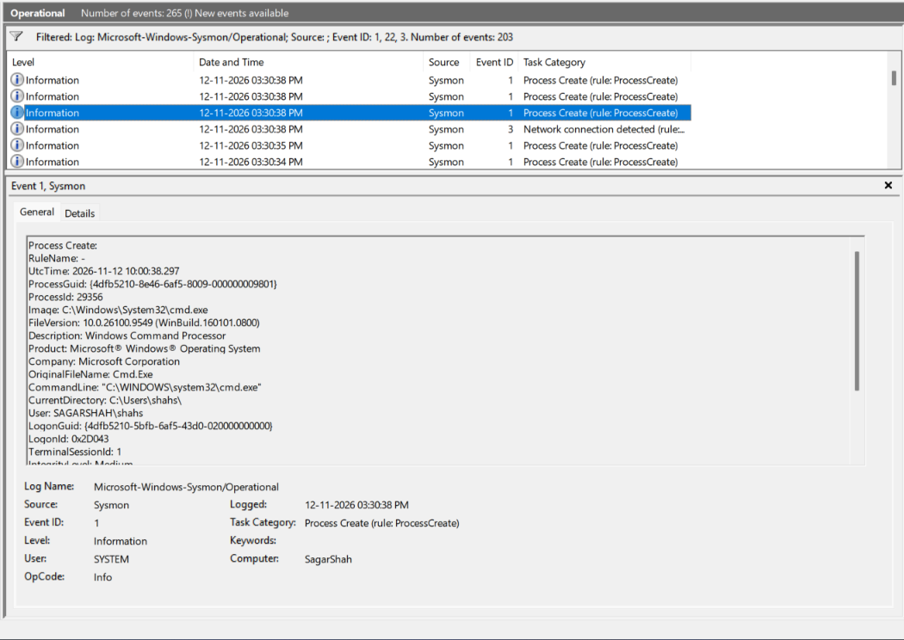
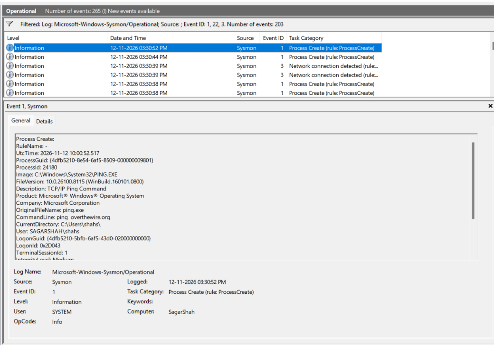
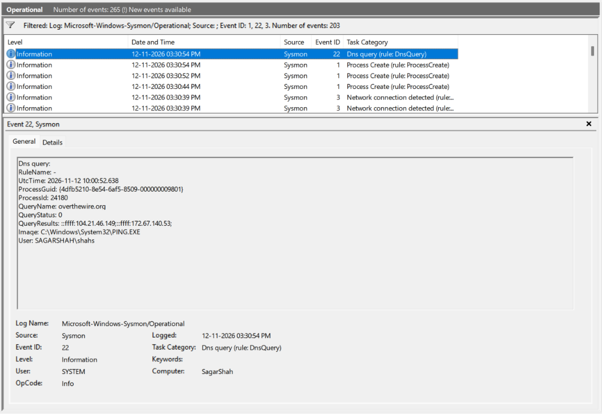
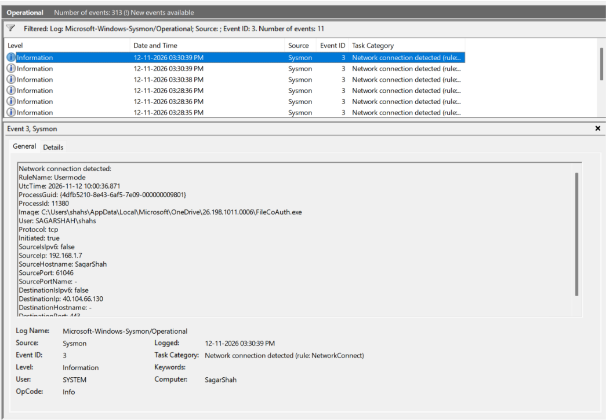

# Cybersecurity Portfolio - Week 3, Day 18
## Topic: Advanced Endpoint Telemetry with Microsoft Sysmon (`Event IDs 1, 3, and 22`)

**Objective:** 
Deploy and configure **Microsoft Sysinternals System Monitor (Sysmon)** using the industry-standard **SwiftOnSecurity** XML configuration (`sysmonconfig-export.xml`). Generate and analyze deep endpoint telemetry in the `Microsoft-Windows-Sysmon/Operational` log channel across **Event ID `1` (Process Creation)**, **Event ID `22` (DNS Query)**, and **Event ID `3` (Network Connection)**, demonstrating how SOC analysts correlate activity using `ProcessGuid` and `OriginalFileName`.

### :hammer_and_wrench: Tools & Environment
* **Host OS:** Windows (`Computer: SagarShah` / User: `SAGARSHAH\shahs`)
* **Telemetry Agent:** Microsoft Sysinternals **Sysmon** (`Sysmon64.exe`)
* **Configuration Baseline:** SwiftOnSecurity (`sysmonconfig-export.xml`)
* **Log Channel:** `Applications and Services Logs` $\rightarrow$ `Microsoft` $\rightarrow$ `Windows` $\rightarrow$ `Sysmon` $\rightarrow$ `Operational`
* **MITRE ATT&CK Mapping:** `T1059.003` (Windows Command Shell), `T1071.004` (Application Layer Protocol: DNS), `T1036` (Masquerading Detection via `OriginalFileName`)

---

### :shield: Part 1: Sysmon vs. Standard Windows Security Logs

While native Windows Security Auditing (`Event ID 4688`) tracks basic process creation, it lacks built-in network connection tracking, DNS query attribution, and cryptographic file hashes. **Sysmon** operates as a persistent system service and device driver that bridges these visibility gaps:

| Telemetry Capability | Native Windows Security Log (`4688`) | Microsoft Sysmon (`Operational` Log) |
| :--- | :--- | :--- |
| **Command-Line & Hashes** | Requires manual Group Policy enablement for command lines; **no file hashes**. | **Event ID `1`** captures full `CommandLine`, `CurrentDirectory`, and cryptographic hashes (`SHA256`, `MD5`, `IMPHASH`). |
| **Anti-Masquerading (`OriginalFileName`)** | Only logs the current filename on disk. | **Event ID `1`** extracts the PE header's `OriginalFileName` (catching attackers who rename `powershell.exe` or `cmd.exe` to `notepad.exe`). |
| **Network Connection Attribution** | Not logged in `4688` (Windows Firewall logs lack full process context). | **Event ID `3`** records exact `SourceIp`, `DestinationIp`, `DestinationPort`, and the specific `Image` (`ProcessGuid`) that initiated the socket. |
| **DNS Resolution Tracking** | Not logged in the Security channel. | **Event ID `22`** attributes every DNS `QueryName` and `QueryResults` directly to the requesting `Image` and `ProcessGuid`. |

---

### :gear: Part 2: Installation & Configuration Baseline

Deploying Sysmon with default settings logs every benign OS operation, causing severe alert fatigue and storage exhaustion. To capture high-signal, low-noise telemetry, I deployed Sysmon with **SwiftOnSecurity's** modular XML configuration (`sysmonconfig-export.xml`), which filters out noisy browser/system operations while targeting high-risk directories (such as `AppData\Local`) and command utilities.

**Installation Command Executed in Elevated PowerShell:**
```powershell
.\Sysmon64.exe -accepteula -i sysmonconfig-export.xml
```

---

### :mag: Part 3: Live Endpoint Telemetry & Forensic Correlation

To test Sysmon's detection and correlation capabilities, I opened `eventvwr.msc`, navigated to `Microsoft-Windows-Sysmon/Operational`, filtered for Event IDs **`1, 22, 3`**, and executed a controlled command-line and network test (`cmd.exe` $\rightarrow$ `ping overthewire.org`).

#### 1. Sysmon Event ID `1` — Command Shell Initialization (`cmd.exe`)
At **`12-11-2026 03:30:38 PM`** (`UtcTime: 2026-11-12 10:00:38.297`), Sysmon captured the creation of the Windows Command Processor:
* **Image:** `C:\Windows\System32\cmd.exe` (`ProcessId: 29356`)
* **ProcessGuid:** `{4dfb5210-8e46-6af5-8009-000000009801}`
* **OriginalFileName:** `Cmd.Exe` (PE header verification confirming the binary was not renamed)
* **CommandLine:** `"C:\WINDOWS\system32\cmd.exe"`
* **CurrentDirectory:** `C:\Users\shahs\`
* **User / Session:** `SAGARSHAH\shahs` (`LogonId: 0x2D043`)

*(Screenshot: Sysmon Event ID 1 capturing `cmd.exe` initialization, PE header metadata, and `CommandLine` arguments)*


---

#### 2. Sysmon Event ID `1` — Child Utility Execution (`ping overthewire.org`)
Fourteen seconds later at **`12-11-2026 03:30:52 PM`** (`UtcTime: 2026-11-12 10:00:52.517`), executing `ping overthewire.org` inside the command prompt generated a second **Event ID `1`**:
* **Image:** `C:\Windows\System32\PING.EXE` (`ProcessId: 24180`)
* **ProcessGuid:** **`{4dfb5210-8e54-6af5-8509-000000009801}`**
* **OriginalFileName:** `ping.exe`
* **CommandLine:** `ping overthewire.org`
* **LogonId:** `0x2D043` (tying this execution to the exact same user logon session as `cmd.exe`)

*(Screenshot: Sysmon Event ID 1 capturing the exact `CommandLine: ping overthewire.org` and assigning `ProcessGuid: {4dfb5210-8e54-6af5-8509-000000009801}`)*


---

#### 3. Sysmon Event ID `22` — DNS Query Correlation via `ProcessGuid`
Immediately following the process creation of `PING.EXE` (`UtcTime: 2026-11-12 10:00:52.638`, logged at **`03:30:54 PM`**), Sysmon recorded **Event ID `22` (`Dns query`)**:
* **ProcessGuid:** **`{4dfb5210-8e54-6af5-8509-000000009801}`** (`ProcessId: 24180`)
* **Image:** `C:\Windows\System32\PING.EXE`
* **QueryName:** `overthewire.org`
* **QueryStatus:** `0` (Success / `NOERROR`)
* **QueryResults:** `::ffff:104.21.46.149;::ffff:172.67.140.53;` (Cloudflare IPv4-mapped IPv6 addresses hosting `overthewire.org`)
* **Forensic Correlation:** Notice how **Event ID `1`** and **Event ID `22`** share the exact same **`ProcessGuid: {4dfb5210-8e54-6af5-8509-000000009801}`** and **`ProcessId: 24180`**. In a real malware investigation, this allows a SOC analyst to prove *which exact binary and command line* requested a malicious Command-and-Control (C2) domain.

*(Screenshot: Sysmon Event ID 22 attributing the `overthewire.org` DNS resolution directly to `PING.EXE` via `ProcessGuid: {4dfb5210-8e54-6af5-8509-000000009801}`)*


---

#### 4. Sysmon Event ID `3` — Outbound Network Connection Triage (`RuleName: Usermode`)
Inspecting **Event ID `3` (`Network connection detected`)** at **`12-11-2026 03:30:39 PM`** demonstrated how the SwiftOnSecurity configuration hunts for suspicious network activity:
* **RuleName:** `Usermode` (SwiftOnSecurity rule that monitors binaries executing out of user-writable directories such as `C:\Users\...\AppData\`, where malware frequently stages payloads, while ignoring noisy standard browser traffic from `Program Files`).
* **Image:** `C:\Users\shahs\AppData\Local\Microsoft\OneDrive\26.198.1011.0006\FileCoAuth.exe` (`ProcessId: 11380`)
* **Protocol / Initiated:** `tcp` / `true`
* **Source:** `192.168.1.7:61046` (`SourceHostname: SagarShah`)
* **Destination:** `40.104.66.130:443` (`DestinationPortName: https`)
* **SOC Triage Verdict:** Although triggered by the `Usermode` (`AppData`) monitoring rule, inspecting the `Image` path and destination IP (`40.104.66.130` — Microsoft Corporation Azure block over HTTPS port `443`) confirms this is benign Microsoft OneDrive Co-Authoring synchronization traffic.

*(Screenshot: Sysmon Event ID 3 capturing an outbound TCP Port 443 connection from `AppData\Local\...\FileCoAuth.exe` to `40.104.66.130`)*


---

### :bulb: Conclusion
Successfully deployed Microsoft Sysmon with the SwiftOnSecurity configuration baseline and performed cross-event forensic correlation across **Event IDs `1`, `22`, and `3`**. Demonstrated how SOC analysts pivot on **`ProcessGuid`** (`{4dfb5210-8e54-6af5-8509-000000009801}`) to link command-line executions (`ping overthewire.org`) directly to DNS resolutions (`104.21.46.149`), and how rule-based filtering (`RuleName: Usermode`) monitors high-risk `AppData` directories for unauthorized outbound C2 connections.