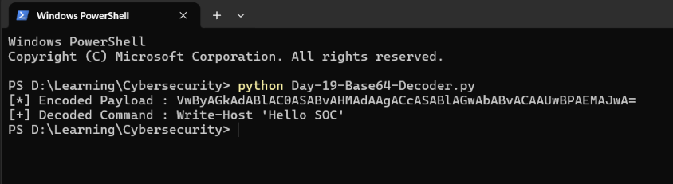
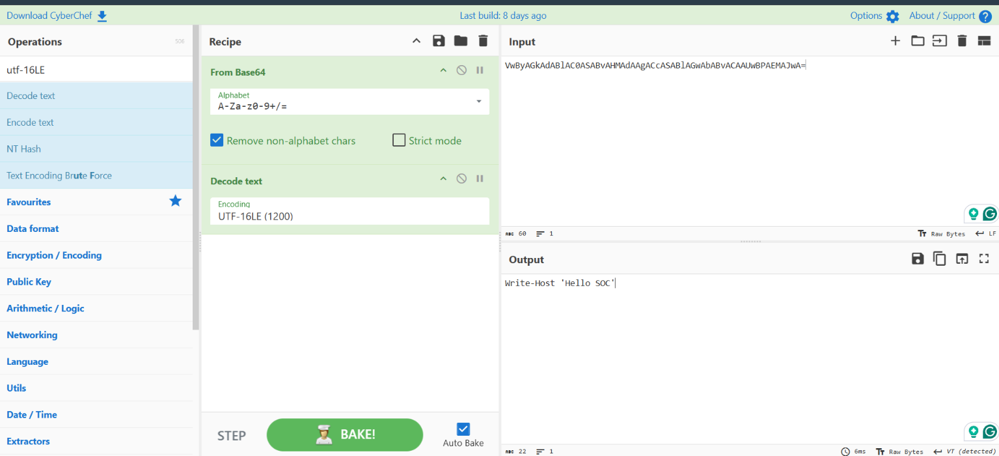

# Cybersecurity Portfolio - Week 3, Day 19

## Topic: Living Off The Land Binaries (LOLBins), Obfuscated PowerShell & Base64 (`UTF-16LE`) Decoding

**Objective:**
Investigate **Living Off The Land Binaries (LOLBins)** using the **LOLBAS Project** framework to understand how adversaries abuse native, Microsoft-signed Windows utilities for defense evasion, payload delivery, and execution. Execute an obfuscated PowerShell command (`-EncodedCommand`), capture the execution telemetry inside **Sysmon Event ID `1`**, and safely de-obfuscate the `UTF-16LE` Base64 payload using both a custom **Python script (`Day-19-Base64-Decoder.py`)** and **GCHQ CyberChef**.

---

### :hammer_and_wrench: Tools & Environment

* **Host OS:** Windows (`Computer: SagarShah` / User: `SAGARSHAH\shahs`)
* **Telemetry & Log Analysis:** Microsoft Sysinternals **Sysmon** (`Microsoft-Windows-Sysmon/Operational` — Event ID `1`)
* **De-obfuscation Tools:** Python 3 (`base64` module), GCHQ **CyberChef** (`From Base64` $\rightarrow$ `Decode text: UTF-16LE`)
* **Reference Frameworks:** [LOLBAS Project](https://lolbas-project.github.io/), MITRE ATT&CK (`T1059.001`, `T1027`, `T1140`, `T1218.005`, `T1218.011`)

---

### :shield: Part 1: Living Off The Land Binaries (LOLBins) — SOC Detection Guide

In modern endpoint attacks, dropping a custom, unsigned `.exe` onto disk immediately triggers antivirus signatures or Digital Signature verification alerts. To bypass application allowlisting and blend in with normal administrative traffic, attackers abuse **LOLBins**—legitimate binaries pre-installed in `C:\Windows\System32\` and cryptographically signed by `Microsoft Corporation`.

#### The "Big 3" Core Lab LOLBins + High-Frequency Enterprise LOLBins

| Windows Binary (LOLBin) | MITRE ATT&CK ID | Legitimate Windows Purpose | Adversary Abuse ("Living Off The Land") | High-Signal **Sysmon Event ID `1` (`CommandLine`)** Indicators |
| :--- | :---: | :--- | :--- | :--- |
| **`powershell.exe`** | `T1059.001` | Windows task automation and configuration shell. | Executes fileless payloads in memory and hides commands via Base64 encoding. | `-EncodedCommand`, `-enc`, `-e`, `-nop`, `-w hidden`, `IEX`, `Invoke-Expression`, `DownloadString` |
| **`certutil.exe`** | `T1140` / `T1105` | Manages Windows cryptographic certificates and CAs. | Used as a stealthy file downloader (like `wget`/`curl`) or to decode Base64/Hex malware payloads on disk. | `-urlcache -split -f http...`, `-decode`, `-decodehex` |
| **`mshta.exe`** | `T1218.005` | Executes Microsoft HTML Applications (`.hta`). | Runs malicious VBScript/JScript directly from remote URLs or spawned as a child of Office macros (`winword.exe`). | `mshta.exe http...`, `javascript:`, `vbscript:` |
| **`rundll32.exe`** | `T1218.011` | Executes functions exported inside `.dll` libraries. | Loads malicious DLLs dropped in `AppData`/`Temp` or executes inline JavaScript/Comsvcs memory dumps. | `rundll32.exe comsvcs.dll, MiniDump` (LSASS dumping), or loading unsigned DLLs from `C:\Users\Public\` |
| **`regsvr32.exe`** | `T1218.010` | Registers and unregisters OLE controls (`.dll` / `.ocx`). | "**Squiblydoo**" attack: fetches and executes remote `.sct` COM scriptlets over HTTP without touching disk. | `/s /n /u /i:http... scrobj.dll` |
| **`bitsadmin.exe`** | `T1197` | Background Intelligent Transfer Service CLI tool. | Creates persistent background download jobs that survive reboots and bypass basic firewall rules. | `/transfer`, `/create`, `/addfile http...` |

---

### :key: Part 2: Encoding vs. Encryption & Why PowerShell Uses `UTF-16LE`

1. **Encoding $\neq$ Encryption (`MITRE T1027`):**
   * **Encryption** transforms data using a secret cryptographic key so that unauthorized parties cannot read it.
   * **Encoding (Base64)** merely translates binary or text data into a safe 64-character ASCII alphabet (`A-Z`, `a-z`, `0-9`, `+`, `/`, `=`) so special characters (quotes, spaces, pipes) do not break command-line parsers. Anyone can reverse Base64 immediately without a key.
   * **SOC Golden Rule:** Analysts **never** execute an unknown encoded command to see what it does; instead, they extract the Base64 string from Sysmon logs and decode it statically as plain text to inspect the attacker's intent.

2. **Recognizing Windows `UTF-16LE` Base64 Signatures:**
   * Unlike Linux (`UTF-8`, which uses $1\text{ byte}$ per ASCII character), Windows PowerShell represents strings in **`UTF-16LE` (16-bit Unicode Little-Endian)**, inserting a null byte (`0x00`) after every standard ASCII character:
     $$\text{"W"} \rightarrow \texttt{0x57 0x00}, \quad \text{"r"} \rightarrow \texttt{0x72 0x00}, \quad \text{"i"} \rightarrow \texttt{0x69 0x00}$$
   * When encoded into Base64, these repeating `0x00` null bytes produce a distinct pattern of alternating uppercase **`A`** characters (`VwByAGkAdABl...`). Spotting this pattern in a log immediately tells a SOC analyst the payload is `UTF-16LE` Windows text.

---

### :mag: Part 3: Live Endpoint Detection — Catching `-EncodedCommand` in Sysmon Event ID `1`

To simulate an obfuscated command execution, I ran the following harmless encoded PowerShell command on the local endpoint:

```powershell
powershell.exe -EncodedCommand VwByAGkAdABlAC0ASABvAHMAdAAgACcASABlAGwAbABvACAAUwBPAEMAJwA=
```

While the terminal output simply printed `Hello SOC`, inspecting **Event Viewer** (`Applications and Services Logs` $\rightarrow$ `Microsoft` $\rightarrow$ `Windows` $\rightarrow$ `Sysmon` $\rightarrow$ `Operational`) confirmed that **Sysmon Event ID `1` (`Process Create`)** captured the full obfuscated command line and binary metadata at **`12-11-2026 07:23:40 PM`**:

* **ProcessGuid:** `{4dfb5210-c4e4-6af5-5f06-000000009901}` (`ProcessId: 6376`)
* **Image:** `C:\Windows\System32\WindowsPowerShell\v1.0\powershell.exe`
* **OriginalFileName:** `PowerShell.EXE` (Verified Microsoft-signed binary)
* **CommandLine:** `"C:\Windows\System32\WindowsPowerShell\v1.0\powershell.exe" -EncodedCommand VwByAGkAdABlAC0ASABvAHMAdAAgACcASABlAGwAbABvACAAUwBPAEMAJwA=`
* **User / Session:** `SAGARSHAH\shahs` (`LogonId: 0x32F7A`, `IntegrityLevel: Medium`)
* **Cryptographic Hashes:** `SHA256=60C9B29B43624DD8AF6B6A7B26147753BE6AEEF65098B9A503CC50850AFE410F`
* **Parent Process:** `C:\Windows\System32\WindowsPowerShell\v1.0\powershell.exe` (`ParentProcessId: 404`)


*(Screenshot: Side-by-side view of PowerShell executing the `-EncodedCommand` payload and Sysmon Event ID 1 capturing the exact `CommandLine` and `SHA256` hash)*

---

### :snake: Part 4: Static De-obfuscation — Python Automation & CyberChef

After extracting the suspicious Base64 string from Sysmon Event ID `1`, I decoded the payload statically using two standard SOC methods:

#### Method 1: Automated Python Decoder (`Day-19-Base64-Decoder.py`)

```python
# Day 19: SOC PowerShell Base64 (UTF-16LE) Decoder
import base64

encoded_cmd = "VwByAGkAdABlAC0ASABvAHMAdAAgACcASABlAGwAbABvACAAUwBPAEMAJwA="
print(f"[*] Encoded Payload : {encoded_cmd}")

raw_bytes = base64.b64decode(encoded_cmd)
decoded_text = raw_bytes.decode("utf-16le")

print(f"[+] Decoded Command : {decoded_text}")
```

**Execution Output:**
```text
PS D:\Learning\Cybersecurity> python Day-19-Base64-Decoder.py
[*] Encoded Payload : VwByAGkAdABlAC0ASABvAHMAdAAgACcASABlAGwAbABvACAAUwBPAEMAJwA=
[+] Decoded Command : Write-Host 'Hello SOC'
```


*(Screenshot: Running `Day-19-Base64-Decoder.py` to decode the Base64 string and strip `UTF-16LE` null bytes)*

#### Method 2: GCHQ CyberChef Verification (`From Base64` $\rightarrow$ `Decode text: UTF-16LE`)

To cross-verify the output using a browser-based SOC swiss-army knife, I built a two-step **CyberChef** recipe:
1. **`From Base64`** (Standard alphabet `A-Za-z0-9+/=`)
2. **`Decode text`** (Encoding set to **`UTF-16LE (1200)`**)


*(Screenshot: Decoding the PowerShell payload in CyberChef using `From Base64` followed by `Decode text: UTF-16LE (1200)` to reveal `Write-Host 'Hello SOC'`)*

---

### :bulb: Conclusion

Successfully investigated **Living Off The Land Binaries (LOLBins)**, triggered and captured an obfuscated `powershell.exe -EncodedCommand` execution in **Sysmon Event ID `1`**, and safely de-obfuscated the `UTF-16LE` Base64 string using both Python (`base64.b64decode().decode("utf-16le")`) and CyberChef.