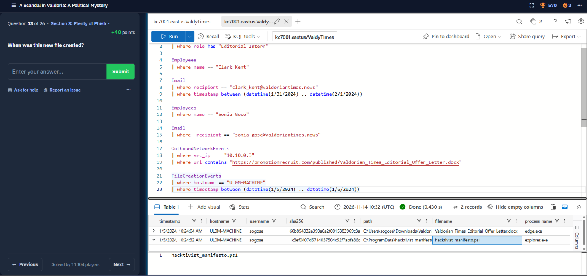
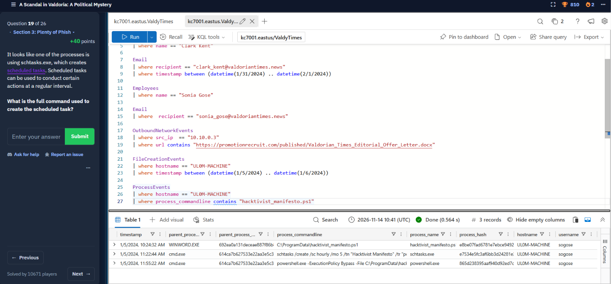

# Cybersecurity Portfolio - Week 3, Day 21

## Topic: Email Authentication Forensics (SPF, DKIM, DMARC) & KC7 Cyber "A Scandal in Valdoria" Investigation

**Objective:**
Analyze email authentication protocols (**SPF, DKIM, and DMARC**) and raw `Authentication-Results` headers to understand how SOC analysts detect spoofing, lookalike domains, and freemail phishing lures. Apply these concepts in **KC7 Cyber (`A Scandal in Valdoria`)** using KQL to trace a targeted spear-phishing campaign against *The Valdorian Times* from initial email delivery to malicious Word macro execution, scheduled task persistence (`schtasks.exe`), RDP reverse tunneling (`plink.exe`), and post-exploitation reconnaissance.

### :hammer_and_wrench: Tools & Environment

* **SIEM / Log Analytics Platform:** KC7 Cyber (`kc7001.eastus.ValdyTimes` — Azure Data Explorer / KQL)
* **Log Tables Audited:** `Employees`, `Email`, `OutboundNetworkEvents`, `FileCreationEvents`, `ProcessEvents`
* **Email Security Protocols:** SPF (`RFC 7208`), DKIM (`RFC 6376`), DMARC (`RFC 7489`)
* **MITRE ATT&CK Mapping:** `T1566.002` (Spearphishing Link), `T1204.002` (Malicious File), `T1059.001` (PowerShell), `T1053.005` (Scheduled Task), `T1572` (Protocol Tunneling via `plink.exe`), `T1033` (System Owner/User Discovery)

---

### :shield: Part 1: Email Header Forensics — How SPF, DKIM, and DMARC Prevent Spoofing

Because the base **Simple Mail Transfer Protocol (SMTP)** lacks built-in sender verification, anyone can forge the visible `From:` header of an email unless three complementary DNS-based authentication controls are enforced:

| Protocol | Full Name | Technical Verification Mechanism | What a Failure Indicates |
| :--- | :--- | :--- | :--- |
| **SPF** | **Sender Policy Framework** | Publishes a DNS `TXT` record listing all IP addresses/subnets authorized to send mail on behalf of a domain. The receiving server checks the **隐藏 `Return-Path` (Envelope From)** and connecting SMTP server IP against this list. | `spf=fail` or `spf=softfail`: The sending server IP is **not** authorized to send email for that domain. |
| **DKIM** | **DomainKeys Identified Mail** | The sending mail server signs the email headers and body hash using a private cryptographic key (`DKIM-Signature`). The receiving server fetches the public key from the domain's DNS record to verify integrity. | `dkim=fail`: Either the sender lacks the domain's private key or the message content was altered in transit. |
| **DMARC** | **Domain-based Message Authentication, Reporting & Conformance** | Enforces **Identifier Alignment**: verifies that the visible **`Header From:`** domain seen by the human recipient matches the domain validated by **SPF** and/or **DKIM**, and instructs the receiver how to handle failures (`p=none`, `p=quarantine`, or `p=reject`). | `dmarc=fail`: The visible `From:` address does not align with verified SPF/DKIM domains (direct domain spoofing). |

#### Analyzing a Raw `Authentication-Results` Email Header

When triaging a reported phishing `.eml` file, SOC analysts inspect the `Authentication-Results` header stamped by the receiving mail gateway:

```text
Authentication-Results: mx.valdoriantimes.news;
    spf=softfail (sender IP 198.51.100.42 is not designated as permitted sender for valdoriantimes.news) smtp.mailfrom=valdoriantimes.news;
    dkim=none (message not signed);
    dmarc=fail action=quarantine header.from=valdoriantimes.news
```

> **Why Phishing Still Bypasses SPF/DKIM/DMARC (`Verdict: CLEAN`):**
> Passing SPF, DKIM, and DMARC only proves that the sender controls the domain they are sending from—**not** that the email is safe. Threat actors routinely bypass email authentication controls using three techniques:
> 1. **Freemail Impersonation:** Sending from a legitimate `@gmail.com` or `@hotmail.com` address (such as `newspaper_jobs@gmail.com` or `valdorias_best_recruiter@gmail.com`). Because Google's servers legitimately send the email for `gmail.com`, SPF, DKIM, and DMARC all pass (`Verdict: CLEAN`).
> 2. **Lookalike / Typosquatted Domains:** Registering deceptive domains (e.g., `promotionrecruit.com` or `valdoria-times.com`) and configuring valid SPF/DKIM records on the attacker-owned domain.
> 3. **Compromised Legitimate Accounts (BEC):** Sending phishing links from an already-breached partner or employee mailbox.

---

### :mag: Part 2: KC7 Cyber Investigation — *A Scandal in Valdoria* Kill Chain

All four investigation screenshots below trace a single, continuous intrusion against **Sonia Gose** (`sonia_gose@valdoriantimes.news`), an employee at *The Valdorian Times* operating on workstation **`UL0M-MACHINE`** (`sogose`, IP `10.10.0.3`).

#### Stage 1: Spear-Phishing Delivery via Recruitment Lure (`KC7Valdoria1.jpg`)

By querying the `Employees` and `Email` tables for **Sonia Gose**, I identified the initial spear-phishing email that bypassed the mail gateway (`verdict: CLEAN`):

```kusto
Employees
| where name == "Sonia Gose"

Email
| where recipient == "sonia_gose@valdoriantimes.news"
```

* **Timestamp:** **`2024-01-05 09:42:05 AM`**
* **Sender / Reply-To:** `newspaper_jobs@gmail.com` (impersonating *"Mike Smith, WeHireJournalists"*; related campaign activity also utilized `valdorias_best_recruiter@gmail.com`)
* **Recipient:** `sonia_gose@valdoriantimes.news`
* **Subject:** `[EXTERNAL] FW: Invitation to Apply: Lead Political Correspondent`
* **Gateway Verdict:** `CLEAN` (Passed authentication checks because the attacker used a valid `@gmail.com` account rather than spoofing `@valdoriantimes.news` directly)
* **Embedded Weaponized Link:** `https://promotionrecruit.com/published/Valdorian_Times_Editorial_Offer_Letter.docx`


*(Screenshot: Identifying the recruitment spear-phishing email from `newspaper_jobs@gmail.com` to `sonia_gose@valdoriantimes.news` delivering the malicious `.docx` link)*

---

#### Stage 2: Malicious Document Download & PowerShell Drop (`KC7Valdoria2.png`)

Pivoting to `OutboundNetworkEvents` (for Sonia's IP `10.10.0.3`) and `FileCreationEvents` on host **`UL0M-MACHINE`** revealed that Sonia clicked the recruitment link $42\text{ minutes}$ after receiving the email:

```kusto
OutboundNetworkEvents
| where src_ip == "10.10.0.3"
| where url contains "https://promotionrecruit.com/published/Valdorian_Times_Editorial_Offer_Letter.docx"

FileCreationEvents
| where hostname == "UL0M-MACHINE"
| where timestamp between (datetime(1/5/2024) .. datetime(1/6/2024))
```

* **Lure Download (`10:24:04 AM`):** `edge.exe` saved `C:\Users\sogose\Downloads\Valdorian_Times_Editorial_Offer_Letter.docx` (`SHA256: 60b854332e393a6a2f0015383969c3a...`).
* **Second-Stage Script Drop (`10:24:32 AM` — $28\text{ seconds}$ later):** Opening the document dropped a malicious PowerShell script into `C:\ProgramData\`:
  * **File Path:** `C:\ProgramData\hacktivist_manifesto.ps1`
  * **SHA-256 Hash:** `1c3ef0407d5714037504c52f7abfa86c...`


*(Screenshot: Correlating the download of `Valdorian_Times_Editorial_Offer_Letter.docx` at `10:24:04 AM` with the creation of `C:\ProgramData\hacktivist_manifesto.ps1` 28 seconds later on `UL0M-MACHINE`)*

---

#### Stage 3: Parent-Child Macro Execution & Scheduled Task Persistence (`KC7Valdoria3.png`)

Querying `ProcessEvents` on `UL0M-MACHINE` for references to `hacktivist_manifesto.ps1` exposed classic parent-child and LOLBin persistence techniques directly matching our Week 3 endpoint defense lessons:

```kusto
ProcessEvents
| where hostname == "UL0M-MACHINE"
| where process_commandline contains "hacktivist_manifesto.ps1"
```

1. **Malicious Parent-Child Execution (`1/5/2024, 10:24:32 AM`):**
   * **Parent Process:** `WINWORD.EXE` (Microsoft Word)
   * **Command Line:** `C:\ProgramData\hacktivist_manifesto.ps1`
   * **SOC Detection Note:** Just as studied on Day 15, `WINWORD.EXE` spawning a script or command shell is a high-confidence indicator of malicious macro execution.
2. **Scheduled Task Persistence via `schtasks.exe` (`1/5/2024, 11:22:44 AM`):**
   * **Parent Process / Process:** `cmd.exe` $\rightarrow$ `schtasks.exe`
   * **Command Line:** `schtasks /create /sc hourly /mo 5 /tn "Hacktivist Manifesto" /tr "powershell.exe -ExecutionPolicy Bypass -File C:\ProgramData\hacktivist_manifesto.ps1..."`
3. **PowerShell Bypass Execution (`1/5/2024, 11:55:22 AM`):**
   * **Command Line:** `powershell.exe -ExecutionPolicy Bypass -File C:\ProgramData\hacktivist_manifesto.ps1...`


*(Screenshot: Catching `WINWORD.EXE` executing `hacktivist_manifesto.ps1` and `schtasks.exe` establishing hourly persistence on `UL0M-MACHINE`)*

---

#### Stage 4: Reverse RDP Tunneling (`plink.exe`) & Post-Exploitation Discovery (`KC7Valdoria4.jpg`)

The following morning (`2024-01-06`), inspecting `ProcessEvents` for `cmd.exe` activity on `UL0M-MACHINE` revealed how the attackers bypassed firewall restrictions to gain interactive Remote Desktop access and enumerate the host:

```kusto
ProcessEvents
| where hostname == "UL0M-MACHINE"
| where process_name contains "cmd"
```

* **`1/6/2024, 02:39:35 AM` — SSH Reverse Tunnel for RDP (`MITRE T1572`):**
  * **Command Line:** `plink.exe -R 3389:localhost:3389 -ssh ...`
  * **Forensic Significance:** The attacker abused PuTTY Link (`plink.exe`) to forward local **Port `3389` (RDP)** out over an encrypted SSH tunnel, enabling interactive Remote Desktop access (which generates **Event ID `4624`, Logon Type `10`** from Day 16!).
* **Hands-on-Keyboard Discovery Commands (`07:30:44 AM` – `08:08:17 AM`):**
  * **`07:30:44 AM`:** `whoami` (Verified active user context: `sogose`)
  * **`07:50:51 AM`:** `ipconfig` (Enumerated local IP address and subnet mask)
  * **`08:08:17 AM`:** `arp -a` (Enumerated adjacent LAN hosts via the ARP cache for lateral movement)


*(Screenshot: Tracing the attacker's `plink.exe -R 3389:localhost:3389` reverse RDP tunnel followed by `whoami`, `ipconfig`, and `arp -a` discovery commands)*

---

### :bulb: Conclusion

Successfully mastered email authentication forensics (**SPF, DKIM, and DMARC**) and reconstructed a multi-stage spear-phishing intrusion in **KC7 Cyber (`A Scandal in Valdoria`)**. This capstone investigation tied together every core concept from Week 1 to Week 3: email header analysis, parent-child process trees (`WINWORD.EXE` $\rightarrow$ `.ps1`), LOLBin persistence (`schtasks.exe` and `powershell.exe -ExecutionPolicy Bypass`), RDP port forwarding (`3389`), and network discovery (`ipconfig` / `arp -a`).