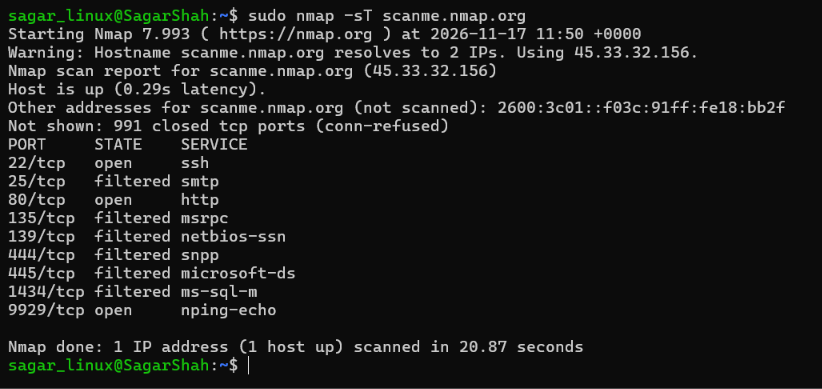
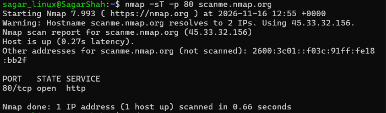
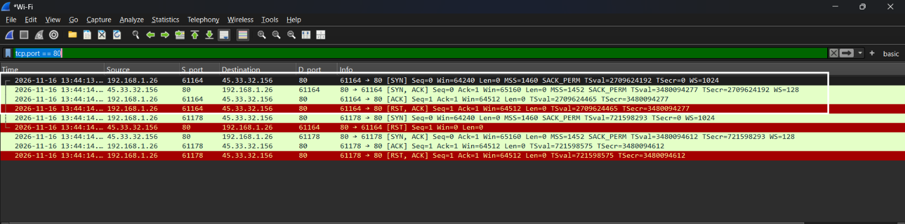
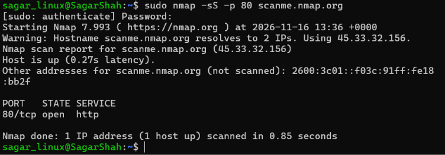
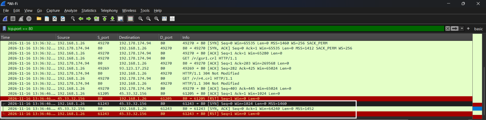

# Cybersecurity Portfolio - Week 4, Day 22

## Topic: Nmap Host Discovery & Port Scanning Basics (`-sT` vs `-sS`)

**Objective:**
Master host discovery and port scanning methodologies using **Nmap (Network Mapper)** within a WSL Ubuntu environment. Differentiate between TCP Connect scans (`-sT`) and SYN Stealth scans (`-sS`) by capturing and analyzing raw TCP handshake packets in **Wireshark**.

---

### :hammer_and_wrench: Tools & Environment

* **Host OS / Environment:** Windows 11 running Windows Subsystem for Linux (**WSL Ubuntu** — `sagar_linux@SagarShah`)
* **Scanning Tool:** **Nmap** (`v7.993`)
* **Packet Capture & Analysis:** **Wireshark** (Display Filter: `tcp.port == 80`)
* **Authorized Target:** `scanme.nmap.org` (`45.33.32.156`)
* **MITRE ATT&CK Mapping:** `T1046` (Network Service Discovery), `T1595.001` (Active Scanning: Scanning IP Blocks)

---

### :shield: Part 1: Host Discovery, Port States & Scan Mechanics

Before interrogating specific services on a target, a cybersecurity practitioner must determine whether the host is reachable on the network and identify which virtual ports ($1\text{--}65535$) are accepting connections.

#### 1. Host Discovery & Nmap Scan Types

| Scan Flag | Scan Name | Technical Mechanism | Operational Trade-offs (Speed, Privileges & Stealth) |
| :--- | :--- | :--- | :--- |
| **`-sn`** | **Ping Scan (Host Discovery)** | Checks if a target host is "alive" without scanning ports. Sends ICMP echo requests and TCP probes (`SYN` to `443`, `ACK` to `80`). | Fast and lightweight; used to map active hosts on a subnet before running port scans. |
| **`-sT`** | **TCP Connect Scan** | Uses the operating system's native `connect()` system call to complete a full 3-way handshake (`SYN` $\rightarrow$ `SYN, ACK` $\rightarrow$ `ACK`), then tears it down with `RST, ACK`. | Does **not** require `sudo`/root privileges, but is noisy because full connections are recorded in target application logs. |
| **`-sS`** | **SYN Stealth Scan ("Half-Open")** | Crafts raw packets to send a `SYN`. Upon receiving `SYN, ACK`, Nmap immediately sends an `RST` instead of completing the handshake with an `ACK`. | Faster and stealthier at the application layer (avoids web/app connection logs), but requires **root/administrator (`sudo`)** privileges. |

#### 2. Understanding Nmap Port States

* **`open`:** An application on the target host is actively listening on the port and responded with a `SYN, ACK` packet.
* **`closed`:** The host is reachable, but no application is listening on the port; the target kernel replies with a TCP `RST` (`conn-refused`).
* **`filtered`:** A firewall, router ACL, or packet filter is silently dropping the probe packets (`no-response`) or returning ICMP unreachable messages, preventing Nmap from determining whether the port is open or closed.

---

### :mag: Part 2: Hands-On Nmap Execution & Terminal Evidence

#### 1. Host Discovery Ping Scan (`-sn`)

To verify that `scanme.nmap.org` was online without triggering a port scan, I executed `-sn`:

```bash
sagar_linux@SagarShah:~$ nmap -sn scanme.nmap.org
```

**Observed Evidence:**

```text
Starting Nmap 7.993 ( https://nmap.org ) at 2026-11-16 12:39 +0000
Warning: Hostname scanme.nmap.org resolves to 2 IPs. Using 45.33.32.156.
Nmap scan report for scanme.nmap.org (45.33.32.156)
Host is up (0.27s latency).
Other addresses for scanme.nmap.org (not scanned): 2600:3c01::f03c:91ff:fe18:bb2f
Nmap done: 1 IP address (1 host up) scanned in 0.63 seconds
```

* **Finding:** DNS resolved `scanme.nmap.org` to IPv4 address `45.33.32.156` (and IPv6 `2600:3c01::f03c:91ff:fe18:bb2f`), confirming the host is active with $0.27\text{s}$ round-trip latency.

---

#### 2. Comprehensive Default Port Scan (`-sT` Top $1,000$ Ports)

When `-p` is omitted, Nmap scans the top $1,000$ most common TCP ports registered in `nmap-services`:

```bash
sagar_linux@SagarShah:~$ sudo nmap -sT scanme.nmap.org
```

**Observed Evidence:**

```text
Starting Nmap 7.993 ( https://nmap.org ) at 2026-11-16 12:54 +0000
Warning: Hostname scanme.nmap.org resolves to 2 IPs. Using 45.33.32.156.
Nmap scan report for scanme.nmap.org (45.33.32.156)
Host is up (0.28s latency).
Other addresses for scanme.nmap.org (not scanned): 2600:3c01::f03c:91ff:fe18:bb2f
rDNS record for 45.33.32.156: 156.32.33.45.in-addr.arpa
Not shown: 991 closed tcp ports (conn-refused)
PORT     STATE    SERVICE
22/tcp   open     ssh
25/tcp   filtered smtp
80/tcp   open     http
135/tcp  filtered msrpc
139/tcp  filtered netbios-ssn
444/tcp  filtered snpp
445/tcp  filtered microsoft-ds
1434/tcp filtered ms-sql-m
9929/tcp open     nping-echo

Nmap done: 1 IP address (1 host up) scanned in 8.86 seconds
```


*(Screenshot: Running `sudo nmap -sT scanme.nmap.org` in WSL Ubuntu to enumerate open, closed, and filtered ports across the top 1,000 TCP ports)*

* **Findings:**
  * **$3$ Open Ports:** `22/tcp` (`ssh`), `80/tcp` (`http`), and `9929/tcp` (`nping-echo`).
  * **$6$ Filtered Ports:** `25/tcp` (`smtp`), `135/tcp` (`msrpc`), `139/tcp` (`netbios-ssn`), `444/tcp` (`snpp`), `445/tcp` (`microsoft-ds`), and `1434/tcp` (`ms-sql-m`)—blocked by an upstream firewall.
  * **$991$ Closed Ports:** Actively rejected connections with TCP `RST` packets (`conn-refused`).

---

### :computer: Part 3: Wireshark Network Traffic Analysis (`-sT` vs `-sS`)

By capturing live traffic in **Wireshark** with the display filter `tcp.port == 80` during targeted single-port scans against `scanme.nmap.org` (`45.33.32.156`), I verified the exact packet-level differences between `-sT` and `-sS`.

#### 1. TCP Connect Scan (`-sT`) on Port `80`

```bash
sagar_linux@SagarShah:~$ nmap -sT -p 80 scanme.nmap.org
```


*(Screenshot: Executing an unprivileged TCP Connect scan (`-sT`) against port 80 in WSL)*


*(Screenshot: Wireshark capture filtered on `tcp.port == 80` showing the 4-packet `-sT` sequence: `[SYN]` $\rightarrow$ `[SYN, ACK]` $\rightarrow$ `[ACK]` $\rightarrow$ `[RST, ACK]`)*

* **Observed Packet Flow (Source Port `61164` $\leftrightarrow$ Destination Port `80`):**
  1. `192.168.1.26` $\rightarrow$ `45.33.32.156`: **`[SYN]`** (`Seq=0`) — Client initiates connection.
  2. `45.33.32.156` $\rightarrow$ `192.168.1.26`: **`[SYN, ACK]`** (`Seq=0, Ack=1`) — Server confirms Port `80` is open.
  3. `192.168.1.26` $\rightarrow$ `45.33.32.156`: **`[ACK]`** (`Seq=1, Ack=1`) — OS completes the full 3-way handshake.
  4. `192.168.1.26` $\rightarrow$ `45.33.32.156`: **`[RST, ACK]`** (`Seq=1, Ack=1`) — Nmap immediately tears down the established session.
* **Technical Insight:** Because the third packet (`[ACK]`) completes the handshake, the OS kernel hands the socket to the listening web server (Apache/Nginx), which logs the connection IP in its application logs.

---

#### 2. SYN Stealth Scan (`-sS`) on Port `80`

```bash
sagar_linux@SagarShah:~$ sudo nmap -sS -p 80 scanme.nmap.org
```


*(Screenshot: Executing a root-privileged SYN Stealth scan (`-sS`) against port 80 in WSL)*


*(Screenshot: Wireshark capture filtered on `tcp.port == 80` showing the 3-packet half-open `-sS` sequence: `[SYN]` $\rightarrow$ `[SYN, ACK]` $\rightarrow$ `[RST]`)*

* **Observed Packet Flow (Source Port `61243` $\leftrightarrow$ Destination Port `80`):**
  1. `192.168.1.26` $\rightarrow$ `45.33.32.156`: **`[SYN]`** (`Seq=0, Win=1024`) — Nmap sends a raw `SYN` probe.
  2. `45.33.32.156` $\rightarrow$ `192.168.1.26`: **`[SYN, ACK]`** (`Seq=0, Ack=1`) — Server indicates Port `80` is open.
  3. `192.168.1.26` $\rightarrow$ `45.33.32.156`: **`[RST]`** (`Seq=1, Win=0`) — Instead of sending `[ACK]`, the host immediately aborts the connection with a Reset packet.
* **Technical Insight:** Skipping the final `[ACK]` prevents the TCP connection from ever reaching the `ESTABLISHED` state. This is faster ($3$ packets instead of $4$) and prevents standard application-layer loggers from recording the scan, though network-layer inspection (IDS/IPS or packet captures) still sees the `[SYN]` and `[RST]` exchange.

---

### :bulb: Conclusion & Key Takeaway

Successfully performed host discovery (`-sn`), top-1,000 port enumeration (`-sT`), and targeted port scanning (`-sT` vs `-sS`) against `scanme.nmap.org`, validating the underlying TCP state transitions in **Wireshark**.

**Key Cybersecurity Takeaway:**
Understanding the packet-level difference between `-sT` (full 3-way handshake) and `-sS` (half-open SYN scan) is essential across cybersecurity domains. From an offensive/reconnaissance perspective, `-sS` provides faster enumeration with a smaller footprint in application logs, provided root privileges (`sudo`) are available. From a network security perspective, because half-open scans bypass application logs, visibility requires network-level monitoring (such as firewall logs, NetFlow, or IDS rules) to detect abnormal spikes in `SYN` and `RST` packets.