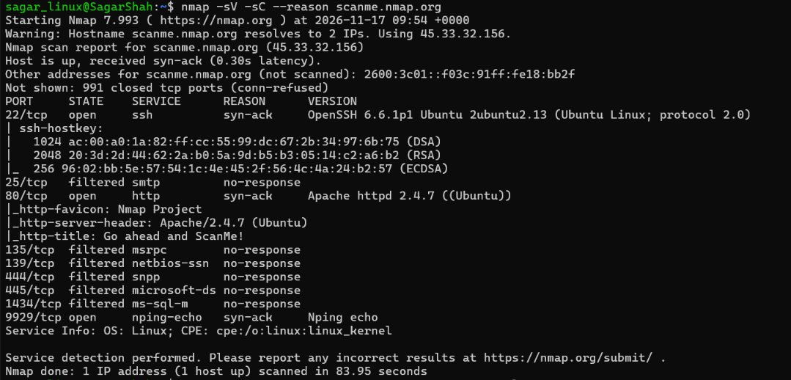
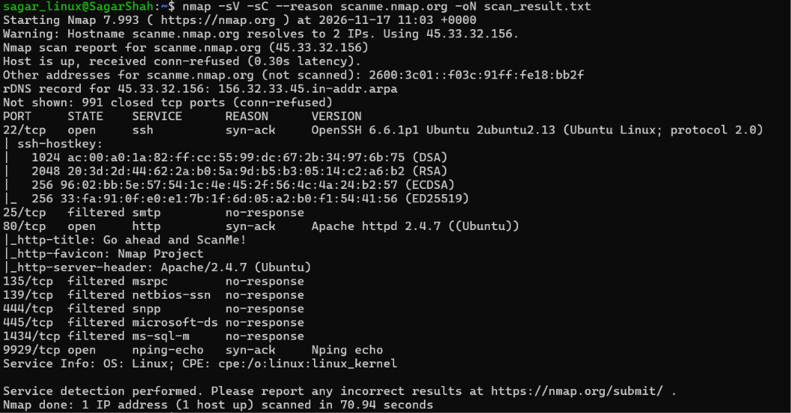

# Cybersecurity Portfolio - Week 4, Day 23

## Topic: Nmap Service Enumeration, NSE Default Scripts & Banner Analysis (`-sV`, `-sC`, `--reason`)

**Objective:**
Perform active service version detection (`-sV`) and execute default **Nmap Scripting Engine (NSE)** scripts (`-sC`) against the explicitly authorized test target (`scanme.nmap.org`). Analyze packet-level state justification (`--reason`), preserve scan evidence using normal output logging (`-oN`), and evaluate the operational limitations of relying solely on service version banners for vulnerability assessment.

---

### :hammer_and_wrench: Tools & Environment

* **Host OS / Environment:** Windows 11 running Windows Subsystem for Linux (**WSL Ubuntu** — `sagar_linux@SagarShah`)
* **Scanning & Enumeration Tool:** **Nmap** (`v7.993`)
* **Authorized Target:** `scanme.nmap.org` (`45.33.32.156`)
* **Key Flags Audited:** `-sV` (Service/Version Detection), `-sC` (Default NSE Scripts), `--reason` (Port/Host State Justification), `-oN` (Normal File Output)
* **MITRE ATT&CK Mapping:** `T1046` (Network Service Discovery), `T1595.002` (Active Scanning: Vulnerability Scanning), `T1592.002` (Gather Victim Host Information: Software)

---

### :shield: Part 1: Core Concepts — Service Enumeration & The Nmap Scripting Engine (NSE)

While basic port scanning (`-sT` / `-sS`) reveals whether a TCP or UDP "door" is open, it only guesses the service based on standard IANA port assignments (e.g., assuming Port `80` is HTTP). If an administrator runs an SSH server on Port `8080`, a basic scan will misidentify it.

| Nmap Flag | Technical Mechanism | Security & Reconnaissance Value |
| :--- | :--- | :--- |
| **`-sV`** *(Version Detection)* | Sends a series of protocol-specific probe packets (`nmap-service-probes`) to open ports and analyzes the application's response banner and behavior. | Identifies the exact software vendor, product name, version number, and underlying OS/CPE (e.g., `Apache httpd 2.4.7 ((Ubuntu))`). |
| **`-sC`** *(Default NSE Scripts)* | Executes Nmap's `default` category of Lua-based scripts from the **Nmap Scripting Engine (NSE)** after port and service detection finishes. | Safely automates post-port discovery tasks: pulling SSH host key fingerprints (`ssh-hostkey`), web page titles (`http-title`), and server headers (`http-server-header`). |
| **`--reason`** *(State Justification)* | Displays the exact network packet or timeout event that caused Nmap to classify a host as up or a port as `open`, `closed`, or `filtered`. | Eliminates guesswork by proving whether a state came from a `syn-ack` packet, a `conn-refused` (`RST`), or a firewall `no-response` timeout. |
| **`-oN <file>`** *(Normal Output)* | Writes the complete terminal scan report directly to a plain-text file on disk. | Ensures forensic evidence preservation, auditability, and seamless reporting without losing terminal scrollback. |

---

### :mag: Part 2: Hands-On Service Enumeration & NSE Script Execution

#### Step 1: Enumerating Services, Default Scripts & State Reasons (`nmap-sV-sC--reason.png`)

To interrogate all open ports on `scanme.nmap.org` and inspect why each port state was assigned, I executed the following scan inside WSL Ubuntu:

```bash
sagar_linux@SagarShah:~$ nmap -sV -sC --reason scanme.nmap.org
```

**Observed Terminal Output:**

```text
Starting Nmap 7.993 ( https://nmap.org ) at 2026-11-17 09:54 +0000
Warning: Hostname scanme.nmap.org resolves to 2 IPs. Using 45.33.32.156.
Nmap scan report for scanme.nmap.org (45.33.32.156)
Host is up, received syn-ack (0.30s latency).
Other addresses for scanme.nmap.org (not scanned): 2600:3c01::f03c:91ff:fe18:bb2f
Not shown: 991 closed tcp ports (conn-refused)
PORT     STATE    SERVICE      REASON      VERSION
22/tcp   open     ssh          syn-ack     OpenSSH 6.6.1p1 Ubuntu 2ubuntu2.13 (Ubuntu Linux; protocol 2.0)
| ssh-hostkey:
|   1024 ac:00:a0:1a:82:ff:cc:55:99:dc:67:2b:34:97:6b:75 (DSA)
|   2048 20:3d:2d:44:62:2a:b0:5a:9d:b5:b3:05:14:c2:a6:b2 (RSA)
|_  256 96:02:bb:5e:57:54:1c:4e:45:2f:56:4c:4a:24:b2:57 (ECDSA)
25/tcp   filtered smtp         no-response
80/tcp   open     http         syn-ack     Apache httpd 2.4.7 ((Ubuntu))
|_http-favicon: Nmap Project
|_http-server-header: Apache/2.4.7 (Ubuntu)
|_http-title: Go ahead and ScanMe!
135/tcp  filtered msrpc        no-response
139/tcp  filtered netbios-ssn  no-response
444/tcp  filtered snpp         no-response
445/tcp  filtered microsoft-ds no-response
1434/tcp filtered ms-sql-m     no-response
9929/tcp open     nping-echo   syn-ack     Nping echo
Service Info: OS: Linux; CPE: cpe:/o:linux:linux_kernel

Service detection performed. Please report any incorrect results at https://nmap.org/submit/ .
Nmap done: 1 IP address (1 host up) scanned in 83.95 seconds
```


*(Screenshot: Running `nmap -sV -sC --reason scanme.nmap.org` to enumerate service banners, NSE script outputs, and packet-level state reasons)*

---

#### Step 2: Saving Forensic Scan Evidence to Disk (`nmap-oNtxtfile.png`)

To preserve the enumeration output in a permanent text file for documentation and comparison, I re-ran the scan with the `-oN` flag:

```bash
sagar_linux@SagarShah:~$ nmap -sV -sC --reason scanme.nmap.org -oN scan_result.txt
```

**Observed Terminal & Saved File Output (`scan_result.txt`):**

```text
Starting Nmap 7.993 ( https://nmap.org ) at 2026-11-17 11:03 +0000
Warning: Hostname scanme.nmap.org resolves to 2 IPs. Using 45.33.32.156.
Nmap scan report for scanme.nmap.org (45.33.32.156)
Host is up, received conn-refused (0.30s latency).
Other addresses for scanme.nmap.org (not scanned): 2600:3c01::f03c:91ff:fe18:bb2f
rDNS record for 45.33.32.156: 156.32.33.45.in-addr.arpa
Not shown: 991 closed tcp ports (conn-refused)
PORT     STATE    SERVICE      REASON      VERSION
22/tcp   open     ssh          syn-ack     OpenSSH 6.6.1p1 Ubuntu 2ubuntu2.13 (Ubuntu Linux; protocol 2.0)
| ssh-hostkey:
|   1024 ac:00:a0:1a:82:ff:cc:55:99:dc:67:2b:34:97:6b:75 (DSA)
|   2048 20:3d:2d:44:62:2a:b0:5a:9d:b5:b3:05:14:c2:a6:b2 (RSA)
|   256 96:02:bb:5e:57:54:1c:4e:45:2f:56:4c:4a:24:b2:57 (ECDSA)
|_  256 33:fa:91:0f:e0:e1:7b:1f:6d:05:a2:b0:f1:54:41:56 (ED25519)
25/tcp   filtered smtp         no-response
80/tcp   open     http         syn-ack     Apache httpd 2.4.7 ((Ubuntu))
|_http-title: Go ahead and ScanMe!
|_http-favicon: Nmap Project
|_http-server-header: Apache/2.4.7 (Ubuntu)
135/tcp  filtered msrpc        no-response
139/tcp  filtered netbios-ssn  no-response
444/tcp  filtered snpp         no-response
445/tcp  filtered microsoft-ds no-response
1434/tcp filtered ms-sql-m     no-response
9929/tcp open     nping-echo   syn-ack     Nping echo
Service Info: OS: Linux; CPE: cpe:/o:linux:linux_kernel

Service detection performed. Please report any incorrect results at https://nmap.org/submit/ .
Nmap done: 1 IP address (1 host up) scanned in 70.94 seconds
```


*(Screenshot: Saving the Nmap service and script scan results directly to `scan_result.txt` using `-oN` and capturing the `ED25519` SSH hostkey and `rDNS` record)*

---

### :microscope: Part 3: Deep-Dive Technical Findings & Observations

1. **Port `80/tcp` (`Apache httpd 2.4.7 ((Ubuntu))`):**
   * **State & Reason:** Marked `open` because the host returned a `syn-ack` packet during the TCP handshake.
   * **NSE Script Intelligence:** Without opening a web browser, three NSE scripts automatically fingerprinted the web application:
     * `http-server-header`: Confirmed the raw HTTP `Server:` response header is `Apache/2.4.7 (Ubuntu)`.
     * `http-title`: Fetched the root HTML page and extracted the `<title>` tag (`Go ahead and ScanMe!`).
     * `http-favicon`: Hashed the site's favicon and matched it to the known `Nmap Project` signature.
2. **Port `22/tcp` (`OpenSSH 6.6.1p1 Ubuntu 2ubuntu2.13`):**
   * **OS & Package Fingerprinting:** The SSH protocol banner leaked the exact Ubuntu package revision (`2ubuntu2.13`), allowing Nmap to deduce the underlying operating system (`OS: Linux; CPE: cpe:/o:linux:linux_kernel`).
   * **Cryptographic Key Enumeration (`ssh-hostkey`):** Extracted the server's public `DSA` ($1024\text{-bit}$), `RSA` ($2048\text{-bit}$), `ECDSA` ($256\text{-bit}$), and `ED25519` ($256\text{-bit}$) host key fingerprints—useful for tracking a server across IP changes or detecting Man-in-the-Middle (MitM) key spoofing.
3. **Host & Port Reason Analysis (`--reason`):**
   * In the second scan (`nmap-oNtxtfile.png`), host discovery reported `Host is up, received conn-refused`. Because unprivileged Nmap host discovery probes Ports `80` and `443`, receiving a TCP `RST` (`conn-refused`) from closed Port `443` proved the remote host stack was alive and reachable.
   * The $6$ filtered ports (`25, 135, 139, 444, 445, 1434`) all showed `REASON: no-response`, proving an upstream firewall silently drops packets destined for common mail and Windows SMB/RPC ports.

---

### :warning: Part 4: Vulnerability Management — Why Patching Matters & Why Banners Alone Do Not Prove Exploitability

#### 1. Why Asset Owners Must Patch Outdated Software
When software vendors discover security flaws (such as buffer overflows, authentication bypasses, or remote code execution bugs), they publish advisories (**CVEs**) and release patches. Adversaries continuously scan the internet using tools like Nmap and Shodan to locate unpatched services running known vulnerable versions. Timely patching closes these exposure windows before automated exploit kits can weaponize them.

#### 2. Limitations: Why a Version Banner Alone Is NOT Proof of a Vulnerability
Although our scan identified `Apache httpd 2.4.7` and `OpenSSH 6.6.1p1` (versions originally released alongside Ubuntu 14.04), a cybersecurity professional **cannot** conclude the server is vulnerable based solely on these banners due to three critical limitations:

* **Linux Security Backporting:** Enterprise Linux distributions (`Ubuntu`, `Debian`, `RHEL`) practice **backporting**. Instead of upgrading a package to a brand-new major version (which might break existing configurations), maintainers take the specific security fix from newer releases and patch it directly into the older version (`2.4.7` or `6.6.1p1-2ubuntu2.13`). The primary version banner remains `2.4.7`, even though the underlying CVE has been completely patched.
* **Banner Obfuscation / Deception:** System administrators can intentionally modify or spoof service banners (e.g., via Apache's `ServerTokens` directive or custom configurations) to hide version details or mislead scanners with decoys.
* **Configuration & Compensating Controls:** Even if a software binary contains a vulnerable code path, the specific vulnerable module might be disabled in the server configuration, or an upstream Web Application Firewall (WAF) / IPS may block the exploit payload.

---

### :bulb: Conclusion & Key Takeaway

Successfully executed service version detection (`-sV`), default NSE script enumeration (`-sC`), and state reason analysis (`--reason`) against `scanme.nmap.org`, preserving the full output in `scan_result.txt`. 

**Key Cybersecurity Takeaway:**
Service enumeration bridges the gap between network discovery and vulnerability assessment by revealing the exact software stack running behind open ports. However, automated banner grabbing frequently produces **false positives** due to OS patch backporting and banner modification. Effective security analysts and penetration testers treat version banners as initial leads rather than confirmed findings—correlating package build numbers (such as `2ubuntu2.13`), configuration states, and safe validation checks before reporting a vulnerability.