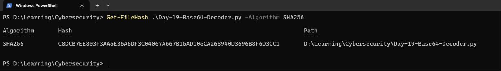
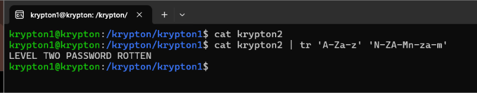
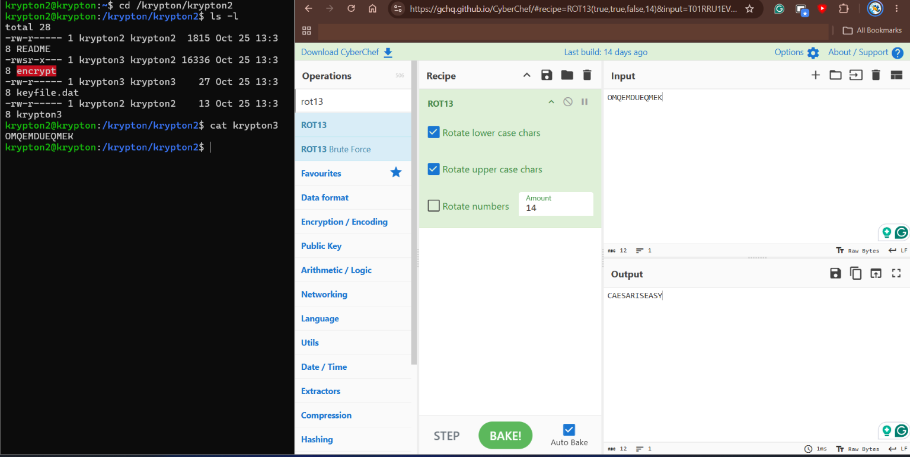

# Cybersecurity Portfolio - Week 4, Day 24

## Topic: Applied Cryptography, SHA-256 File Integrity, TLS 1.3 Certificates & OverTheWire Krypton (Levels 0–3)

**Objective:**
Master the core pillars of applied cryptography by contrasting **Hashing (one-way file integrity)** with **Encryption (two-way confidentiality: Symmetric vs. Asymmetric)**. Generate cryptographic file hashes in Windows PowerShell using `Get-FileHash`, inspect a live **HTTPS / TLS 1.3 Certificate Chain** in the browser, and crack classical substitution ciphers in **OverTheWire Krypton (Levels 0–3)**.

### :hammer_and_wrench: Tools & Environment

* **Host OS:** Windows 11 (`PowerShell`) & WSL Ubuntu (`ssh`, `tr`, `base64`, Python 3)
* **Cryptographic Utilities:** PowerShell `Get-FileHash` (`SHA256`), Browser TLS Certificate Viewer (`X.509` / `TLS 1.3`), GCHQ CyberChef
* **Wargame Environment:** OverTheWire **Krypton** (`krypton.labs.overthewire.org` — Port `2231`)
* **MITRE ATT&CK & Security Standards:** `NIST FIPS 180-4` (`SHA-256`), `RFC 8446` (`TLS 1.3`), `T1553.002` (Code Signing / File Integrity), `T1573` (Encrypted Channel)

---

### :shield: Part 1: Hashing vs. Encryption (Core Security Architecture)

One of the most common interview questions in cybersecurity is explaining the exact architectural difference between **Hashing**, **Symmetric Encryption**, and **Asymmetric Encryption**:

| Cryptographic Pillar | Direction | Key Structure | Primary Security Goal (CIA Triad) | Common Algorithms | Real-World SOC & Enterprise Use Cases |
| :--- | :--- | :--- | :--- | :--- | :--- |
| **Hashing** | **One-Way Function** (Irreversible) | **Keyless** (or paired with a random `Salt` / `HMAC` key) | **Integrity** (Proving data has not been modified by even $1\text{ bit}$) | `SHA-256`, `SHA-3`, `MD5` (legacy), `bcrypt` / `Argon2` | Verifying downloaded software integrity, generating malware Indicators of Compromise (IOCs) for VirusTotal, and storing password hashes. |
| **Symmetric Encryption** | **Two-Way Function** (Reversible with key) | **Single Shared Secret Key** (Same key encrypts and decrypts) | **Confidentiality** at high speed (Bulk data encryption) | `AES-128` / `AES-256` (`GCM`), `ChaCha20` | Full-disk encryption (BitLocker), database encryption at rest, and bulk session traffic inside an established TLS tunnel. |
| **Asymmetric Encryption** | **Two-Way / Key-Pair Function** | **Public Key** (shared openly) + **Private Key** (kept secret) | **Confidentiality, Authentication & Non-Repudiation** | `RSA` ($2048\text{--}4096\text{ bit}$), `ECC` (`ECDSA`, `ECDHE`) | TLS/HTTPS handshakes, SSH key authentication (`id_rsa`), and Digital Signatures (`Authenticode`). |

#### Key Mathematical Properties of a Cryptographic Hash (`SHA-256`)
1. **Deterministic:** The exact same input file always produces the exact same $256\text{-bit}$ ($64\text{-character}$ hexadecimal) digest.
2. **Pre-Image Resistance (One-Way):** Given a hash value $H(x)$, it is computationally infeasible to reverse the math to discover the original input $x$.
3. **Avalanche Effect:** Changing a single character or bit in a file completely scrambles the resulting `SHA-256` hash.
4. **Collision Resistance:** It is computationally infeasible to find two different files $x_1 \neq x_2$ such that $H(x_1) = H(x_2)$.

---

### :lock: Part 2: Verifying File Integrity in PowerShell (`Get-FileHash`)

To demonstrate cryptographic file fingerprinting on a Windows endpoint, I computed the `SHA-256` digest of my Python Base64 decoder script (`Day-19-Base64-Decoder.py`) using PowerShell's native `Get-FileHash` cmdlet:

```powershell
Get-FileHash .\Day-19-Base64-Decoder.py -Algorithm SHA256
```

**Captured Output:**

| Algorithm | SHA-256 Hash ($64$ Hex Characters / $256$ Bits) | File Path |
| :--- | :--- | :--- |
| `SHA256` | `C8DCB7EE803F3AA5E36A6DF3C04067A667B15AD105CA268940D3696B8F6D3CC1` | `D:\Learning\Cybersecurity\Day-19-Base64-Decoder.py` |

* **SOC Operational Workflow:** When triaging a suspicious binary or script on an endpoint, a SOC analyst computes its `SHA-256` hash with `Get-FileHash` and queries the hash on **VirusTotal** or internal threat intelligence feeds. Because hashes are one-way fingerprints, the analyst can check if the file is known malware without ever uploading sensitive corporate files or executing the binary.


*(Screenshot: Generating a cryptographic `SHA-256` fingerprint for `Day-19-Base64-Decoder.py` in Windows PowerShell)*

---

### :globe_with_meridians: Part 3: Inspecting a Live HTTPS / TLS 1.3 Certificate Chain

When a browser connects to a secure website (`https://`), **Transport Layer Security (TLS 1.3)** combines **Asymmetric Cryptography** (for authentication and key exchange) with **Symmetric Cryptography** (for fast bulk data encryption):

1. **The X.509 Certificate Chain of Trust:**
   * **Root Certificate Authority (Root CA):** Self-signed certificate pre-installed in the operating system's trusted root store (e.g., DigiCert, ISRG Root X1).
   * **Intermediate CA:** Signed by the Root CA to issue certificates safely without exposing the offline Root private key.
   * **Leaf (Server) Certificate:** Issued to the specific domain (e.g., `github.com`). The browser uses the Intermediate CA's public key to verify the digital signature on the server's certificate, preventing Man-in-the-Middle (MitM) spoofing.
2. **Ephemeral Diffie-Hellman Key Exchange (`ECDHE`):** Once the certificate is verified, the client and server use asymmetric math to agree on a temporary session key with **Forward Secrecy**.
3. **Symmetric Tunnel (`AES-256-GCM` / `ChaCha20-Poly1305`):** All subsequent HTTP requests and responses are encrypted at high speed using the shared symmetric session key.

---

### :key: Part 4: Classical Cryptanalysis — OverTheWire Krypton (Levels 0 $\rightarrow$ 3)

To understand how substitution ciphers and encryption keys operate under the hood, I completed **OverTheWire Krypton Levels 0 through 3** via SSH (`ssh kryptonX@krypton.labs.overthewire.org -p 2231`).

#### 1. Krypton Level 0 $\rightarrow$ Level 1: Base64 Decoding
* **Challenge String:** `S1JZUFRPTklTR1JFQVQ=`
* **Concept:** Base64 is keyless encoding, not encryption. Decoding via CLI (`echo "S1JZUFRPTklTR1JFQVQ=" | base64 -d`) revealed the Level 1 password:
  * **Password:** `KRYPTONISGREAT`

#### 2. Krypton Level 1 $\rightarrow$ Level 2: ROT13 Substitution Cipher (`krypton1.png`)
After logging into `krypton1` and navigating to `/krypton/krypton1`, reading the `krypton2` file revealed ciphertext encrypted with a **ROT13** cipher (a Caesar cipher with a fixed key shift of $k = 13$):

$$\text{Ciphertext: } \texttt{YRIRY GJB CNFFJBEQ EBGGRA}$$

Using the Linux `tr` (translate) utility to shift all uppercase and lowercase ASCII letters by $13$ positions:

```bash
cd /krypton/krypton1
cat krypton2 | tr 'A-Za-z' 'N-ZA-Mn-za-m'
```

* **Decoded Plaintext:** `LEVEL TWO PASSWORD ROTTEN`


*(Screenshot: Cracking the ROT13 substitution cipher in `/krypton/krypton1` using the native Linux `tr` command)*

#### 3. Krypton Level 2 $\rightarrow$ Level 3: Unknown Key Caesar Shift (`krypton2.png`)
In `/krypton/krypton2`, the file `krypton3` contained ciphertext encrypted with an unknown Caesar shift offset:

$$\text{Ciphertext: } \texttt{OMQEMDUEQMEK}$$

Because a monoalphabetic Caesar cipher only has $25$ possible key shifts ($k \in \{1, 2, \dots, 25\}$), it is trivially vulnerable to key-space brute-forcing. Testing a rotation of $14$ (`ROT13` with `Amount: 14` in CyberChef, or `echo "OMQEMDUEQMEK" | tr 'A-Za-z' 'O-ZA-No-za-n'` in Bash) decrypted the message:

$$D_{k=12}(x) \equiv E_{k=14}(x) \pmod{26} \implies \texttt{CAESARISEASY}$$

* **Decoded Level 3 Password:** `CAESARISEASY`


*(Screenshot: Recovering the Level 3 password `CAESARISEASY` by rotating the ciphertext `OMQEMDUEQMEK` by 14 positions)*

---

### :bulb: Conclusion

Successfully contrasted **Hashing (`SHA-256`)**, **Symmetric Encryption (`AES`)**, and **Asymmetric Encryption (`RSA`/`ECDHE`)**, verified local file integrity using PowerShell's `Get-FileHash`, inspected live browser TLS certificate chains, and solved **OverTheWire Krypton Levels 0–3** using Linux CLI pipelines and cipher rotation analysis.