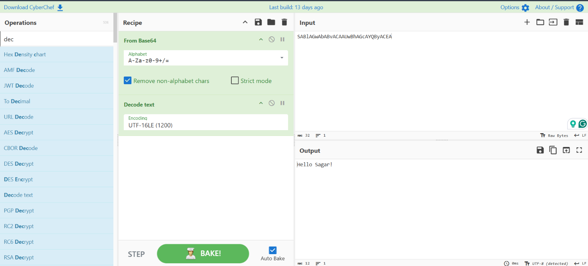
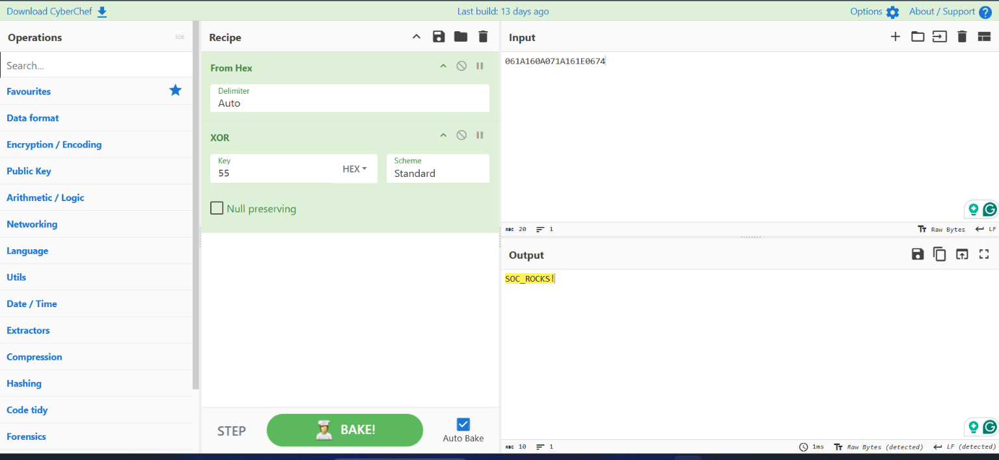
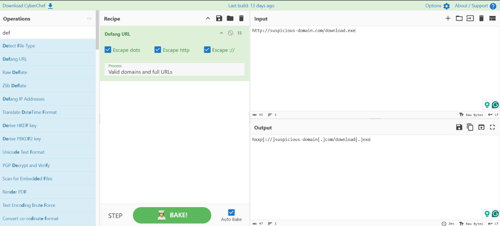

# Cybersecurity Portfolio - Week 4, Day 24 & 25

## Topic: Applied Cryptography, Hashing, TLS & The CyberChef De-obfuscation Playbook

**Objective:**
Understand the foundational pillars of applied cryptography (**Encoding, Encryption, Hashing, and TLS Certificates**) and build a repeatable **GCHQ CyberChef** de-obfuscation playbook. Safely decode multi-layered benign payloads (**Base64 + `UTF-16LE`** and **Hex + `XOR`**) using static analysis, and sanitize indicators of compromise (IOCs) using **URL Defanging** for safe security reporting.

### :hammer_and_wrench: Tools & Environment

* **Analysis & De-obfuscation Platform:** GCHQ **CyberChef** (Browser-based static analysis workbench)
* **Core Operations Audited:** `From Base64`, `Decode text (UTF-16LE)`, `From Hex`, `XOR`, `Defang URL`
* **Cryptographic & Encoding Standards:** Base64 (`RFC 4648`), Unicode `UTF-16LE`, Hexadecimal (Base-16), Bitwise `XOR` ($\oplus$), TLS (`RFC 8446`)
* **MITRE ATT&CK Mapping:** `T1027` (Obfuscated Files or Information), `T1140` (Deobfuscate/Decode Files or Information), `T1059.001` (PowerShell)

---

### :shield: Part 1: Applied Cryptography Fundamentals — Encoding vs. Encryption vs. Hashing

In cybersecurity, data transformation falls into three distinct categories. Confusing encoding with encryption is a common pitfall:

| Mechanism | Purpose | Key Required? | Reversible? | Common Examples | Security & Operational Use Case | 
| ----- | ----- | ----- | ----- | ----- | ----- | 
| **Encoding** | **Usability & Data Transport:** Translates data into a standard character format so systems can transmit it safely without breaking parsers. | **No** (Publicly known algorithm) | **Yes** (Anyone can decode) | `ASCII`, `UTF-8`, `UTF-16LE`, `Base64`, `Hex`, `URL Encoding` | Sending binary attachments over email (MIME) or passing complex strings in CLI commands. Attackers abuse it to hide plain-text strings from basic signatures. | 
| **Encryption** | **Confidentiality:** Mathematically scrambles plaintext into ciphertext so only authorized parties can read it. | **Yes** (Symmetric or Asymmetric Key) | **Yes** (Only with the decryption key) | `AES-256`, `RSA`, `ChaCha20` | Protecting data at rest (Hard Drive Encryption) and data in transit (TLS/HTTPS). Attackers use it in Ransomware to lock files. | 
| **Hashing** | **Integrity & Fingerprinting:** Condenses variable-length data into a fixed-length, unique digital fingerprint. | **No** (Though salted hashes exist) | **No** (Strictly one-way) | `SHA-256`, `MD5`, `NTLM` | Storing user passwords securely, verifying file integrity (malware signatures), and generating digital signatures. | 

---

### :mag: Part 2: Static Payload De-obfuscation — CyberChef Playbook

Security professionals never execute untrusted, encoded command-line strings directly on their workstations. Instead, payloads are extracted and statically de-obfuscated in isolated environments like CyberChef.

#### Task 1: Decoding Base64 & Windows `UTF-16LE`
Windows PowerShell inherently uses `UTF-16LE` (16-bit Unicode Little-Endian) encoding, which inserts null bytes (`0x00`) after every standard character. When converting PowerShell payloads, two operations are required.

* **Benign Input String:** `SABlAGwAbABvACAAUwBhAGcAYQByACEA`
* **Operation Order:** `From Base64` $\rightarrow$ `Decode text (UTF-16LE)`

*(Screenshot: De-obfuscating a Base64 payload formatted in `UTF-16LE` to reveal the plain-text string `Hello Sagar!`)*

#### Task 2: Bitwise `XOR` Decryption & Hexadecimal Processing
Malware authors frequently use bitwise **XOR (Exclusive OR)** logic to hide shellcode or configuration URLs from antivirus scanners. Because XOR is a mathematical operation on binary data, Hexadecimal strings must first be converted to raw bytes before the XOR key is applied.

* **Benign Input String (Locked Hex):** `061A160A071A161E0674`
* **Known XOR Key:** `55` (Hex)
* **Operation Order:** `From Hex` $\rightarrow$ `XOR (Key: 55, Scheme: Hex)`

*(Screenshot: Reversing a Hex-encoded string by first converting it to raw bytes (`From Hex`), then unlocking it with the `XOR` key `55` to reveal `SOC_ROCKS!`)*

---

### :link: Part 3: Safe Reporting — URL Defanging

When an attacker's command-and-control (C2) or payload-hosting URL is extracted during analysis, it must be neutralized before being shared in security reports, ticketing systems (Jira/ServiceNow), or emails. **Defanging** alters the protocol and structural characters to ensure the link cannot be accidentally clicked or executed by the recipient.

* **Extracted Suspicious URL:** `http://suspicious-domain.com/download.exe`
* **Operation:** `Defang URL` (Escape dots, http, and ://)
* **Neutralized Output:** `hxxp[://]suspicious-domain[.]com/download[.]exe`

*(Screenshot: Applying the Defang URL recipe to neutralize an extracted indicator of compromise, preventing accidental execution during intelligence sharing)*

---

### :bulb: Conclusion & Security Professional Takeaway

Successfully mastered the differences between encoding, encryption, and hashing, and built a foundational de-obfuscation playbook using GCHQ CyberChef. 

**Security Takeaway:** 
Adversaries layer encodings (like Hex or Base64) with lightweight mathematical obfuscation (like XOR) to evade perimeter defenses and endpoint detection. As a security professional, developing muscle memory for static analysis in tools like CyberChef allows for rapid, safe extraction of attacker intent (payloads, C2 IPs, and execution logic) without risking accidental detonation on corporate infrastructure. Always defang extracted network indicators before sharing intelligence.