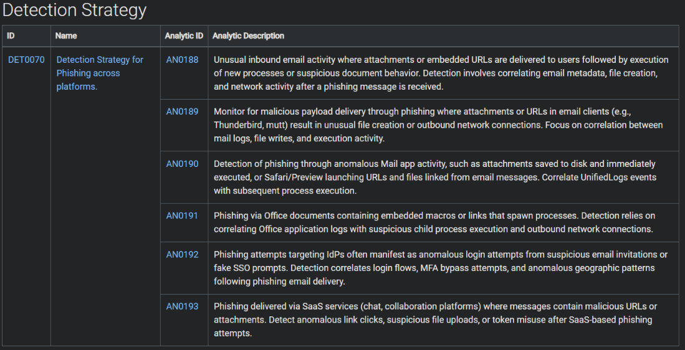
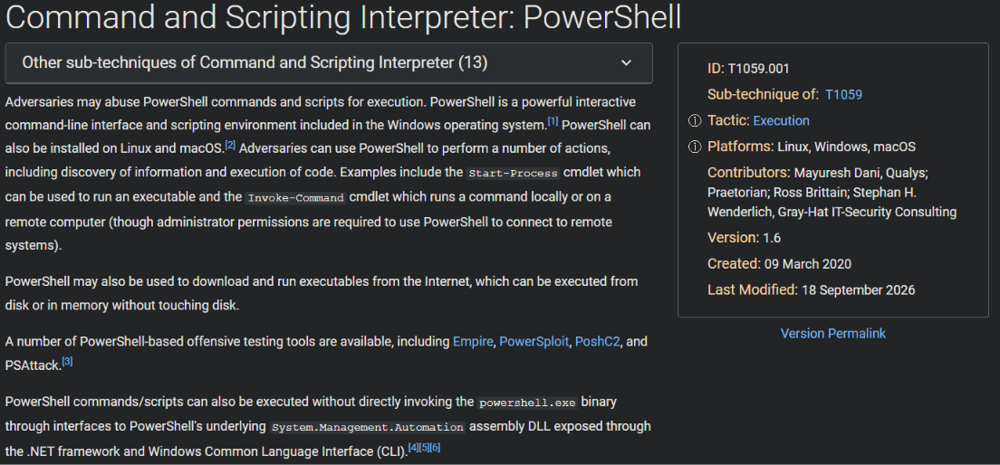
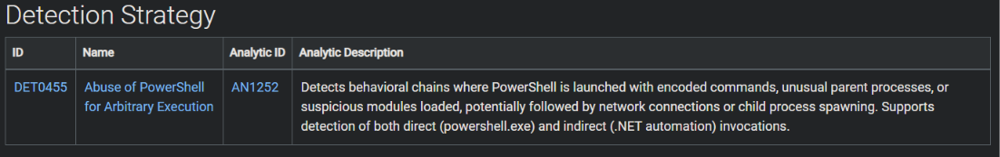
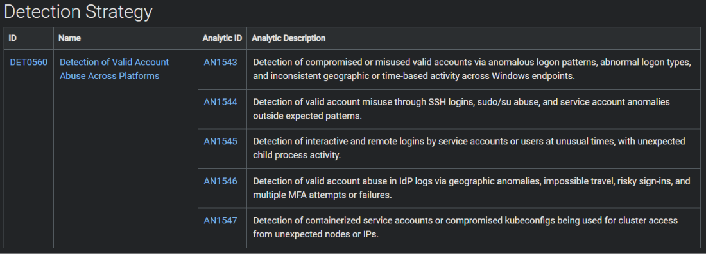
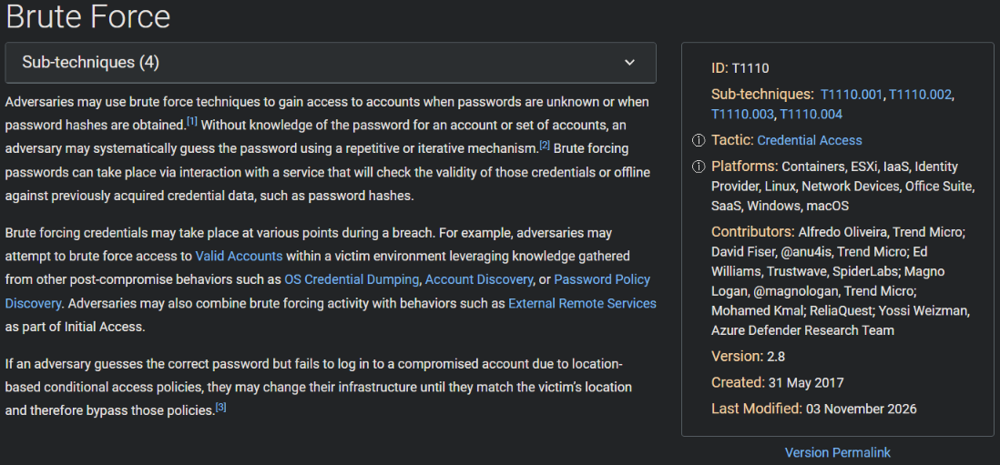
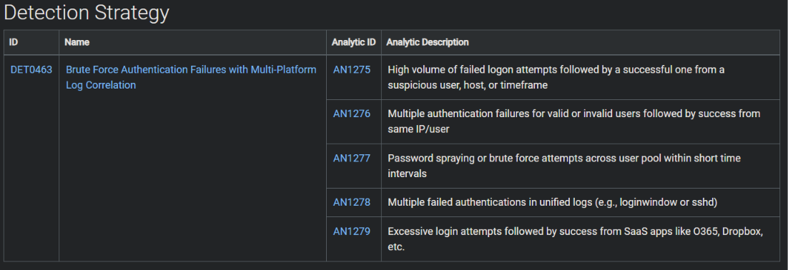
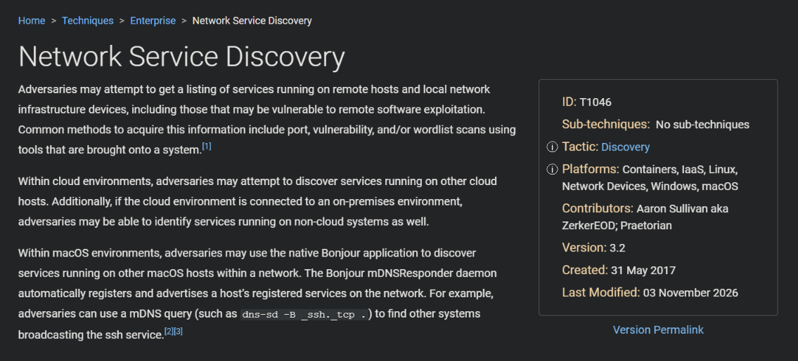
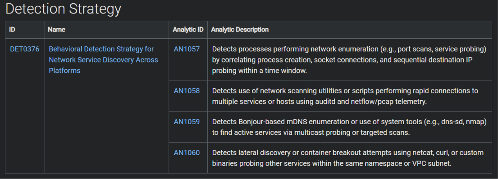

# Cybersecurity Portfolio - Week 4, Day 26

## Topic: MITRE ATT&CK Enterprise Matrix Mapping & Home Lab Telemetry Gap Analysis

**Objective:**
Analyze five foundational **MITRE ATT&CK Enterprise** techniques (`T1566`, `T1059.001`, `T1078`, `T1110`, and `T1046`), map each technique to its official detection strategies, accurate log/data sources, observable evidence, and detection logic, and critically evaluate telemetry blind spots within a Windows/WSL home lab environment.

---

### :hammer_and_wrench: Tools & Environment

* **Threat Framework:** **MITRE ATT&CK Enterprise Matrix** (`attack.mitre.org`)
* **Home Lab Telemetry Baseline:** Windows 11 Host (Windows Event Logs, PowerShell Logging, **Sysinternals Sysmon**), **WSL Ubuntu** (`auth.log` / local CLI), and **Wireshark** (local packet capture)
* **Techniques Audited:** `T1566` (Phishing), `T1059.001` (PowerShell), `T1078` (Valid Accounts), `T1110` (Brute Force), `T1046` (Network Service Discovery)

---

### :shield: Part 1: Core Concepts — Tactics, Techniques & Detection Strategies

* **Tactic ("Why"):** The adversary's high-level technical goal during an intrusion (e.g., *Initial Access*, *Execution*, *Credential Access*, *Discovery*).
* **Technique ("How"):** The specific method an adversary uses to achieve a tactic (e.g., using *Phishing* for Initial Access or *PowerShell* for Execution).
* **Detection Strategy (`DET`) & Analytics (`AN`):** Modern MITRE ATT&CK guidance groups detection logic into platform-aware Detection Strategies and behavioral Analytics—emphasizing multi-source log correlation rather than fragile single-indicator matching.
* **Technique vs. Evidence:** A technique describes *adversary behavior*, whereas observable evidence is only a *partial artifact* left behind in logs or packets. No single Wireshark filter or Windows Event ID can reliably detect every variation of a technique.

---

### :bar_chart: Part 2: MITRE ATT&CK 5-Technique Mapping Table

| Technique ID & Name | Tactic(s) | Accurate Data Sources & Telemetry | Observable Evidence | Detection Idea | Limitations & Home Lab Telemetry Gaps |
| :--- | :--- | :--- | :--- | :--- | :--- |
| **`T1566`** — Phishing | Initial Access | Email Gateway / Mail Server Logs & Metadata, Office Application Logs, Identity Provider (IdP) Sign-In Logs, SaaS Audit Logs, Sysmon Process/File/Network Telemetry, Proxy/DNS Logs | Suspicious sender metadata or spoofed headers; anomalous embedded URLs; Office/mail apps (`OUTLOOK.EXE`, `WINWORD.EXE`) writing files or spawning script interpreters (`powershell.exe`, `cmd.exe`) followed by outbound connections; fake SSO/MFA bypass attempts | Correlate inbound email delivery or document open events with subsequent unusual child process creation, suspicious file writes, or unexpected outbound network connections (`DET0070`: `AN0188`–`AN0193`) | **Limitation:** Phishing via personal chat/SaaS or phone-based social engineering may leave zero endpoint process artifacts. **Home Lab Gap:** No enterprise Email Security Gateway (SEG), corporate mail server logs, SaaS collaboration audit logs, or corporate IdP telemetry. |
| **`T1059.001`** — Command and Scripting Interpreter: PowerShell | Execution | Windows PowerShell Operational Logs (Script Block Logging, Module Logging), Windows Security Process Creation Logs, Sysmon (Process Creation, Image/DLL Load, Network Connection), Linux/macOS Audit Logs | `powershell.exe` launched with encoded/obfuscated arguments (`-EncodedCommand`), hidden windows, or download cradles; unusual parent processes (e.g., Office apps or browsers); loading `System.Management.Automation` DLL inside non-PowerShell processes | Alert on behavioral chains combining unusual parent processes, heavy encoding/obfuscation, suspicious module loads, or direct/indirect `.NET` PowerShell invocations followed by child processes or outbound connections (`DET0455`: `AN1252`) | **Limitation:** Legitimate admins heavily use PowerShell (high false-positive risk); attackers can bypass `powershell.exe` entirely via `.NET` automation DLLs. **Home Lab Gap:** Script Block Logging and DLL/image-load monitoring must be explicitly tuned in Sysmon/Group Policy; no centralized SIEM for automated behavioral chaining. |
| **`T1078`** — Valid Accounts | Initial Access, Persistence, Privilege Escalation, Defense Evasion (Stealth) | Windows Security Logon Logs, Linux Authentication Logs (`sshd`, `sudo`/`su`), Identity Provider (IdP) & VPN Logs, SaaS/Cloud Audit Logs, Kubernetes/Container Audit Logs | Logins from unusual geographic locations or impossible travel; abnormal logon types or off-hours interactive/remote sign-ins; service accounts spawning interactive shells or unexpected child processes; multiple MFA prompts/failures | Baseline normal user/service account behavior and alert on anomalous logon times, unexpected logon types, geographic/IP anomalies, or service accounts performing interactive activity (`DET0560`: `AN1543`–`AN1547`) | **Limitation:** Because credentials are valid, activity blends into normal user traffic; inactive/orphaned accounts are especially easy to abuse quietly. **Home Lab Gap:** No enterprise Active Directory domain controller, corporate VPN, IdP (Entra ID/Okta), or Kubernetes cluster logs. |
| **`T1110`** — Brute Force | Credential Access | Windows Security Authentication Logs, Linux `sshd` / PAM / Unified Auth Logs, Identity Provider (IdP) Logs, SaaS Application Sign-In Logs (e.g., M365, Dropbox), Network/Firewall Logs | High volume of failed logon attempts targeting one account (password guessing) or many accounts from one/few IPs (password spraying), especially when followed by a successful login from the same source | Correlate bursts of authentication failures across valid/invalid usernames within a short time window, prioritizing patterns where repeated failures transition into a successful logon (`DET0463`: `AN1275`–`AN1279`) | **Limitation:** Offline hash cracking generates zero authentication logs; "low-and-slow" password spraying across rotating IPs evades simple rate thresholds. **Home Lab Gap:** Only local Windows/WSL logon events are visible; no enterprise SaaS, IdP, or multi-host authentication log aggregation. |
| **`T1046`** — Network Service Discovery | Discovery | Network Packet Captures (PCAP / Wireshark), NetFlow / Firewall Logs, Host Process & Socket Telemetry (Sysmon, Linux `auditd`), IDS/IPS Sensors, Container/VPC Flow Logs | Rapid TCP `SYN` / `RST` bursts from one host across sequential destination ports or IPs; execution of scanning utilities (`nmap`, `netcat`, `curl`, `dns-sd`) correlating with high-rate outbound socket connections; multicast `mDNS` probing | Correlate host process creation and outbound socket telemetry with network flow/PCAP patterns showing rapid or sequential probing of multiple ports or internal hosts within a defined time window (`DET0376`: `AN1057`–`AN1060`) | **Limitation:** Slow, throttled, or distributed scans blend into routine network chatter; legitimate IT asset/vulnerability scanners create similar traffic. **Home Lab Gap:** Local Wireshark captures only see traffic on the host interface—no enterprise NetFlow collectors, perimeter firewall/IDS sensors (Suricata/Zeek), or cloud VPC flow logs. |

---

### :mag: Part 3: Technique-by-Technique Review & MITRE Reference Evidence

#### 1. `T1566` — Phishing (`DET0070`)
Phishing relies on electronically delivered social engineering (spearphishing attachments, links, or SaaS/third-party service lures) to gain initial access or harvest credentials. MITRE's detection strategy (`DET0070`) highlights cross-platform correlation across email metadata, file writes, Office macro child processes (`AN0191`), IdP login/MFA anomalies (`AN0192`), and SaaS collaboration events (`AN0193`).

*(Screenshot: MITRE ATT&CK overview for `T1566 — Phishing`, covering Initial Access tactic, sub-techniques `T1566.001`–`T1566.004`, and target platforms)*

*(Screenshot: MITRE Detection Strategy `DET0070` and Analytics `AN0188`–`AN0193` detailing email, endpoint, IdP, and SaaS correlation)*

---

#### 2. `T1059.001` — Command and Scripting Interpreter: PowerShell (`DET0455`)
Adversaries abuse PowerShell (`Start-Process`, `Invoke-Command`, in-memory download/execution) for discovery and code execution. Crucially, PowerShell can also be invoked *indirectly* via the `.NET` `System.Management.Automation` assembly DLL without ever spawning `powershell.exe`. Detection Strategy `DET0455` (`AN1252`) therefore focuses on behavioral chains covering both direct and `.NET`-based invocations.

*(Screenshot: MITRE ATT&CK overview for `T1059.001 — Command and Scripting Interpreter: PowerShell`, noting both direct CLI and `.NET` DLL execution paths)*

*(Screenshot: MITRE Detection Strategy `DET0455` and Analytic `AN1252` for behavioral PowerShell execution detection)*

---

#### 3. `T1078` — Valid Accounts (`DET0560`)
Compromised credentials allow adversaries to authenticate natively to VPNs, webmail, RDP, cloud services, or local hosts—often without dropping malware. Detection Strategy `DET0560` spans Windows logon anomalies (`AN1543`), Linux SSH/`sudo` misuse (`AN1544`), unusual interactive/service account child processes (`AN1545`), IdP impossible travel/MFA failures (`AN1546`), and container/kubeconfig abuse (`AN1547`).

*(Screenshot: MITRE ATT&CK overview for `T1078 — Valid Accounts`, spanning multiple tactics including Initial Access, Persistence, Privilege Escalation, and Defense Evasion/Stealth)*

*(Screenshot: MITRE Detection Strategy `DET0560` and Analytics `AN1543`–`AN1547` for cross-platform valid account abuse)*

---

#### 4. `T1110` — Brute Force (`DET0463`)
Adversaries iteratively guess passwords online (guessing, spraying, credential stuffing) or crack obtained hashes offline. Detection Strategy `DET0463` emphasizes correlating high-volume authentication failures with a subsequent successful login (`AN1275`, `AN1276`, `AN1279`), detecting password spraying across user pools (`AN1277`), and monitoring unified auth logs such as `sshd` (`AN1278`).

*(Screenshot: MITRE ATT&CK overview for `T1110 — Brute Force` under the Credential Access tactic, including sub-techniques `T1110.001`–`T1110.004`)*

*(Screenshot: MITRE Detection Strategy `DET0463` and Analytics `AN1275`–`AN1279` for multi-platform brute force and password spraying correlation)*

---

#### 5. `T1046` — Network Service Discovery (`DET0376`)
Adversaries enumerate running services across remote hosts, internal networks, cloud VPCs, or containers to identify exploitable targets. Detection Strategy `DET0376` combines host process/socket correlation (`AN1057`), `auditd` + NetFlow/PCAP telemetry (`AN1058`), mDNS/Bonjour discovery (`AN1059`), and lateral container/VPC probing via `netcat` or `curl` (`AN1060`).

*(Screenshot: MITRE ATT&CK overview for `T1046 — Network Service Discovery` under the Discovery tactic across OS, network, and cloud platforms)*

*(Screenshot: MITRE Detection Strategy `DET0376` and Analytics `AN1057`–`AN1060` for behavioral network enumeration detection)*

---

### :warning: Part 4: Analytical Principles & Home Lab Limitations

#### 1. ATT&CK Mapping Supports Investigation — It Is Not Proof by Itself
Tagging an alert or log entry with a MITRE ATT&CK ID (such as `T1059.001` or `T1046`) does **not** prove malicious intent. An IT administrator running a PowerShell maintenance script or an authorized Nmap inventory scan generates telemetry that looks nearly identical to an adversary's behavior. ATT&CK mapping serves as a structured **investigative hypothesis and common vocabulary**—helping analysts decide which additional logs, timelines, and user contexts to inspect next before confirming an incident.

#### 2. Distinguishing a Technique from Evidence
A single Event ID (e.g., Windows `4625` or Sysmon `1`) or a single Wireshark display filter (`tcp.flags.syn == 1`) only captures one narrow slice of evidence. Adversaries routinely evade brittle signatures by slowing down scan timing, switching to living-off-the-land binaries (`curl`, `.NET` DLLs), or cracking password hashes offline. Robust detection therefore relies on **behavioral correlation** across multiple telemetry layers.

#### 3. Current Home Lab Telemetry Gaps
| Telemetry Layer | Home Lab Status | Practical Impact |
| :--- | :--- | :--- |
| **Endpoint Process & Network (`Sysmon` / Windows Logs)** | **Available (Local)** | Strong local visibility for `T1059.001`, local `T1110`, and local `T1046` process-to-socket behavior. |
| **Local Packet Capture (`Wireshark`)** | **Available (Single Host)** | Great for inspecting targeted lab scans (`T1046`), but lacks continuous 24/7 enterprise NetFlow/IDS visibility. |
| **Email Gateway & SaaS Audit Logs** | **Missing (Gap)** | Cannot observe raw inbound phishing headers, SPF/DKIM failures, or SaaS link clicks (`T1566`). |
| **Enterprise Identity Provider (IdP / AD / VPN)** | **Missing (Gap)** | Cannot detect impossible travel, MFA fatigue, or domain-wide password spraying (`T1078`, `T1110`). |
| **Centralized SIEM Correlation** | **Missing (Gap)** | Cross-source behavioral analytics (like `DET0070` or `DET0463`) must be correlated manually rather than via automated SIEM rules. |

---

### :bulb: Conclusion & Key Cybersecurity Takeaway

Successfully mapped five high-priority MITRE ATT&CK Enterprise techniques (`T1566`, `T1059.001`, `T1078`, `T1110`, and `T1046`) to their official detection strategies (`DET0070`, `DET0455`, `DET0560`, `DET0463`, and `DET0376`), real-world telemetry sources, and home lab visibility gaps.

**Key Cybersecurity Takeaway:**
Effective security analysis goes beyond memorizing single Event IDs or packet filters. Using **MITRE ATT&CK** systematically forces practitioners to connect adversary goals (*Tactics*) and methods (*Techniques*) to observable telemetry while staying honest about visibility blind spots. Mapping an event to ATT&CK is the **starting point of structured investigation**, never a standalone verdict—real confirmation always comes from correlating multiple data sources with environmental context.