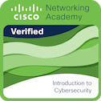

# Cybersecurity Portfolio - Week 4, Day 27

## Topic: Verified Cybersecurity Credentials — KC7 Security Analyst I & Cisco Introduction to Cybersecurity

**Objective:**
Consolidate Phase 1 (Weeks 1–4) foundational training into verifiable, industry-recognized digital credentials by completing the **KC7 Foundation Security Analyst I** career path and the **Cisco Networking Academy Introduction to Cybersecurity** course.

---

### :trophy: Credentials Summary

| Credential | Issuing Organization | Issue Date | Verification / Credential ID | Portfolio Artifact |
| :--- | :--- | :--- | :--- | :--- |
| **Security Analyst I** | **KC7 Foundation** | November 21, 2026 | **Certificate ID:** `103384` ([KC7 Profile](https://kc7cyber.com/profile/Sagar%20Shah)) | [View Certificate PDF](kc7-certificate.pdf) |
| **Introduction to Cybersecurity** | **Cisco Networking Academy** | November 24, 2026 | [Verify Official Credly Badge](https://www.credly.com/badges/a4903ffb-dc4c-4e58-bc64-78614384f350/public_url) | [View Certificate PDF](I2CSUpdate20261124-20-a7s9w0.pdf) |

---

### :detective: Credential 1: KC7 Foundation — Security Analyst I

* **Credential Holder:** Sagar Shah
* **Issuer:** KC7 Foundation *(Signed by Simeon Kalpon, President)*
* **Date Earned:** November 21, 2026
* **Certificate ID:** `103384`
* **Public Profile:** [kc7cyber.com/profile/Sagar Shah](https://kc7cyber.com/profile/Sagar%20Shah)
* **Certificate File:** [Download / View `kc7-certificate.pdf`](kc7-certificate.pdf)

#### Verified Hands-On Competencies
Earned by completing the full **Security Analyst I** investigative track using **Kusto Query Language (KQL)** in Azure Data Explorer across simulated enterprise breach datasets:
* Identifying Indicators of Compromise (IOCs) across `Email`, `OutboundNetworkEvents`, `FileCreationEvents`, `ProcessEvents`, and `PassiveDns` telemetry.
* Formulating investigative hypotheses and pivoting across tables to reconstruct multi-stage intrusions.
* Correlating phishing lures, malicious documents, persistence mechanisms, lateral movement, and data exfiltration commands.

#### Linked Investigation Reports in This Portfolio
* **Week 2, Day 14:** [KC7 CloutHaus SOC Breach Report & VirusTotal Pivoting](../Week-2-Linux-Security/Day-14-KC7-CloutHaus-Report.md)
* **Week 3, Day 20:** [KC7 Jojo's Hospital Two-Stage Ransomware Investigation (`SharkFin7` & `LockByte`)](../Week-3-Windows-Defense/Day-20-KC7-Ransomware-Report.md)
* **Week 3, Day 21:** [KC7 A Scandal in Valdoria Phishing & Persistence Forensics](../Week-3-Windows-Defense/Day-21-Email-Phishing-Forensics.md)

---

### :shield: Credential 2: Cisco Networking Academy — Introduction to Cybersecurity

* **Credential Holder:** Sagar Shah
* **Issuer:** Cisco Networking Academy *(Signed by Lynn Bloomer, Director)*
* **Date Earned:** November 24, 2026
* **Official Verification Link:** [Credly Public Verification URL](https://www.credly.com/badges/a4903ffb-dc4c-4e58-bc64-78614384f350/public_url)
* **Certificate File:** [Download / View `I2CSUpdate20261124-20-a7s9w0.pdf`](I2CSUpdate20261124-20-a7s9w0.pdf)

#### Verified Core Competencies
* Explaining foundational cybersecurity principles, online safety, and the operational impact of cyber incidents.
* Identifying common cyber threats, attack vectors, malware categories, and system vulnerabilities.
* Applying personal security controls and understanding how organizations defend networks, endpoints, and critical operations.
* Navigating foundational cybersecurity career pathways and defensive roles.

---

### :bulb: Phase 1 Milestone Summary

Earning both the **KC7 Security Analyst I Certificate** and the **Cisco Introduction to Cybersecurity Badge** validates the hands-on skills built across Weeks 1–4—combining theoretical security foundations with practical KQL threat hunting, packet analysis, OS log forensics, and MITRE ATT&CK mapping.