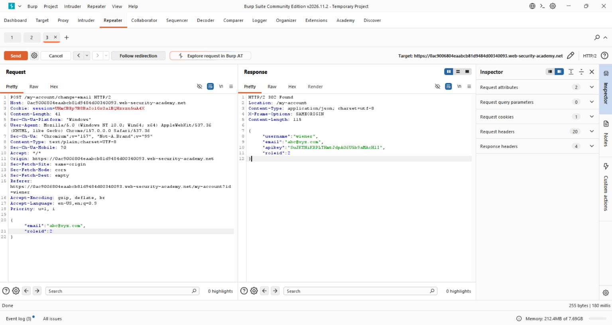

# Cybersecurity Portfolio - Week 5, Day 31

## Topic: API Authorization Flaws — BOLA, BFLA & JSON Mass Assignment (`roleid` Tampering)

**Objective:**
Differentiate **Broken Object Level Authorization (BOLA)** from **Broken Function Level Authorization (BFLA)** in REST APIs, exploit **JSON Mass Assignment** by modifying `"roleid": 2` inside **Burp Repeater** to gain administrative access, and identify how SOC analysts spot IDOR/BOLA enumeration in web and API access logs.

### :hammer_and_wrench: Tools & Environment

* **Intercepting Proxy & Workbench:** Burp Suite Community Edition (`v2026.11.2`) + Built-in Chromium Browser

* **Lab Environment:** PortSwigger Web Security Academy (Access Control Labs)

* **OWASP API Security Top 10 Mapping:** `API1:2023` (Broken Object Level Authorization), `API3:2023` (Broken Property Level Authorization / Mass Assignment), `API5:2023` (Broken Function Level Authorization)

### :shield: Part 1: BOLA vs. BFLA in REST APIs

| Flaw | OWASP API ID | What Goes Wrong | Concrete API Example |
| :--- | :--- | :--- | :--- |
| **BOLA** (*Broken Object Level Authorization*) | **`API1`** | The endpoint verifies authentication, but fails to check whether the authenticated user **owns or is authorized for the specific object ID** requested. (Equivalent to IDOR on APIs.) | Changing `GET /api/v1/orders/501` to `GET /api/v1/orders/502` and reading another user's order data. |
| **BFLA** (*Broken Function Level Authorization*) | **`API5`** | The endpoint checks that a user is logged in, but fails to enforce **role/privilege checks** before allowing access to administrative routes, actions, or HTTP methods. | A standard user (`roleid: 1`) calling `DELETE /api/v1/users/carlos` or accessing `/admin`. |

### :mag: Part 2: JSON Mass Assignment & `roleid` Tampering in Burp Repeater (`RoleID1TORoleID2.jpg`)

In PortSwigger's *User role can be modified in user profile* lab, logging in as `wiener` and updating an email address (`abc@xyz.com`) via `POST /my-account/change-email` revealed a JSON profile object containing `"roleid": 1`.

1. Sent the `POST /my-account/change-email` request to **Burp Repeater** (`Ctrl + R`).
2. Added `"roleid": 2` to the JSON request body alongside `"email": "abc@xyz.com"` and clicked **Send**.
3. The server returned `HTTP/2 302 Found` (`Location: /my-account`) with `"roleid": 2` reflected in the JSON response body (`Content-Type: application/json`), elevating `wiener`'s role and unlocking `/admin` access (`wiener` and `carlos` visible on the admin panel).

*(Screenshot: Modifying the JSON payload in Burp Repeater to include `"roleid": 2` on `POST /my-account/change-email` and receiving `"roleid": 2` in the server response)*

### :eyes: Part 3: Spotting IDOR / BOLA in Access Logs

When reviewing web server, reverse proxy, or API gateway access logs (`access.log` or SIEM telemetry), analysts detect BOLA/IDOR probing through specific behavioral patterns:

* **Sequential ID Enumeration:** A single IP address, user session, or API token making rapid `GET`, `PUT`, `PATCH`, or `DELETE` calls where numeric or predictable object IDs increment sequentially (e.g., `/api/users/100`, `/api/users/101`, `/api/users/102`, `/api/users/103`) within a short window.
* **Status Code & User-Mismatch Anomalies:** High request rates from one source showing a mix of `200 OK` (unauthorized object access), `403 Forbidden`, or `404 Not Found` (probing non-existent IDs), or object IDs belonging to `User A` being accessed under `User B`'s authenticated session/token.

### :bulb: Conclusion

Practiced exploiting parameter- and JSON-driven privilege escalation in Burp Repeater, distinguished **BOLA (`API1`)** from **BFLA (`API5`)**, and mapped how sequential object ID enumeration appears in access logs. Never trust client-supplied JSON fields or role flags—always enforce ownership checks on every object and role checks on every function server-side.
